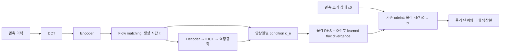

# 앙상블별 물리 ODE 구성

이 문서는 최초 Cartesian 예제를 설명합니다. 사용자 답변을 반영한 전지구
ERA5/ClimODE 격자·15일 구성은 [ERA5 확장 문서](era5_15day_ko.md)를 사용하십시오.

## 먼저 바꿀 부분

PINN 뒤에 ODE solver만 붙여서는 물리 보정이 보장되지 않습니다. solver는
주어진 미분식을 적분하는 수치 도구입니다. 핵심은 물리 단위의 상태, 적절한
우변, 초기조건·경계조건, 학습할 미해결 항을 정의하는 것입니다.

이 저장소에서는 기존 **`torchdiffeq.odeint`**를 사용합니다. 현재 구현은
PyTorch 모델과의 미분 가능한 연결을 검증하는 작은 기반입니다. 첨부 PDF는
32 MiB 전송 한도를 넘어 읽지 못했으므로, 아래 내용은 해당 PDF의 세 논문을
분석하거나 재현했다는 의미가 아닙니다.

## 권장 구조: 물리 적분이 최종 예측을 생성

기존 FM이 미래 상태를 생성하는 경우에도 그 출력을 초기조건으로 다시
미래까지 진전시키지 않습니다. FM 결과나 latent를 각 member의 closure
condition으로 사용하고, 관측 초기 상태에서 한 번 적분합니다.



위 그림의 condition에는 latent 또는 복원한 FM 예측 중 하나를 사용합니다.
둘을 반드시 동시에 사용해야 하는 것은 아닙니다. 새로운 learned head나
closure의 학습은 필요하지만, 새 solver는 필요하지 않습니다.

\[
\frac{d x_e}{dt}=F_{\mathrm{phys}}(x_e,t)
                 -\nabla_h\cdot J_\theta(x_e,c_e,t),\qquad x_e(t_0)=x_{\mathrm{obs}}.
\]

앙상블마다 `c_e`가 달라서 같은 초기 관측에서도 다른 경로를 만들 수 있습니다.
closure의 파라미터는 member 사이에서 공유하지만, 상태·condition을 섞거나
ensemble 평균으로 대체하지 않습니다. 실제로 `t0`의 초기 상태 앙상블을
생성하도록 FM을 학습했다면, 그 결과를 `integrate_ensemble`에 직접 넣는
경로도 가능합니다. 미래 상태를 생성하던 FM의 출력을 설명 없이 초기 상태로
재해석해서는 안 됩니다.

### 현재 구현한 물리식

\[
\partial_t q=-\partial_x(uq)-\partial_y(vq)
              +K(\partial_{xx}q+\partial_{yy}q)
              -\nabla_h\cdot J_\theta.
\]

`q`는 수동 추적자, `u,v`는 주어진 고정 바람, `K≥0`는 고정 확산 계수입니다.
공간 미분은 보존형 face-upwind flux와 중앙차분 Laplacian, 시간 적분은
`torchdiffeq`가 맡습니다. 두 공간 축에 주기 경계를 적용합니다. flux의
divergence로 closure를 만들었으므로 균일 격자에서 각 member/channel의 공간
합이 보존됩니다. 외부 source/sink가 필요한 물리량에는 별도의 budget이
필요합니다. 이 식이 기온·바람·습도 전체의 대기역학을 대체하지는 않습니다.

### 코드 연결

아래의 `latent_ensemble`, `decoder`, `observed_initial` 등은 기존 모델이
제공하는 tensor/module입니다. 이 저장소가 FM 또는 decoder를 구현했다고
가정하지 않습니다.

```python
import torch
import torch_dct
from physical_guide_flowmatching import (
    decode_ensemble_forecast, PeriodicCartesianGrid,
    ConservativeFluxClosure2D, ConservativeTransport2D,
    ODESolverConfig, integrate_ensemble,
)

# 기존 모델의 표준화가 physical space에서 DCT 전에 수행된 경우의 adapter.
forecast = decode_ensemble_forecast(
    latent_ensemble, decoder,
    lambda x: torch_dct.idct_2d(x, norm="ortho"),
    channel_mean=channel_mean, channel_scale=channel_scale,
)  # [B,E,C,H,W], 실제 단위
B, E, C, H, W = forecast.shape
grid = PeriodicCartesianGrid(dx_m=10_000.0, dy_m=10_000.0)

# 학습 전체에 걸쳐 한 번 생성하고 optimizer에 등록할 공유 closure.
closure = ConservativeFluxClosure2D(
    C, grid, condition_channels=C,
    input_scale=state_scale, flux_scale=physical_flux_scale,
).to(device=forecast.device, dtype=forecast.dtype)

# 아래는 batch마다 구성. condition의 단위/정규화는 학습·추론에서 동일해야 함.
condition = (forecast - channel_mean.reshape(1, 1, C, 1, 1)) / (
    channel_scale.reshape(1, 1, C, 1, 1)
)
rhs = ConservativeTransport2D(
    grid, u_m_s=known_u, v_m_s=known_v, diffusivity_m2_s=known_K,
    closure=closure.conditioned_on(condition),
)
x0 = observed_initial[:, None].expand(B, E, C, H, W)
times = x0.new_tensor([0.0, forecast_horizon_seconds])
trajectory = integrate_ensemble(
    rhs, x0, times,
    ODESolverConfig(method="rk4", step_seconds=chosen_stable_step_seconds),
)
prediction = trajectory[-1]
```

`closure`의 생성은 training loop 밖에서 한 번만 수행하십시오. 원래 모델이
DCT coefficient를 정규화했다면 정규화 역변환은 IDCT **전**에 해야 합니다.
실제 파이프라인의 전처리 순서의 역순으로 복원해야 합니다.

`condition_channels=D`일 때 condition은 `[B,E,D]` 또는 `[B,E,D,H,W]`입니다.
풍속은 scalar 또는 state로 명시적으로 broadcast되는 5차원 tensor입니다.
각 member에 다른 바람을 줄 수도 있지만 바람 자체를 예측하는 동역학은 이
예제에 포함하지 않습니다. `state_scale`, `physical_flux_scale`과 grid/계수는
실제 데이터의 단위에 맞춰 지정해야 합니다.

closure의 마지막 convolution은 0으로 초기화됩니다. 처음에는 물리 RHS만
작동하고 마지막 layer가 먼저 학습됩니다. 이 시점에는 condition/FM으로의
gradient가 0일 수 있습니다. 따라서 closure를 먼저 pretrain한 뒤 FM과
연결해 fine-tune하십시오. 같은 `x0`와 0 closure를 쓰는 최초 시점의 ensemble이
같은 것은 이 초기화의 의도된 결과이며, diversity 검증은 학습 이후에도
반드시 수행해야 합니다.

## 기존 미래 예측을 그대로 참조하는 경로

`correct_forecast`는 별도 실험 경로입니다.

\[
r_e(t)=x_0+\frac{t-t_0}{T}(\widehat x_e(t_1)-x_0),\qquad
\dot x_e=F_{\mathrm{phys}}(x_e,t)+\lambda\,P(r_e(t)-x_e).
\]

초기값은 `x0`이고 FM은 선형 reference를 제공합니다. `P`는 기본적으로 공간
평균을 빼는 연산입니다. 이는 수동 추적자의 평균 budget을 바꾸지 않도록
nudging 항을 제한하는 선택이지, 일반적인 대기 물리 제약이 아닙니다.

```python
from physical_guide_flowmatching import correct_forecast

trajectory = correct_forecast(
    rhs_without_reference_nudging,
    observed_initial, forecast, times,
    nudging_rate_s=1.0 / nudging_timescale_seconds,
    conserve_spatial_mean=True,
    config=ODESolverConfig(step_seconds=chosen_stable_step_seconds),
)
prediction = trajectory[-1]
```

nudging 자체는 추가 forcing이며 물리 법칙이 아닙니다. 정확도 개선이나
물리 제약의 정확한 만족을 보장하지 않습니다. 또한 분산을 줄입니다. 물리
RHS가 0이고 공간 평균이 0인 FM 편차에 대해 최종 편차는

\[
a(\lambda T)=1-\frac{1-e^{-\lambda T}}{\lambda T}
\]

배가 됩니다. `λT=1`이면 약 36.8%만 남습니다. `λ→0`이면 같은 초기값을 쓰는
member가 동일한 물리 경로로 수렴할 수 있고, 큰 `λ`는 FM을 강하게 따르면서
물리 항을 압도할 수 있습니다. 기본 평균 제거는 channel 평균에 관한 FM의
다양성과 gradient도 제거합니다. 따라서 이 경로는 권장 조건부 closure와
비교할 실험 대상으로 취급하십시오.

## 학습: 적분 결과를 supervision에 직접 연결

1. 관측/재분석 초기 상태와 여러 lead time의 target trajectory를 준비합니다.
2. 먼저 물리 RHS만 적분해 baseline과 단위·경계·시간 step을 확인합니다.
3. 물리 RHS를 유지하고 closure를 적분 trajectory loss로 pretrain합니다.
   예측 결과를 `detach()`하거나 `no_grad()`로 감싸지 않습니다.
4. FM과 연결할 때 condition은 실제 추론 시 사용할 FM 출력/이력에서 만듭니다.
   관측한 실제 미래를 condition으로 넣어 데이터 누수를 만들지 않습니다.
5. closure pretraining 후 필요하면 FM과 joint fine-tune합니다. encoder/decoder가
   이미 잘 학습됐다면 먼저 고정한 채 확인할 수 있습니다.

학습 목적의 예시는

\[
\mathcal L=\mathcal L_{\mathrm{trajectory}}
 +\alpha\mathcal L_{\mathrm{budget}}
 +\beta\mathcal L_{\mathrm{closure\ size}}
 +\gamma\mathcal L_{\mathrm{ensemble\ score}}.
\]

물리 budget은 보존되어야 하는 실제 양과 외부 forcing으로 정의하십시오.
학습 항과 nudging까지 포함한 전체 ODE RHS에 대한 residual은 solver 정의상
작아질 수 있어 독립적인 물리 검증이 되지 않습니다.

단일 실제 미래에 모든 member를 독립적인 MSE로 강하게 맞추면 ensemble
collapse를 유도할 수 있습니다. 최종 확률 예측에는 CRPS/energy score와 같은
적절한 score 및 calibration 평가를 고려하십시오. 임의 member 번호끼리
억지로 matching하는 손실은 교환 가능한 ensemble에 적절한지 검토해야 합니다.
`examples/pretrain_closure.py`의 MSE는 작은 deterministic closure의 학습 경로를
확인하는 용도이며 ensemble 학습의 완성된 objective가 아닙니다.

## solver 선택과 수치 조건

- 기본은 `torchdiffeq`의 `rk4` + 명시적 `step_size`입니다. `times=[0,T]`는
  출력 시점이지 적절한 내부 step size를 자동 결정하는 지시가 아닙니다.
- `step_seconds`는 이류·확산·nudging의 explicit bound와 비교됩니다. learned
  closure가 추가하는 stiffness는 이 bound에 포함되지 않으므로 `h`와 `h/2`
  예측 차이, 긴 적분의 발산·진동을 별도로 확인합니다.
- `dopri5`도 선택할 수 있습니다. 코드의 max-step과 member별 최대 RMS norm은
  어려운 member의 오차가 전체 평균에 희석되는 문제를 줄입니다. 그래도
  adaptive time grid는 공유됩니다. 엄격한 member별 적응 step이 필요하면
  기존 [`torchode`](https://github.com/martenlienen/torchode)를 고려하십시오.
- 처음에는 direct `odeint` autograd로 gradient를 확인합니다. 메모리가 커지면
  checkpoint/adjoint를 검토하되, condition tensor까지의 gradient와 역방향
  적분 오차를 다시 검증해야 합니다.
- `torchdiffeq`의 `scipy_solver` wrapper는 내부에서 detach/NumPy 변환을 하므로
  end-to-end gradient가 필요한 이 구현에는 사용하지 않습니다.
- 시간은 큰 Unix timestamp 대신 **경과 초**를 사용하십시오. float32의 큰
  절대 시각에서는 짧은 시간 간격 정밀도가 손실될 수 있습니다.
- first-order upwind는 수치 확산이 있습니다. 매끄러운 장의 spectral 정밀도나
  물리적 확산 계수와 동일하다고 해석하지 마십시오. 양성·에너지·엔트로피의
  보장은 별도로 설계해야 합니다.

## 실제 기후 데이터 적용 전에 필요한 것

이 문서의 예제는 두 축이 주기인 **균일 직교 격자**입니다. DCT의 경계 가정과도
자동으로 일치하지 않습니다. 실제 지리 영역의 경계를 먼저 정하고, 그에
맞는 공간 연산자를 제공해야 합니다.

전지구 위경도 데이터에서는 경도만 주기이며, 위도·극점, 지구 반지름,
`cos(latitude)` metric과 grid-cell area가 필요합니다. 바람·기온·기압·습도의
coupled state에는 적절한 압력경도력, Coriolis, 수직 구조, 복사·수분 forcing
및 물리 budget이 추가되어야 합니다. 기온을 단순 보존 tracer로 취급해
전지구 평균을 강제로 고정해서는 안 됩니다.

필수 평가는 ODE 미적용 FM, 물리-only, conditional closure, reference-nudging의
동일한 held-out 기간 비교입니다. RMSE/ACC뿐 아니라 CRPS/energy score,
spread–skill, rank histogram/reliability, 실제 물리 budget drift, 여러 lead
time 및 장기 안정성을 확인하십시오. 현재 예제의 synthetic 성능을 실제 기후
성능으로 해석하지 않습니다.

## 공식 구현과의 관계

- [ClimODE (ICLR 2024)](https://github.com/Aalto-QuML/ClimODE)의
  [`model_function.py`](https://github.com/Aalto-QuML/ClimODE/blob/main/model_function.py)는
  실제로 `torchdiffeq.odeint`를 호출합니다. ClimODE는 별도의 solver 이름이
  아니라 물리에서 영감을 얻은 learned dynamics 모델입니다.
- [`torchdiffeq`](https://github.com/rtqichen/torchdiffeq)와
  [옵션 문서](https://github.com/rtqichen/torchdiffeq/blob/master/FURTHER_DOCUMENTATION.md)는
  이 구현에서 사용하는 solver와 API의 출처입니다.
- [NeuralGCM](https://github.com/neuralgcm/neuralgcm)은 JAX와
  [Dinosaur](https://github.com/neuralgcm/dinosaur)의 구면 대기 dynamical core 및
  learned parameterization을 결합합니다. 그 시간 적분기만 떼어 붙여
  NeuralGCM 수준의 물리를 얻는 구조가 아닙니다.
