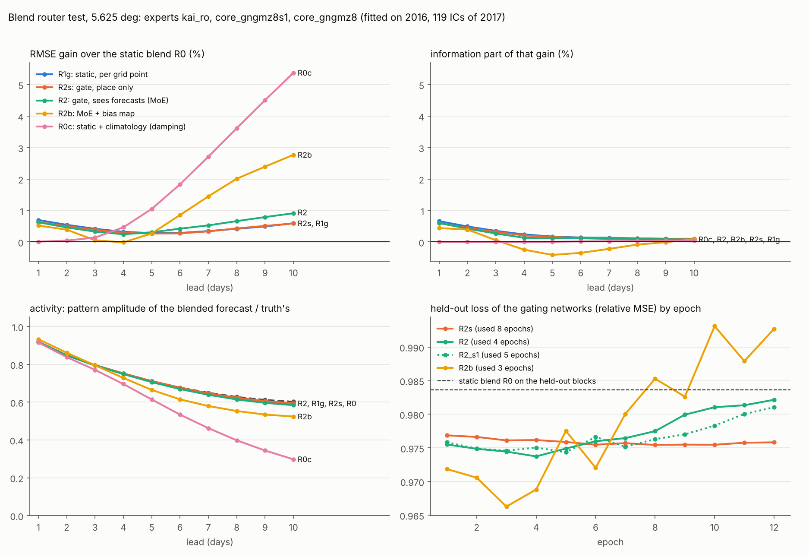
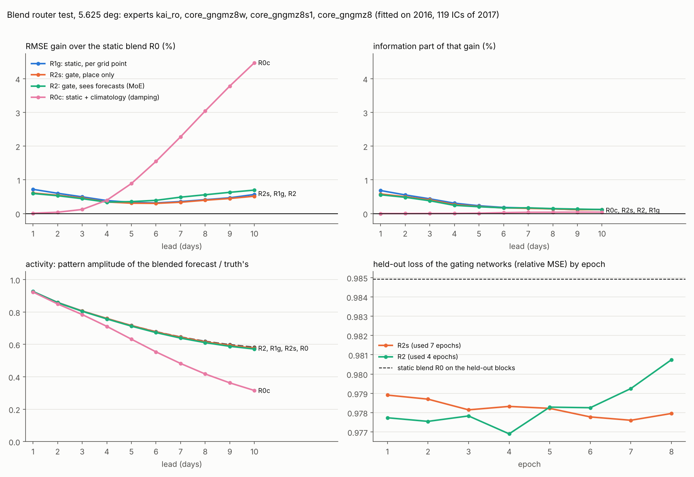

# 혼합(blend)에 학습한 라우터(MoE)가 필요한가: 5.625° 작은 시험 (2026-11-13)

질문(2026-11-13 12:57 KST): "Blend 할 때도 라우터를 만들어야 할까요? 특히 학습을 통한 라우터 구조가 필요할 것 같기도 한데, MoE 같은 구조로 해 본다면 어떨까요?"

## 요약

이 시험에서는 **학습한 라우터가 지금의 혼합에 정보를 더하지 못했습니다.** 가중을 바꿀 만한 것은 "어떤 날씨인가"가 아니라 "어디인가"였고, 그것은 학습 없이 얻을 수 있습니다.

1. **장소에 따라 가중을 바꾸면 작지만 확실한 이득이 있습니다.** 격자점별 고정 가중(R1g)은 지금의 혼합(R0)보다 선행 1 / 3 / 5 / 7 / 10일에 +0.7 / +0.4 / +0.3 / +0.3 / +0.6 % 좋습니다(유의한 칸 628 대 0). 이 가운데 정보 항은 +0.7 / +0.4 / +0.2 / +0.1 / +0.1 %입니다. 닫힌 식으로 계산하며 학습이 없습니다.
2. **그날의 상태를 보고 가중을 바꾸는 것(MoE 고유의 부분)은 정보를 더하지 못했습니다.** 같은 gating network에 예보를 보여 준 것(R2)과 보여 주지 않은 것(R2s)의 차이는 정보 항으로 0.0 / −0.1 / 0.0 / 0.0 / 0.0 %이고 seed 차이(0.1 %) 안입니다. 7~10일의 RMSE 이득 +0.2 / +0.3 %는 진폭 항입니다.
3. **bias 지도를 더한 형태(MoWE의 형태, R2b)는 10일 RMSE를 +2.8 % 낮추지만 진폭을 줄여서입니다**(활동도 0.60 → 0.52). 3~7일의 정보는 오히려 잃습니다.
4. **기후값을 전문가로 하나 더 넣은 고정 혼합(R0c)이 10일 RMSE를 +5.4 % 낮춥니다.** 정보 이득은 0이고 활동도는 0.30입니다. 긴 선행의 RMSE 경쟁은 감쇠 경쟁이고, 어떤 라우터도 이 단순 감쇠를 RMSE로 이기지 못했습니다.
5. 감쇠를 양쪽에 똑같이 허용하면(R2c 대 R1gc) MoE 라우터와 격자점별 고정 가중의 차이는 −0.1 / −0.1 / 0.0 / 0.0 / −0.1 %입니다.
6. **전문가에 넓은 core를 더해 넷으로 해도 결론이 같습니다**(7절). 예보를 보는 것이 더한 정보는 0.0 %이고, 넓은 core를 전문가로 넣는 것 자체가 혼합을 +3.5 / +2.3 / +1.6 / +1.4 / +1.4 % 좋게 합니다. 가중을 정교하게 만드는 것보다 전문가를 좋게 만드는 쪽의 효과가 큽니다.

한계가 분명한 시험입니다(8절). 라우터를 학습한 자료가 2016년 한 해뿐이고, 전문가들이 서로 닮았고, 격자가 5.625°입니다. "MoE는 쓸모없다"가 아니라 "지금 조건에서는 고정 가중으로 충분하다"입니다.



## 1. 무엇을 비교했나

지금의 혼합은 선행일 10개 × 채널 67개마다 가중 하나를 검증 연도 예보에서 계산해 씁니다. 지구 어디서나, 어떤 날씨에서나 같은 가중입니다. MoE 라우터는 gating network가 전문가들의 예보를 보고 격자점과 채널마다 가중 지도를 냅니다. 그 사이의 단계를 하나씩 나눠서 비교했습니다.

| 이름 | 가중이 달라지는 축 | 학습 | 설명 |
| --- | --- | --- | --- |
| R0 | 선행일, 채널 | 없음 (닫힌 식) | 지금의 혼합. 가중은 0 이상, 합 1 |
| R1 | + 위도대 (22.5° 8개) | 없음 | |
| R1g | + 격자점 | 없음 | 격자점의 통계를 위도대 쪽으로 80 % 줄여서 씀(줄이는 정도는 2016년 안의 교차검증으로 고름) |
| R2s | + 격자점 (network가 만든 지도) | 있음 | gating network가 장소와 선행일만 봄. 예보는 보지 않음 |
| R2 | + 그날의 상태 | 있음 | **MoE 라우터**: 같은 network가 전문가들의 예보도 봄 |
| R2b | + bias 지도 | 있음 | R2에 더하는 항을 붙인 것 (MoWE, arXiv 2509.09052의 형태) |
| R0c, R1gc, R2c | | | 위의 것에 일별 기후값을 전문가로 하나 더 넣음. **감쇠 대조** |

- **전문가**: 미세조정 KAI(`kai_ro`)와 8일 기준 core 둘(`core_gngmz8`, `core_gngmz8s1`). R0는 score Lr의 `blend_core_gngmz8s1+core_gngmz8@kai_ro`와 같은 모델입니다.
- **자료**: 모든 변형을 2016년 예보(초기장 178개, 이틀 간격)로만 맞추고, 2017년의 초기장 119개(채점과 같은 것)로 평가했습니다. 전문가들은 2012~2015년으로 학습했으므로 두 해 모두 본 적이 없습니다.
- **gating network**: 3 × 3 합성곱 4층(폭 96), 선행일은 층마다 scale과 shift로 넣음, 출력은 채널과 격자점마다 전문가에 대한 softmax. parameter는 R2s 0.28 M, R2 0.46 M. 마지막 층을 0으로 시작해서 **학습 전의 라우터가 정확히 R0**입니다. loss는 면적 가중 MSE를 R0의 MSE로 나눈 값(선행일과 채널마다 같은 무게).
- **epoch 수**: 2016년을 30일 묶음으로 나눠 넷째 묶음마다 빼 두고(초기장 43개, 24 %), 거기서 loss가 가장 낮은 epoch 수를 고른 뒤 2016년 전체로 그만큼 다시 학습했습니다.
- **감쇠 대조가 필요한 이유**: MSE로 학습한 혼합은 예보를 흐리게 만들수록 긴 선행의 RMSE가 내려갑니다. 라우터의 이득이 정보인지 감쇠인지 가르려면, 감쇠만 하는 고정 혼합과 비교해야 합니다.

확인: 이 script가 계산한 전문가들의 nRMSE는 채점의 값과 6 × 10⁻⁷ 안에서 같고, R0는 score Lr의 혼합을 재현합니다(0.1752 / 0.3113 / 0.3974 / 0.4516 / 0.4952, score Lr 0.1752 / 0.3112 / 0.3974 / 0.4516 / 0.4952).

## 2. 결과: 지금의 혼합(R0) 대비

이득 %, + = 좋아짐, 선행 1 / 3 / 5 / 7 / 10일. 65채널 nRMSE 기준이고, 항별 분해는 `scripts/eval_kai_breakdown.py`의 것입니다(정보 = 진폭을 가장 좋게 맞췄을 때 남는 pattern 항, 진폭 = 나머지 진폭 비용). 칸은 선행일 × 변수 650칸 가운데 95 % 구간이 0을 벗어난 수입니다.

| 변형 | 전체 | 정보 | 진폭 | 유의한 칸 (좋음 / 나쁨) | 10일 ACC | 10일 활동도 |
| --- | --- | --- | --- | --- | --- | --- |
| R0 지금의 혼합 | 기준 | | | | 0.250 | 0.60 |
| R1 위도대별 | +0.6 / +0.3 / +0.2 / +0.2 / +0.4 | +0.5 / +0.3 / +0.1 / +0.1 / +0.1 | 0.0 / 0.0 / 0.0 / +0.1 / +0.3 | 573 / 0 | 0.254 | 0.60 |
| R1g 격자점별 | +0.7 / +0.4 / +0.3 / +0.3 / +0.6 | +0.7 / +0.4 / +0.2 / +0.1 / +0.1 | 0.0 / 0.0 / +0.1 / +0.2 / +0.4 | 628 / 0 | 0.256 | 0.59 |
| R2s gating, 장소만 | +0.6 / +0.4 / +0.3 / +0.3 / +0.6 | +0.6 / +0.3 / +0.2 / +0.1 / +0.1 | 0.0 / 0.0 / +0.1 / +0.2 / +0.4 | 594 / 0 | 0.256 | 0.59 |
| **R2 MoE 라우터** | +0.6 / +0.3 / +0.3 / +0.5 / +0.9 | +0.6 / +0.3 / +0.1 / +0.1 / +0.1 | 0.0 / 0.0 / +0.2 / +0.4 / +0.7 | 585 / 0 | 0.256 | 0.58 |
| R2b MoE + bias | +0.5 / +0.1 / +0.3 / +1.5 / +2.8 | +0.4 / +0.1 / −0.4 / −0.2 / +0.1 | +0.1 / 0.0 / +0.6 / +1.6 / +2.4 | 454 / 58 | 0.260 | 0.52 |
| R0c 혼합 + 기후값 | 0.0 / +0.1 / +1.1 / +2.7 / +5.4 | 0.0 / 0.0 / 0.0 / 0.0 / 0.0 | 0.0 / +0.2 / +1.1 / +2.7 / +5.2 | 468 / 13 | 0.251 | 0.30 |

nRMSE 값(1 / 3 / 5 / 7 / 10일): 미세조정 KAI 0.2231 / 0.3366 / 0.4234 / 0.4830 / 0.5381, R0 0.1752 / 0.3113 / 0.3974 / 0.4516 / 0.4952, R1g 0.1740 / 0.3100 / 0.3963 / 0.4500 / 0.4923, R2 0.1741 / 0.3102 / 0.3961 / 0.4492 / 0.4907, R2b 0.1743 / 0.3111 / 0.3963 / 0.4450 / 0.4815, R0c 0.1752 / 0.3108 / 0.3932 / 0.4393 / 0.4686. 기후값은 0.486입니다. 변수별 표(t2m, t850, z500, u850, msl, 물리 단위)는 `variable_table_router.md`에 있습니다.

참고로 혼합 자체(R0)가 미세조정 KAI보다 좋은 정도는 전체 +21.5 / +7.5 / +6.1 / +6.5 / +8.0 %, 정보 +19.4 / +5.5 / +2.8 / +1.4 / +0.4 %입니다. 아래의 차이들은 그 위에 얹는 작은 수입니다.

읽는 법:

- R0 → R1 → R1g: 가중을 장소에 따라 바꾸는 것만으로 모든 선행에서 조금씩 좋아지고, 나빠진 칸이 없습니다. 1~3일의 이득은 거의 전부 정보 항입니다.
- R1g와 R2s는 같습니다(차이 0.0 ~ −0.1 %). 장소별 가중은 network로 만들 필요가 없습니다.
- R2가 R2s보다 좋아지는 곳은 7~10일뿐이고 그 차이는 진폭 항입니다(3절).

## 3. 상태 의존이 더한 것: R2 대 R2s, R2 대 R1g

| 짝 | 전체 | 정보 | 진폭 | 유의한 칸 (좋음 / 나쁨) |
| --- | --- | --- | --- | --- |
| R2 대 R2s (예보를 본 것 대 안 본 것) | 0.0 / −0.1 / 0.0 / +0.2 / +0.3 | 0.0 / −0.1 / 0.0 / 0.0 / 0.0 | 0.0 / 0.0 / +0.1 / +0.2 / +0.3 | 243 / 98 |
| R2 대 R1g (MoE 대 격자점별 고정 가중) | −0.1 / −0.1 / 0.0 / +0.2 / +0.3 | −0.1 / −0.1 / −0.1 / 0.0 / 0.0 | 0.0 / 0.0 / +0.1 / +0.2 / +0.3 | 236 / 145 |
| R2 seed 1 대 seed 0 | 0.0 / 0.0 / 0.0 / +0.1 / +0.1 | 0.0 | 0.0 / 0.0 / 0.0 / 0.0 / +0.1 | 120 / 72 |

- 라우터는 실제로 상황에 따라 가중을 바꿨습니다. 가중의 흩어짐(표준편차)은 격자 위에서 0.094, 같은 자리에서 예보마다 0.061입니다(R2s는 예보마다 0). 바꾸긴 했지만 그것이 정보로 이어지지 않았습니다.
- R2가 R2s보다 좋은 10일의 +0.3 %는 규모로 보면 가장 큰 몫이 동서 평균(k0 +1.6 %, 다른 규모 +0.1 ~ +0.3 %)이고 열대에는 없습니다(0.0 %). 활동도는 0.59 → 0.58로 조금 더 줄었습니다.
- 1~3일에는 MoE 쪽이 z의 정보를 조금 잃습니다(−0.2 / −0.3 %). seed 차이(0.0 / −0.1 %)보다 조금 큰 정도입니다.

## 4. 장소의 이득은 어디서 오는가 (R1g 대 R0)

- **규모**: 동서 평균(k0) +3.1 / +2.0 / +1.9 / +2.3 / +3.4 %, 행성 규모(k1~3) +1.1 / +0.6 / +0.3 / +0.2 / +0.2 %, 종관 규모(k4~9) +0.6 / +0.3 / +0.1 / +0.2 / +0.5 %, 작은 규모(k10+) +0.1 / 0.0 / +0.1 / +0.2 / +0.3 %. 가장 큰 몫은 위도에 따라 달라지는 동서 평균입니다.
- **지역**: 열대 +0.8 / +0.6 / +0.5 / +0.7 / +1.2 %, 북쪽 +0.7 / +0.5 / +0.2 / +0.2 / +0.4 %, 남쪽 +0.9 / +0.4 / +0.3 / +0.3 / +0.6 %.
- **변수**: 습도(q) +0.8 / +0.8 / +0.8 / +0.9 / +1.2 %와 지표 +0.6 / +0.9 / +0.8 / +0.8 / +1.2 %가 크고, t2m은 +0.7 / +1.4 / +1.3 / +1.2 / +1.6 %입니다. z, u, v는 3일 이후 +0.1 ~ +0.4 %입니다.

score Li에서 본 것과 같은 방향입니다. core와 KAI 가운데 이기는 쪽이 열대와 지표에서, 그리고 중위도 자유대기에서 서로 달랐고, 장소별 가중이 그 차이를 씁니다.

## 5. 감쇠 대조

| 짝 | 전체 | 정보 | 진폭 | 10일 활동도 |
| --- | --- | --- | --- | --- |
| R0c 대 R0 (기후값을 전문가로 추가) | 0.0 / +0.1 / +1.1 / +2.7 / +5.4 | 0.0 / 0.0 / 0.0 / 0.0 / 0.0 | 0.0 / +0.2 / +1.1 / +2.7 / +5.2 | 0.30 대 0.60 |
| R2b 대 R0c (MoE + bias 대 감쇠한 고정 혼합) | +0.5 / −0.1 / −0.8 / −1.3 / −2.8 | +0.4 / +0.1 / −0.4 / −0.3 / 0.0 | +0.1 / −0.1 / −0.4 / −1.2 / −3.0 | 0.52 대 0.30 |
| R2 대 R0c (MoE 대 감쇠한 고정 혼합) | +0.6 / +0.2 / −0.7 / −2.2 / −4.7 | +0.6 / +0.3 / +0.1 / +0.1 / 0.0 | 0.0 / −0.1 / −0.9 / −2.4 / −4.8 | 0.58 대 0.30 |
| R1gc 대 R0c (감쇠 허용, 격자점별 대 고정) | +0.8 / +0.6 / +0.4 / +0.3 / +0.3 | +0.8 / +0.6 / +0.3 / +0.2 / +0.2 | 0.0 | 0.31 대 0.30 |
| R2c 대 R0c (감쇠 허용, MoE 대 고정) | +0.7 / +0.6 / +0.4 / +0.3 / +0.2 | +0.6 / +0.5 / +0.3 / +0.2 / +0.1 | 0.0 | 0.30 대 0.30 |
| R2c 대 R1gc (감쇠 허용, MoE 대 격자점별) | −0.1 / −0.1 / 0.0 / 0.0 / −0.1 | −0.1 / −0.1 / 0.0 / 0.0 / −0.1 | 0.0 | 0.30 대 0.31 |

- 기후값을 섞는 것만으로 10일 RMSE가 5.4 % 내려갑니다. 10일에 기후값의 평균 가중은 0.51입니다. 정보 항은 그대로이므로 예보가 더 맞아진 것이 아니라 더 흐려진 것입니다.
- 감쇠를 양쪽에 허용하면 진폭 항의 차이가 사라지고 정보 항만 남습니다. 그때 장소별 가중의 이득은 그대로(+0.8 → +0.2 %)이고, MoE는 격자점별 고정 가중보다 좋지 않습니다.
- 그래서 R2와 R2b가 R0보다 긴 선행에서 더 좋아 보인 부분은 감쇠의 일부를 배운 것이라고 읽습니다. 감쇠가 목적이라면 기후값을 섞는 쪽이 값싸고 더 큽니다.

## 6. 과적합

빼 둔 묶음의 loss(R0 = 0.9836, 그림의 오른쪽 아래):

- R2s(장소만): 0.9769에서 0.9754까지 천천히 내려가고 12 epoch까지 안정합니다.
- R2(MoE): 4 epoch에서 최저 0.9737, 그 뒤로 올라가 12 epoch에 0.9822입니다. seed 1은 5 epoch에서 0.9744입니다.
- R2b(MoE + bias): 3 epoch에서 0.9663, 8 epoch부터 R0 수준이거나 더 나쁩니다(0.983 ~ 0.993).

예보를 보는 network는 학습 표본 1,350개(초기장 135개 × 선행 10일)를 몇 epoch 만에 외우기 시작합니다. 상태 의존 가중이 도움이 되는지를 제대로 물으려면 자료가 더 필요합니다.

## 7. 전문가 넷 (넓은 core를 더함)

전문가에 넓은 core(`core_gngmz8w`, score Lr에서 가장 좋았던 core)를 더해 넷(`kai_ro`, `core_gngmz8w`, `core_gngmz8s1`, `core_gngmz8`)으로 같은 비교를 했습니다. 전문가가 달라져도 결론이 같은지를 보는 것이 목적이어서 gating network는 seed 하나, 8 epoch까지만 봤고 R2b와 R2c는 뺐습니다.

고정 혼합 자체는 넓은 core를 넣은 것만으로 좋아집니다. 전문가 넷의 R0는 nRMSE 0.1690 / 0.3042 / 0.3912 / 0.4451 / 0.4881로, 전문가 셋의 R0보다 +3.5 / +2.3 / +1.6 / +1.4 / +1.4 %, score Lr의 KAI + 넓은 core 혼합(0.1699 / 0.3054 / 0.3944 / 0.4510 / 0.4995)보다 +0.5 / +0.4 / +0.8 / +1.3 / +2.3 % 좋습니다(nRMSE 값의 비이고 항별로 나누지는 않았습니다). 10일 ACC는 0.250 → 0.267, 활동도는 0.60 → 0.58입니다. 평균 가중은 1일에 KAI 0.18, 넓은 core 0.58, 기준 core 둘 0.12와 0.11이고, 10일에 0.34 / 0.28 / 0.20 / 0.18입니다.

전문가 넷의 R0 대비 (이득 %, + = 좋아짐, 선행 1 / 3 / 5 / 7 / 10일):

| 변형 | 전체 | 정보 | 진폭 | 유의한 칸 (좋음 / 나쁨) | 10일 ACC | 10일 활동도 |
| --- | --- | --- | --- | --- | --- | --- |
| R0 고정 혼합 (전문가 넷) | 기준 | | | | 0.267 | 0.58 |
| R1g 격자점별 | +0.7 / +0.5 / +0.3 / +0.4 / +0.6 | +0.7 / +0.4 / +0.2 / +0.2 / +0.1 | 0.0 / 0.0 / +0.1 / +0.1 / +0.4 | 622 / 0 | 0.273 | 0.57 |
| R2s gating, 장소만 | +0.6 / +0.5 / +0.3 / +0.3 / +0.5 | +0.6 / +0.4 / +0.2 / +0.2 / +0.1 | 0.0 / 0.0 / +0.1 / +0.1 / +0.3 | 593 / 0 | 0.273 | 0.58 |
| **R2 MoE 라우터** | +0.6 / +0.4 / +0.4 / +0.5 / +0.7 | +0.6 / +0.4 / +0.2 / +0.2 / +0.1 | 0.0 / 0.0 / +0.1 / +0.3 / +0.5 | 587 / 0 | 0.273 | 0.57 |
| R0c 혼합 + 기후값 | 0.0 / +0.1 / +0.9 / +2.3 / +4.5 | 0.0 / 0.0 / 0.0 / 0.0 / 0.0 | 0.0 / +0.1 / +0.9 / +2.2 / +4.4 | 461 / 13 | 0.269 | 0.32 |

| 짝 | 전체 | 정보 | 진폭 | 유의한 칸 (좋음 / 나쁨) |
| --- | --- | --- | --- | --- |
| R2 대 R2s (예보를 본 것 대 안 본 것) | 0.0 / 0.0 / 0.0 / +0.2 / +0.2 | 0.0 / 0.0 / 0.0 / 0.0 / 0.0 | 0.0 / 0.0 / +0.1 / +0.1 / +0.2 | 209 / 86 |
| R2 대 R1g (MoE 대 격자점별 고정 가중) | −0.1 / −0.1 / 0.0 / +0.1 / +0.1 | −0.1 / −0.1 / 0.0 / 0.0 / 0.0 | 0.0 / 0.0 / +0.1 / +0.1 / +0.1 | 165 / 151 |
| R2 대 R0c (MoE 대 감쇠한 고정 혼합) | +0.6 / +0.3 / −0.5 / −1.8 / −4.0 | +0.6 / +0.4 / +0.2 / +0.1 / +0.1 | 0.0 / −0.1 / −0.8 / −2.0 / −4.0 | 207 / 369 |
| R1gc 대 R0c (감쇠 허용, 격자점별 대 고정) | +0.8 / +0.7 / +0.4 / +0.3 / +0.2 | +0.8 / +0.7 / +0.4 / +0.3 / +0.2 | 0.0 | 524 / 5 |

물리 단위 RMSE (선행 1 / 5 / 10일, 전체 표는 `variable_table_router_C.md`):

| 모델 | t2m (K) | t850 (K) | z500 (m²/s²) | u850 (m/s) | msl (hPa) |
| --- | --- | --- | --- | --- | --- |
| persistence | 1.43 / 2.71 / 3.04 | 2.30 / 4.03 / 4.28 | 504 / 974 / 1058 | 3.77 / 6.28 / 6.61 | 4.81 / 8.70 / 9.21 |
| climatology | 2.23 / 2.23 / 2.22 | 3.08 / 3.09 / 3.08 | 777 / 776 / 775 | 4.84 / 4.84 / 4.83 | 6.71 / 6.72 / 6.70 |
| 미세조정 KAI | 2.07 / 2.72 / 3.38 | 1.78 / 2.75 / 3.62 | 228 / 599 / 840 | 2.11 / 4.28 / 5.36 | 2.35 / 5.66 / 7.53 |
| 넓은 core (혼자) | 0.88 / 2.07 / 2.76 | 1.18 / 2.78 / 3.78 | 147 / 586 / 815 | 1.79 / 4.35 / 5.40 | 1.76 / 5.58 / 7.38 |
| R0 고정 혼합 (전문가 넷) | 0.87 / 1.95 / 2.46 | 1.14 / 2.52 / 3.26 | 141 / 552 / 755 | 1.71 / 4.04 / 4.92 | 1.69 / 5.24 / 6.84 |
| R1g 격자점별 가중 | 0.86 / 1.92 / 2.42 | 1.13 / 2.51 / 3.24 | 140 / 551 / 755 | 1.70 / 4.03 / 4.90 | 1.68 / 5.23 / 6.80 |
| R2 MoE 라우터 | 0.86 / 1.92 / 2.42 | 1.13 / 2.51 / 3.23 | 141 / 552 / 754 | 1.71 / 4.03 / 4.90 | 1.68 / 5.23 / 6.79 |
| R0c 혼합 + 기후값 | 0.86 / 1.85 / 2.16 | 1.14 / 2.47 / 2.99 | 141 / 552 / 735 | 1.71 / 4.00 / 4.70 | 1.69 / 5.23 / 6.52 |

- **결론은 전문가 셋일 때와 같습니다.** 장소별 가중은 정보 +0.7 → +0.1 %를 더하고 나빠진 칸이 없습니다. 예보를 보는 것이 더한 정보는 다섯 선행 모두 0.0 %입니다.
- R2가 R2s보다 좋은 7~10일의 +0.2 %는 진폭 항이고, 변수로는 v의 진폭(+0.3 / +0.4 %)입니다.
- 기후값을 섞은 고정 혼합이 10일 RMSE를 4.5 % 낮추고(활동도 0.32, 기후값의 평균 가중 0.47) 정보는 0입니다. R2는 그 감쇠 혼합에 5 / 7 / 10일에서 −0.5 / −1.8 / −4.0 % 집니다.
- 과적합도 같습니다. R2의 빼 둔 묶음 loss는 4 epoch에서 최저 0.9769이고 8 epoch에 0.9807까지 올라갑니다(R0 0.9849). R2s는 7 epoch에 0.9776입니다. 가중의 흩어짐은 격자 위에서 0.083, 예보마다 0.049입니다.
- **전문가를 바꾼 효과(+1.4 ~ +3.5 %)가 가중을 정교하게 만든 효과(+0.3 ~ +0.7 %)보다 큽니다.**



## 8. 한계

1. **라우터를 학습한 자료가 한 해입니다.** 전문가가 보지 않은 해가 2016년뿐이어서 초기장 178개로 학습했습니다. MoWE는 35년의 예보로 학습했습니다. 6절의 과적합은 이 한계를 직접 보여 줍니다.
2. **전문가가 닮았습니다.** 같은 4년 자료로 학습한 KAI와, 그 KAI와 같은 자료로 학습한 core들입니다. MoWE가 섞은 것은 따로 만든 큰 모델 셋입니다.
3. **5.625° 격자, 작은 gating network.** 격자점 2,048개에서는 날씨 계에 따른 차이를 공간으로 가를 여지가 작습니다. 1.5°에서는 달라질 수 있습니다. network도 합성곱 4층(0.46 M)뿐이고 다른 구조는 시험하지 않았습니다.
4. **혼합만 봤습니다.** 되먹임 연결(loop) 안에서 가중을 상태에 따라 바꾸는 것은 시험하지 않았습니다. 그쪽은 rollout 안에서 학습해야 합니다.
5. **loss가 MSE입니다.** 흐려짐을 벌하는 loss(예: 진폭을 보존하는 항)로 학습한 라우터는 시험하지 않았습니다.
6. gating network의 seed는 둘(전문가 넷에서는 하나), epoch 수는 한 번의 분할로 골랐습니다. 0.1 % 아래의 차이는 읽지 않았습니다.

## 9. 다음 단계 제안

1. **혼합에 장소별 고정 가중을 넣는 것**은 값싼 개선입니다(+0.3 ~ +0.7 %, 학습 없음, 나빠진 칸 없음). 채점 코드의 혼합에 옵션으로 넣을 수 있습니다. 아직 넣지 않았습니다.
2. **학습 라우터를 다시 볼 조건**은 자료입니다. 1980~2011년 32년 학습(`docs/kai_tendency_plusplus.md` 7절)을 하면 2012~2015년 4년이 전문가가 보지 않은 해로 남습니다. 그 4년의 예보로 같은 script를 돌리면 자료가 8배이고 격자가 1.5°입니다. 그때 R2가 R1g를 정보 항에서 이기는지가 판정입니다.
3. **긴 선행의 비교는 RMSE가 아니라 정보 항(또는 ACC)과 활동도로** 합니다. 이 시험에서 10일 RMSE의 순위는 활동도의 역순이었습니다(R0c 0.30, R2b 0.52, R2 0.58, R0 0.60).

## 10. 재현

```bash
# 1. 전문가 예보 저장 (5.625°, 2016년 초기장 178개와 2017년 119개; 약 10분, 3.3 GB)
python scripts/run_kai_tendency.py --out runs/kaitend --score kai_ro \
    --score-cores core_gngmz8 core_gngmz8s1 core_gngmz8w --blend-bases kai_ro \
    --dump runs/kaitend/dump_router --dump-val-stride 2

# 2. 비교 (전문가 셋: 약 1시간, CPU 4개)
python scripts/kai_blend_router.py --dump runs/kaitend/dump_router --cache data/era5_5p625/kaiday \
    --stats runs/kaitend/stats.npz --experts kai_ro core_gngmz8s1 core_gngmz8 --out runs/kaitend/router_A \
    --variants R0 R1 R1g R2s R2 R2b R0c R1c R1gc R2c --seeds 0 1 --epochs 12

# 3. 정보 / 진폭 분해와 그림
python scripts/eval_kai_breakdown.py --stats runs/kaitend/stats.npz runs/kaitend/router_A/score_router.json \
    runs/kaitend/router_A/score_router_raw.npz runs/kaitend/router_A/breakdown "R2:R2s" "R2:R1g" "R1g:R0" "R0c:R0"
python scripts/plot_kai_blend_router.py runs/kaitend/router_A runs/kaitend/stats.npz docs/kai_blend_router/fig_router.png
# 4. 전문가 넷 (7절; 약 30분)
python scripts/kai_blend_router.py --dump runs/kaitend/dump_router --cache data/era5_5p625/kaiday \
    --stats runs/kaitend/stats.npz --experts kai_ro core_gngmz8w core_gngmz8s1 core_gngmz8 --out runs/kaitend/router_C \
    --variants R0 R1 R1g R2s R2 R0c R1gc --seeds 0 --epochs 8
python scripts/plot_kai_blend_router.py runs/kaitend/router_C runs/kaitend/stats.npz docs/kai_blend_router/fig_router_C.png
```

`--dump`는 채점이 예보를 파일로 쓰고 멈추게 하는 옵션입니다(작은 격자 전용). 1.5°의 예보는 초기장 하나에 0.5 GB(float16)이므로 그대로는 쓸 수 없고, 1.5°에서 하려면 예보를 디스크에서 읽는 방식으로 바꿔야 합니다.
