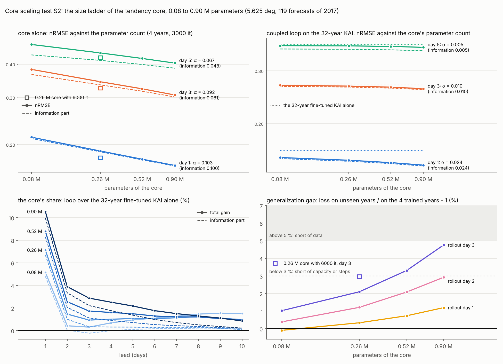
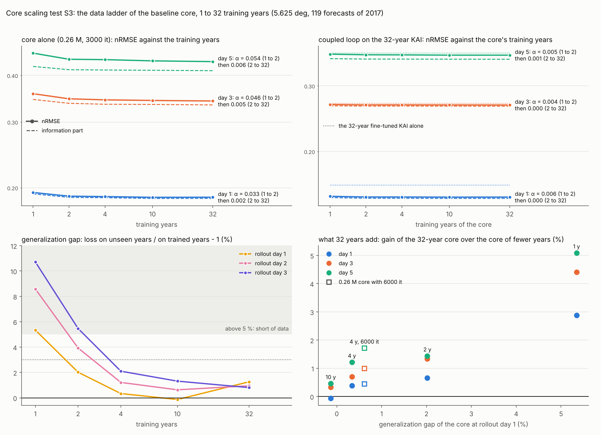

# tendency core의 scaling 시험: 무엇을 키워야 10년, 30년 자료가 효과를 내나? 5.625° 작은 시험 (2026-11-15)

요청(2026-11-15 11:12 KST): "현재 네트워크의 표현력에 대해서는 어떻게 생각하시나요? 특히 저는 시간 데이터가 증가하면 그 데이터를 충분히 표현 및 학습하는 즉 scaling law가 잘 반영되게 학습구조를 만들어야 할 것 같은데 현재의 tendency core는 물리적 embedding으로 보는데 어떻게 하면 시간데이터 즉 10년치 30년치 데이터 학습의 효과를 보도록 모델을 늘릴 수 있을까요? ... 특히 tendency core 즉 physical embedding 쪽도 48에서 96같은 확장도 고려해서 실험 진행" (scaling law와 PINN / PINO scaling에 대한 글 두 편 첨부).

이렇게 읽었습니다: (1) 지금 네트워크가 세 영역(용량 부족 / scaling / 포화) 가운데 어디에 있는지 의견을 내고, (2) 자료 기간이 늘 때 효과가 나오도록 core의 무엇을 키워야 하는지 5.625° CPU 시험으로 잽니다. "48에서 96"은 코드에 48이 두 개 있어서 둘 다 쟀습니다: **물리항 48개**(u, v, T, q 방정식의 경향 × 12층, 입력 채널)와 **trunk 폭 48**(`--core-hidden`).

**상태(2026-11-16 10:40 KST): 채점 S1(물리항 96개, 폭 24), S2(크기 사다리 0.08 ~ 0.90 M, 과적합 폭), S3(자료 길이 사다리 1 ~ 32년), S4(폭 96 core의 32년 학습)가 끝났습니다. 물리항 96개의 같은 크기 대조군(S5)은 학습 중입니다.**

## 지금까지의 요약

1. **물리항 48 → 96개는 지렛대가 아닙니다.** 단독 +1.5 / +1.0 / +1.0 / +0.7 / +0.5 %, 되먹임 +0.7 / +0.3 / +0.2 / 0.0 / +0.3 %이고, 늘어난 파라미터 9.8 %의 몫(+1.0 / +0.8 / +0.6 / +0.5 / +0.5 %)과 거의 같습니다. T와 q의 수평 / 연직 분리에만 신호가 있습니다(3절).
2. **폭(용량)은 멱법칙을 따르고 포화가 없습니다.** 0.083 / 0.26 / 0.52 / 0.90 M 네 점에서 α = 0.103 / 0.092 / 0.067(1 / 3 / 5일), 구간별 1일 지수 0.104, 0.102, 0.100. 폭 96 core는 기준 core보다 단독 +11.7 / +10.8 / +8.4 / +6.3 / +5.7 %, 되먹임 +3.7 / +2.0 / +1.1 / +0.4 / −0.1 %입니다(4절).
3. **같은 계산량이면 폭이 반복 수보다 낫습니다.** 폭 96 core(3000회, 5.1시간) 대 기준 core 6000회(4.8시간): 단독 +6.5 / +5.8 / +4.6 / +3.1 / +2.1 %.
4. **core가 커질수록 자료 부족 쪽으로 옮겨 갑니다.** 과적합 폭(rollout 3일째)이 0.083 M +1.0 %, 0.26 M +2.1 %, 0.52 M +3.3 %, 0.90 M +4.8 %입니다. 방향은 "용량을 키워야 자료 축이 켜진다"이지만, S3의 눈금으로 보면 0.90 M도 아직 충분히 크지 않습니다(7번).
5. **되먹임에서는 지수가 훨씬 작습니다**(1일 0.024, 3일 0.010). 다만 크기와 함께 커집니다(1일 구간별 0.018, 0.026, 0.036).
6. 최고 모델(S4에서 갱신): 32년 KAI + 32년 폭 96 core. 되먹임 nRMSE 0.145 / 0.261 / 0.358 / 0.433 / 0.509, 혼합 0.145 / 0.261 / 0.355 / 0.422 / 0.481. (4년 폭 96 core로는 되먹임 0.145 / 0.262 / 0.359 / 0.437 / 0.515였습니다.)
7. **자료 축에는 세 영역이 다 보이고, 0.26 M core는 약 2년에서 포화합니다.** 1 → 2년 +2.2 / +3.1 / +3.7 %(α 0.033 / 0.046 / 0.054), 2 → 32년은 16배의 자료로 +0.7 / +1.3 / +1.4 %(α 0.002 / 0.005 / 0.006)입니다. 크기 축 지수(0.103 / 0.092 / 0.067)의 50분의 1 ~ 10분의 1입니다(5절).
8. **연수가 효과를 낼지는 과적합 폭이 미리 말해 줍니다.** 1일째 폭이 1년 +5.3 %, 2년 +2.0 %, 4년 +0.3 %, 10년 −0.1 %이고, 32년이 더해 주는 이득이 이 폭을 따라갑니다. 폭 96 core의 폭(+1.2 %)은 2년 점과 4년 점 사이라서, S4의 예상은 +0.5 / +1.3 / +1.5 % 안팎이었습니다(5.3절, 시험 전에 적어 둔 예측).
9. **예측이 맞았습니다: 폭 96 core가 32년에서 얻는 것은 +0.6 / +1.0 / +1.5 / +2.0 / +1.8 %입니다.** 폭 48 core의 +0.4 / +0.7 / +1.2 / +1.3 / +0.9 %보다 크지만(정보 이득 약 1.5배), 같은 자리에서 폭이 주는 +11.9 / +11.0 / +8.7 %와는 견줄 수 없습니다. 되먹임에서는 0.0 / +0.1 / +0.5 / +0.9 / +1.1 %입니다(6절).

모든 수치는 2017년 초기값 119개, 선행 1 / 3 / 5 / 7 / 10일, + = 좋아짐입니다. KAI는 우리가 재학습한 작은 KAI(0.43 M)이고 원본 체크포인트가 아닙니다.

## 1. 시험 전의 의견 (시간 확장 시험의 수치로)

scaling 지수를 α = −Δ ln E / Δ ln x 로 씁니다(E = 65채널 nRMSE, x = 파라미터 수, 반복 수, 학습 연수).

| 축 (core 단독) | 변화 | 이득 % (1 / 3 / 5일) | α (1 / 3 / 5일) |
|---|---|---|---|
| 파라미터 | 0.26 → 0.52 M | +6.8 / +5.9 / +4.7 | 0.10 / 0.09 / 0.07 |
| 반복 수 | 3000 → 6000 | +5.6 / +5.3 / +4.0 | 0.08 / 0.08 / 0.06 |
| 학습 연수 (6000회) | 4 → 32년 | +0.5 / +1.0 / +1.7 | 0.002 / 0.005 / 0.008 |

- 두 네트워크(KAI, core) 모두 **용량 / 학습량 부족 영역**에 있습니다. 파라미터와 반복 수 축에는 지수가 있고 자료 축의 지수는 0에 가깝습니다.
- 자료 축은 작은 자료로 학습한 모델의 과적합 폭이 열릴 때 켜집니다. KAI는 반복 8배에서 과적합 폭이 +6.8 %가 되었고 그때 32년이 +1.2 ~ +2.5 %를 주었습니다. core는 6000회에서도 과적합 폭이 +0.6 ~ +3.0 %입니다(`docs/kai_time_extension.md` 7.5절).
- 그래서 순서는 (1) 반복 수를 연수에 비례하게(driver의 TIME), (2) 그다음 용량, (3) 판단은 과적합 폭(GAP)입니다.

첨부된 두 글에 대해 확인한 것:

- "Scaling Laws of Global Weather Models"(Yu 외, arXiv 2602.22962)의 자료 크기 D는 학습에서 처리한 표본 수이고 서로 다른 연수가 아닙니다(학습 자료는 ERA5 1979 ~ 2020으로 고정). 즉 그 논문의 자료 축은 우리의 반복 수 축에 가깝습니다. 폭이 깊이보다 낫다는 결론은 우리 결과(반복 2배 = 폭 2배)와 맞습니다.
- "Scaling Laws and Pathologies of Single-Layer PINNs"(Chaudhry, arXiv 2603.12556)의 "폭을 늘려도 오차가 줄지 않는다"는 PDE 잔차를 loss로 쓰는 PINN의 최적화 문제입니다. 우리 core는 물리항을 입력으로 받고 자료로 학습하므로 그 병리가 그대로 적용되지는 않습니다.
- 글의 "Residual-Capacity Scaling"(물리 core는 고정, 잔차 네트워크 확장)은 우리 구조에서는 물리항 G(x) 위의 trunk를 넓히는 것에 해당하고, 아래 크기 사다리가 그 시험입니다.

## 2. 시험의 구성

모든 core는 memory core의 조리법(`--core-gfeat --core-mem 8 --core-mz`, GroupNorm)으로 **3000회** 학습합니다. 반복 수가 같으므로 큰 모델일수록 덜 익은 상태일 수 있습니다(주 약점). 그래서 학습 곡선과 과적합 폭을 함께 봅니다.

| 이름 | 무엇 | 파라미터 | 학습 연도 | 검증 loss (2016) |
|---|---|---|---|---|
| `core_gngmz8h24` | 폭 24 (memory 12채널) | 83,010 | 2012 ~ 2015 | 0.2646 |
| `core_gngmz8` | 기준: 폭 48 (memory 24), 물리항 48개 | 259,842 | 2012 ~ 2015 | 0.2379 |
| `core_gngmz8g96` | 물리항 96개 (`--core-gsplit`), 폭 48 | 285,186 | 2012 ~ 2015 | 0.2342 |
| `core_gngmz8h51` | 대조: 물리항 48개, 폭 51 (memory 25) | 286,780 | 2012 ~ 2015 | 대기 |
| `core_gngmz8w` | 폭 72 (memory 34) | 520,966 | 2012 ~ 2015 | 0.2232 |
| `core_gngmz8h96` | 폭 96 (memory 48) | 895,170 | 2012 ~ 2015 | 0.2124 |
| `core_gngmz8_y1`, `_y2`, `_y10` | 기준 core, 1 / 2 / 10년 | 259,842 | 2015 / 2014 ~ 15 / 2006 ~ 15 | 대기 |
| `core_gngmz8_y32` | 기준 core, 32년 | 259,842 | 1984 ~ 2015 | 0.2362 |
| `core_gngmz8_x2` | 기준 core, 6000회 (같은 계산량의 대조) | 259,842 | 2012 ~ 2015 | 0.2259 |
| `core_gngmz8h96_y32` | 폭 96, 32년 | 895,170 | 1984 ~ 2015 | 대기 |

**물리항 96개**: 원시방정식 연산자의 경향 G(x) 48개(u, v, T, q × 12층)를 항마다 둘로 나눠 넣습니다(`pgcfm/physics/primitive.py`의 `tendency_parts`). u, v = 이류 | 코리올리 + 기압경도력, T = 수평 이류 | 연직 항 ω(R Tv / (cp p) − ∂T/∂p), q = 수평 이류 | 연직 이류. 두 부분을 더하면 원래 G가 됩니다(단위 시험). 각 부분의 RMS / 전체 항의 RMS(층 평균): u 이류 1.00, u 힘 1.17, v 이류 0.93, v 힘 1.22, T 수평 0.42, T 연직 0.91, q 수평 0.48, q 연직 0.84. 입력 채널이 늘어서 파라미터가 9.8 % 늘어납니다.

## 3. 채점 S1: 물리항 48 → 96개, 그리고 폭 24

### 3.1 물리항 96개 core 대 기준 core

| | 전체 | 정보 | 진폭 | 유의한 칸 (좋음 / 나쁨) |
|---|---|---|---|---|
| core 단독 | +1.5 / +1.0 / +1.0 / +0.7 / +0.5 | +1.4 / +0.9 / +0.7 / +0.5 / +0.3 | 0.0 / +0.1 / +0.3 / +0.1 / +0.1 | 323 / 16 |
| 32년 KAI와 되먹임 | +0.7 / +0.3 / +0.2 / 0.0 / +0.3 | +0.7 / +0.3 / +0.1 / −0.1 / 0.0 | 0.0 / 0.0 / +0.1 / +0.1 / +0.2 | 261 / 10 |
| 32년 KAI와 혼합 | +0.7 / +0.1 / +0.2 / +0.2 / +0.1 | +0.7 / +0.1 / +0.1 / +0.2 / +0.1 | 0.0 / 0.0 / 0.0 / 0.0 / −0.2 | 206 / 7 |

변수 묶음별(단독, 전체 이득 %): z +1.8 / +0.8 / +1.1 / +0.6 / +0.4, q +3.2 / +1.7 / +1.2 / +1.5 / +2.5, t +2.0 / +1.3 / +1.1 / +1.1 / +1.0, u +0.9 / +0.7 / +0.7 / +0.5 / −0.6, v 0.0 / +0.8 / +1.1 / +0.4 / +0.2, 지표 +2.2 / +1.8 / +1.4 / +0.9 / +0.5.

| 변수 | 단독 이득 % | 되먹임 이득 % |
|---|---|---|
| t2m | +1.9 / +2.6 / +1.4 / +0.6 / +0.2 | +1.3 / +2.2 / +2.2 / +2.1 / +2.3 |
| t850 | +2.5 / +1.9 / +0.9 / −0.2 / −1.3 | +1.5 / +0.7 / +0.8 / +0.6 / +1.1 |
| z500 | +1.7 / +0.9 / +1.3 / +0.3 / +0.4 | +0.3 / +0.2 / 0.0 / −0.4 / +0.2 |
| u850 | +0.9 / +0.9 / +0.8 / +0.6 / −0.4 | +0.2 / +0.1 / 0.0 / −0.4 / −0.3 |
| msl | +2.1 / +0.9 / +1.4 / +1.0 / −0.1 | +0.5 / +0.1 / 0.0 / −0.2 / +0.2 |

**읽는 법.** 파라미터가 9.8 % 늘었으므로 크기 지수(3.2절)만으로 +1.0 / +0.8 / +0.6 / +0.5 / +0.5 %가 기대됩니다. 물리항을 나눈 것 자체의 순 효과는 그 차이인 +0.5 / +0.2 / +0.4 / +0.2 / 0.0 % 정도이고 잡음 수준입니다. 다만 고르지 않습니다: 크기를 키웠을 때의 이득은 변수에 고르게 퍼지는데, 여기서는 1일에 q(+3.2), 지표(+2.2), t(+2.0)가 크고 u(+0.9), v(0.0)는 기대값 아래입니다. T와 q의 수평 / 연직 분리에는 신호가 있고 바람의 이류 / 힘 분리에는 없습니다. 되먹임에서는 t2m만 전 구간 +1.3 ~ +2.3 %로 남습니다.

**약점.** (1) 순 효과는 지수로 계산한 추정입니다. 같은 크기의 대조군 `core_gngmz8h51`(S5)이 직접 답합니다. (2) seed 하나씩이고 core 사이의 잡음은 재지 않았습니다(KAI에서는 약 1 %). (3) 나누는 방법은 한 가지만 시험했습니다.

### 3.2 크기 사다리의 첫 구간: 폭 24 → 48

| 구간 (core 단독) | 전체 이득 % | 정보 이득 % | α 전체 | α 정보 |
|---|---|---|---|---|
| 0.083 → 0.26 M (× 3.13) | +11.2 / +10.1 / +7.0 / +5.4 / +5.7 | +10.8 / +8.6 / +4.6 / +2.2 / +0.7 | 0.104 / 0.093 / 0.064 / 0.049 / 0.052 | 0.100 / 0.079 / 0.041 / 0.020 / 0.006 |
| 0.26 → 0.52 M (× 2.00) | +6.8 / +5.9 / +4.7 / +3.8 / +3.4 | +6.7 / +5.3 / +3.5 / +2.2 / +1.0 | 0.102 / 0.088 / 0.069 / 0.056 / 0.049 | 0.100 / 0.079 / 0.051 / 0.033 / 0.014 |

두 구간의 지수가 같습니다(1일 0.10, 3일 0.09, 5일 0.07). 세 점이 log-log에서 한 직선 위에 있고 포화 조짐이 없습니다. 정보 항의 지수는 선행일이 길수록 작아져 7일 이후에는 0.01 ~ 0.03입니다: 긴 선행의 이득은 대부분 진폭입니다.

되먹임에서는 차이가 줄어듭니다. 32년 KAI 위에서 기준 core의 되먹임은 폭 24 core의 되먹임보다 +2.1 / +0.6 / +0.1 / −0.1 / −0.6 %입니다. core의 몫(되먹임 대 KAI): 폭 24 +5.2 / +0.3 / +0.9 / +1.3 / +1.5 (정보 +4.8 / −0.2 / +0.1 / +0.2 / +0.1), 기준 +7.1 / +0.9 / +1.1 / +1.1 / +0.9 (정보 +6.7 / +0.3 / +0.3 / +0.3 / +0.1), 물리항 96개 +7.7 / +1.2 / +1.3 / +1.1 / +1.2 (정보 +7.3 / +0.6 / +0.4 / +0.2 / +0.1).

변수별 전체 표(물리 단위, persistence / climatology 포함): `runs/kaitend/variable_table_S1.md`.

## 4. 채점 S2: 크기 사다리 0.08 → 0.26 → 0.52 → 0.90 M



### 4.1 core 단독: 멱법칙

| 구간 | 전체 이득 % | 정보 이득 % | α 전체 | α 정보 |
|---|---|---|---|---|
| 0.083 → 0.26 M (× 3.13) | +11.2 / +10.1 / +7.0 / +5.4 / +5.7 | +10.8 / +8.6 / +4.6 / +2.2 / +0.7 | 0.104 / 0.093 / 0.064 / 0.049 / 0.052 | 0.100 / 0.079 / 0.041 / 0.020 / 0.006 |
| 0.26 → 0.52 M (× 2.00) | +6.8 / +5.9 / +4.7 / +3.8 / +3.4 | +6.7 / +5.3 / +3.5 / +2.2 / +1.0 | 0.102 / 0.088 / 0.069 / 0.056 / 0.049 | 0.100 / 0.079 / 0.051 / 0.033 / 0.014 |
| 0.52 → 0.90 M (× 1.72) | +5.3 / +5.2 / +3.9 / +2.6 / +2.4 | +5.2 / +4.8 / +3.1 / +1.8 / +1.0 | 0.100 / 0.098 / 0.074 / 0.049 / 0.044 | 0.098 / 0.091 / 0.059 / 0.034 / 0.019 |
| 사다리 전체 기울기 | | | 0.103 / 0.092 / 0.067 / 0.051 / 0.050 | 0.100 / 0.081 / 0.048 / 0.026 / 0.011 |

nRMSE(1 / 3 / 5 / 7 / 10일): 0.083 M 0.213 / 0.383 / 0.474 / 0.531 / 0.592, 0.26 M 0.189 / 0.344 / 0.441 / 0.502 / 0.558, 0.52 M 0.176 / 0.324 / 0.420 / 0.483 / 0.540, 0.90 M 0.167 / 0.307 / 0.404 / 0.470 / 0.527. 검증 loss(2016)는 0.2646, 0.2379, 0.2232, 0.2124로 같은 기울기(0.09)입니다.

- 파라미터 11배 범위에서 지수가 일정합니다. 포화 영역의 조짐(지수가 줄어드는 것)이 없습니다. 3 ~ 5일의 정보 지수는 오히려 큰 쪽 구간에서 커집니다(5일 0.041, 0.051, 0.059).
- 폭 96 core 대 기준 core: 전체 +11.7 / +10.8 / +8.4 / +6.3 / +5.7, 정보 +11.4 / +9.4 / +5.8 / +3.3 / +1.5, 진폭 +0.3 / +1.3 / +2.5 / +2.9 / +4.0, 650칸 가운데 650칸이 유의하게 좋아짐. 변수 묶음별 1일: z +14.6, q +10.1, t +11.7, u +11.8, v +12.4, 지표 +12.1(고르게 퍼짐).
- **같은 계산량의 대조**: 폭 96 core(3000회, 18,405초) 대 기준 core 6000회(17,340초): 전체 +6.5 / +5.8 / +4.6 / +3.1 / +2.1, 정보 +6.4 / +5.1 / +3.4 / +2.0 / +0.9. 이 크기에서는 계산을 폭에 쓰는 쪽이 낫습니다.

### 4.2 되먹임(32년 KAI 위)

| 구간 | 되먹임 전체 이득 % | 정보 이득 % | α 전체 |
|---|---|---|---|
| 0.083 → 0.26 M | +2.1 / +0.6 / +0.1 / −0.1 / −0.6 | +2.0 / +0.6 / +0.2 / +0.1 / −0.1 | 0.018 / 0.006 / 0.001 / −0.001 / −0.005 |
| 0.26 → 0.52 M | +1.8 / +0.8 / +0.4 / +0.1 / 0.0 | +1.8 / +0.8 / +0.4 / +0.2 / +0.2 | 0.026 / 0.012 / 0.006 / 0.001 / 0.001 |
| 0.52 → 0.90 M | +1.9 / +1.2 / +0.7 / +0.3 / −0.1 | +1.9 / +1.1 / +0.7 / +0.3 / 0.0 | 0.036 / 0.022 / 0.013 / 0.005 / −0.002 |
| 사다리 전체 기울기 | | | 0.024 / 0.010 / 0.005 / 0.001 / −0.003 |

core의 몫(되먹임 대 32년 KAI 단독):

| core | 전체 | 정보 |
|---|---|---|
| 0.083 M | +5.2 / +0.3 / +0.9 / +1.3 / +1.5 | +4.8 / −0.2 / +0.1 / +0.2 / +0.1 |
| 0.26 M | +7.1 / +0.9 / +1.1 / +1.1 / +0.9 | +6.7 / +0.3 / +0.3 / +0.3 / +0.1 |
| 0.52 M | +8.8 / +1.7 / +1.5 / +1.2 / +1.0 | +8.3 / +1.1 / +0.7 / +0.4 / +0.2 |
| 0.90 M | +10.5 / +2.9 / +2.2 / +1.5 / +0.9 | +10.0 / +2.2 / +1.4 / +0.7 / +0.2 |

- 되먹임의 지수는 단독의 4분의 1(1일)에서 9분의 1(3일)입니다. KAI가 이미 아는 것을 core가 다시 배우는 부분은 되먹임에서 값이 없기 때문입니다.
- 그래도 지수가 크기와 함께 커집니다(1일 0.018, 0.026, 0.036). 3일의 정보 몫이 −0.2, +0.3, +1.1, +2.2 %로 늘어납니다. 7일 이후는 어느 크기에서나 +0.7 % 이하입니다.
- 폭 96 대 기준 core의 되먹임: +3.7 / +2.0 / +1.1 / +0.4 / −0.1 (정보 +3.5 / +1.9 / +1.1 / +0.4 / +0.1), 혼합 +3.7 / +1.4 / +1.0 / +0.8 / +0.6. 폭 96 대 기준 core 6000회의 되먹임: +2.3 / +1.3 / +0.7 / +0.1 / −0.3.

| 변수 | 폭 96 대 기준, 단독 % | 폭 96 대 기준, 되먹임 % | 폭 96 되먹임 대 32년 KAI % |
|---|---|---|---|
| t2m | +10.5 / +11.2 / +8.4 / +6.1 / +4.9 | +7.6 / +6.1 / +3.7 / +1.2 / −0.8 | +41.3 / +20.8 / +15.5 / +12.3 / +10.8 |
| t850 | +10.1 / +10.8 / +7.8 / +5.2 / +3.0 | +4.7 / +2.2 / +1.0 / −0.1 / −0.4 | +20.7 / +2.9 / +2.5 / +2.2 / +1.9 |
| z500 | +14.6 / +11.7 / +8.3 / +4.9 / +3.4 | +5.4 / +1.9 / +0.7 / −0.1 / +0.1 | +15.6 / +1.6 / +1.4 / +0.6 / −0.5 |
| u850 | +10.9 / +10.3 / +7.1 / +5.4 / +4.3 | +2.8 / +1.4 / +0.8 / +0.4 / +0.3 | +6.2 / +1.2 / +1.3 / +1.0 / +0.4 |
| msl | +14.2 / +11.3 / +7.8 / +5.4 / +4.3 | +4.2 / +1.5 / +0.8 / +0.2 / +0.5 | +10.0 / +1.0 / +1.6 / +1.0 / +1.0 |

물리 단위의 전체 표: `runs/kaitend/variable_table_S2.md`.

### 4.3 과적합 폭: 큰 core는 자료 부족 쪽으로 간다

처음 보는 해(1985 ~ 2010년의 여섯 해, 2016, 2017)의 loss / 학습한 4년(2012 ~ 2015)의 loss − 1, core 자체 rollout의 1 / 2 / 3일째(`diag_gap_size.json`):

| core (4년, 3000회) | 과적합 폭 % |
|---|---|
| 0.083 M | −0.1 / +0.4 / +1.0 |
| 0.26 M | +0.3 / +1.2 / +2.1 |
| 0.29 M (물리항 96개) | +0.4 / +1.3 / +2.1 |
| 0.52 M | +0.7 / +2.1 / +3.3 |
| 0.90 M | +1.2 / +2.9 / +4.8 |
| 0.26 M, 6000회 | +0.6 / +1.8 / +3.0 |

- 과적합 폭은 크기에 따라 단조롭게 커집니다. 0.90 M core의 3일째 폭(+4.8 %)은 "자료 부족"의 기준으로 쓴 5 %에 닿아 있습니다.
- 이것이 질문의 답의 절반입니다: 자료 축(연수)은 모델이 그 자료를 다 쓸 만큼 커졌을 때 켜집니다. 작은 core(0.26 M)는 32년에서 +0.4 ~ +1.3 %(3000회)만 얻었습니다. 0.90 M core는 폭이 두 배 넘게 열려 있으므로 더 얻을 것으로 예상하고, S4(폭 96 core의 32년 학습)가 확인합니다. (S3 뒤의 수정: 자료 사다리의 눈금으로 보면 그 이득은 작을 것으로 예상합니다. 5.3절.)

**약점.** (1) 모두 3000회라서 "반복 수를 고정한" 지수입니다. 큰 core를 더 오래 학습하면 지수와 과적합 폭이 모두 달라질 수 있습니다. (2) seed 하나씩입니다. 되먹임의 5일 이후 이득(+1.1 % 이하)은 잡음(약 1 %) 안입니다. (3) CPU 한계로 0.90 M까지만 쟀습니다. 1.5°의 ++ core(w128 1.4 M, u96 4.3 M)에서 같은 지수가 이어지는지는 서버의 크기 실험이 답합니다. (4) 폭과 memory 채널을 함께 늘렸습니다(24 / 48 / 72 / 96에 12 / 24 / 34 / 48채널). trunk와 memory 가운데 어느 쪽의 몫인지는 나누지 않았습니다.

## 5. 채점 S3: 자료 길이 사다리 1 / 2 / 4 / 10 / 32년 (0.26 M, 3000회)



같은 core(0.26 M), 같은 3000회에서 학습 연수만 바꿨습니다: 1년 = 2015, 2년 = 2014 ~ 2015, 4년 = 2012 ~ 2015, 10년 = 2006 ~ 2015, 32년 = 1984 ~ 2015. 3000회 × batch 8 = 시작일 24,000개이므로 하루를 보는 횟수는 1년 66회, 2년 33회, 4년 16회, 10년 6.6회, 32년 2.1회입니다. 검증 loss(2016)는 0.2434, 0.2382, 0.2379, 0.2370, 0.2362입니다.

### 5.1 core 단독

| 구간 | 전체 이득 % | 정보 이득 % | 진폭 % | α 전체 (1 / 3 / 5일) |
|---|---|---|---|---|
| 1 → 2년 | +2.2 / +3.1 / +3.7 / +3.4 / +4.1 | +2.1 / +2.2 / +1.7 / +0.8 / +0.3 | +0.1 / +0.8 / +1.9 / +2.5 / +3.7 | 0.033 / 0.046 / 0.054 |
| 2 → 4년 | +0.3 / +0.6 / +0.2 / +0.4 / +0.1 | +0.2 / +0.6 / +0.2 / +0.2 / 0.0 | +0.1 / +0.1 / +0.1 / +0.3 / +0.2 | 0.004 / 0.009 / 0.003 |
| 4 → 10년 | +0.4 / +0.4 / +0.8 / +0.9 / +1.2 | +0.4 / +0.1 / +0.1 / +0.1 / +0.1 | 0.0 / +0.3 / +0.6 / +0.8 / +1.1 | 0.005 / 0.004 / 0.008 |
| 10 → 32년 | −0.1 / +0.3 / +0.5 / +0.4 / −0.3 | 0.0 / +0.3 / +0.2 / +0.1 / 0.0 | 0.0 / 0.0 / +0.2 / +0.3 / −0.2 | −0.001 / 0.003 / 0.004 |
| 2 → 32년 기울기 | | | | 0.002 / 0.005 / 0.006 |

nRMSE(1 / 3 / 5 / 7 / 10일): 1년 0.194 / 0.357 / 0.459 / 0.522 / 0.583, 2년 0.190 / 0.346 / 0.442 / 0.504 / 0.559, 4년 0.189 / 0.344 / 0.441 / 0.502 / 0.558, 10년 0.189 / 0.343 / 0.438 / 0.497 / 0.552, 32년 0.189 / 0.342 / 0.436 / 0.495 / 0.553.

- **세 영역이 한 축에 다 보입니다.** 1 → 2년은 자료가 모자란 영역(650칸 가운데 650칸이 유의하게 좋아짐, 정보 이득 +2.1 / +2.2 / +1.7 %), 2년부터는 포화입니다. 2 → 32년은 자료 16배로 +0.7 / +1.3 / +1.4 / +1.8 / +1.1 %이고, 7일 이후의 이득은 거의 진폭 몫입니다.
- 크기 축의 지수(0.103 / 0.092 / 0.067)와 견주면 자료 축의 지수는 2년 이후 50분의 1(1일) ~ 10분의 1(5일)입니다. 이 크기와 반복 수에서는 연수가 지렛대가 아닙니다.
- 1 → 2년의 변수 묶음별 1일 이득: z +4.9, 지표 +2.6, u +2.4, v +2.3, t +1.8, q +1.4. 큰 규모의 장(z, msl)이 한 해만으로는 가장 모자랍니다.

### 5.2 되먹임(32년 KAI 위)

| 구간 | 되먹임 전체 이득 % | 정보 이득 % |
|---|---|---|
| 1 → 2년 | +0.4 / +0.3 / +0.4 / +0.4 / +0.6 | +0.4 / +0.2 / +0.2 / +0.2 / +0.2 |
| 2 → 4년 | 0.0 / 0.0 / +0.1 / +0.3 / −0.2 | 0.0 / 0.0 / 0.0 / +0.1 / −0.1 |
| 4 → 10년 | +0.1 / +0.1 / +0.2 / +0.2 / +0.4 | +0.1 / 0.0 / 0.0 / 0.0 / +0.1 |
| 10 → 32년 | 0.0 / 0.0 / 0.0 / 0.0 / +0.1 | 0.0 / 0.0 / 0.0 / +0.1 / +0.1 |

- 되먹임에서는 1 → 2년조차 +0.4 % 안팎이고, 그 뒤 구간은 −0.2 ~ +0.4 %로 잡음(약 1 %) 안입니다. 32년 core 되먹임 대 1년 core 되먹임: +0.5 / +0.3 / +0.6 / +1.0 / +1.0 %.
- **1년만 배운 core도 되먹임에서는 몫의 대부분을 냅니다.** core의 몫(되먹임 대 32년 KAI 단독): 1년 core +6.7 / +0.7 / +0.6 / +0.4 / +0.5(정보 +6.3 / +0.2 / 0.0 / 0.0 / 0.0), 4년 core +7.1 / +0.9 / +1.1 / +1.1 / +0.9, 10년 core +7.2 / +1.0 / +1.2 / +1.4 / +1.4(정보 +6.8 / +0.4 / +0.4 / +0.3 / +0.1). 같은 자리에서 크기를 0.26 → 0.90 M으로 키우면 +10.5 / +2.9 / +2.2였습니다(4.2절).

| 변수 | 1 → 2년, 단독 % | 4 → 32년, 단독 % | 1 → 2년, 되먹임 % | 4 → 10년, 되먹임 % |
|---|---|---|---|---|
| t2m | +1.1 / +2.0 / +2.9 / +2.5 / +2.4 | +0.7 / +1.4 / +1.0 / +0.5 / +0.4 | +0.8 / +0.8 / +0.9 / +0.2 / −0.8 | +0.3 / +0.4 / +0.6 / +0.7 / +1.3 |
| t850 | +1.0 / +2.5 / +3.5 / +2.9 / +3.7 | +0.4 / +1.3 / +1.3 / +1.0 / +0.6 | +0.2 / +0.2 / +0.2 / −0.4 / −0.6 | +0.2 / +0.1 / +0.4 / +0.5 / +0.9 |
| z500 | +5.3 / +5.8 / +5.4 / +3.8 / +4.4 | +1.3 / +1.6 / +2.2 / +1.7 / +0.9 | +1.6 / +0.3 / +0.3 / −0.1 / +0.1 | +0.1 / −0.1 / +0.2 / +0.1 / +0.5 |
| u850 | +2.7 / +3.4 / +3.1 / +2.8 / +3.6 | +0.5 / +0.7 / +1.1 / +1.2 / −0.9 | +0.3 / +0.1 / +0.3 / +0.4 / +0.6 | +0.1 / +0.1 / +0.2 / +0.1 / +0.3 |
| msl | +4.3 / +5.4 / +4.6 / +2.7 / +3.4 | +0.8 / +0.7 / +1.6 / +1.4 / −0.5 | +0.7 / +0.4 / +0.5 / +0.5 / +0.8 | +0.1 / −0.1 / +0.2 / +0.2 / +0.6 |

물리 단위의 전체 표: `runs/kaitend/variable_table_S3.md`.

### 5.3 과적합 폭이 자료 축을 미리 말해 준다

core 자체 rollout의 1 / 2 / 3일째, 처음 보는 해 / 학습한 해 − 1(`diag_gap_data.json`, `diag_gap_core32.json`):

| 학습 연수 (0.26 M, 3000회) | 과적합 폭 % | 32년이 더해 주는 이득 % (단독, 1 / 3 / 5일) |
|---|---|---|
| 1년 | +5.3 / +8.6 / +10.7 | +2.9 / +4.4 / +5.1 |
| 2년 | +2.0 / +3.9 / +5.5 | +0.7 / +1.3 / +1.4 |
| 4년 | +0.3 / +1.2 / +2.1 | +0.4 / +0.7 / +1.2 |
| 10년 | −0.1 / +0.6 / +1.3 | −0.1 / +0.3 / +0.5 |
| 32년 | +1.3 / +1.0 / +0.8 (처음 보는 해가 2016, 2017뿐) | |

- 과적합 폭의 기준(1일째 5 % 이상 = 자료 부족, 3 % 이하 = 용량 / 반복 부족)이 실제 이득과 맞습니다. 1일째 폭이 +5.3 %인 1년 core만 연수에서 뚜렷하게 얻고, +2.0 %인 2년 core부터는 +1 % 안팎입니다.
- 이 core에서 자료가 효과를 내는 것은 하루를 약 30번 넘게 볼 때입니다(1년 66회는 부족, 2년 33회부터 포화). 연수를 늘리고 반복 수를 그대로 두면 하루를 보는 횟수만 줄어듭니다(32년 2.1회).
- **S4에 대한 예측(결과를 보기 전에 적음).** 폭 96 core(4년, 3000회)의 1일째 폭은 +1.2 %로 2년 점(+2.0 %)과 4년 점(+0.3 %) 사이입니다. 그러므로 폭 96 core가 32년에서 얻는 것은 +0.5 / +1.3 / +1.5 %(1 / 3 / 5일) 안팎으로 예상합니다. 4.3절에 적은 "더 얻을 것"은 방향은 맞아도 크기는 작다는 뜻으로 고칩니다.
- 1일째 폭이 크기에 거의 비례하므로(0.083 M −0.1, 0.26 M +0.3, 0.52 M +0.7, 0.90 M +1.2 %), 3000회에서 4년이 모자라게 되는 크기는 약 3 ~ 4 M으로 외삽됩니다. 이것은 네 점의 외삽이고 잰 값이 아닙니다.

**약점.** (1) 반복 수를 3000회로 고정해서 연수가 늘수록 하루를 보는 횟수가 줄어듭니다. 연수의 순수한 효과는 반복 수를 연수에 맞춘 대조가 있어야 나오고, 0.26 M core에서는 T3이 그 대조였습니다(반복 2배에서 32년 대 4년 단독 +0.5 ~ +1.8 %). (2) 1년 = 2015, 2년 = 2014 ~ 2015로 가장 최근의 해만 썼습니다. 다른 해를 고르면 1 → 2년의 크기가 달라질 수 있습니다. (3) seed 하나씩이고, 2년 이후 구간의 차이는 잡음(약 1 %) 안입니다. (4) 32년 core는 처음 보는 해가 2016, 2017 둘뿐이라 과적합 폭의 오차가 큽니다.

## 6. 채점 S4: 폭 96 core의 32년 학습 (0.90 M, 3000회)

`core_gngmz8h96_y32`: 폭 96, 1984 ~ 2015, 3000회, 16,890초, 검증 loss(2016) 0.2105(4년 학습은 0.2124). 폭 48의 같은 짝(32년 대 4년)과 나란히 채점했습니다.

### 6.1 core 단독

| 비교 | 전체 이득 % | 정보 % | 진폭 % | 유의하게 좋아진 / 나빠진 칸 (650칸) |
|---|---|---|---|---|
| 폭 96: 32년 대 4년 | +0.6 / +1.0 / +1.5 / +2.0 / +1.8 | +0.6 / +0.6 / +0.7 / +0.6 / +0.2 | 0.0 / +0.3 / +0.8 / +1.4 / +1.6 | 577 / 13 |
| 폭 48: 32년 대 4년 | +0.4 / +0.7 / +1.2 / +1.3 / +0.9 | +0.4 / +0.4 / +0.4 / +0.2 / 0.0 | 0.0 / +0.3 / +0.8 / +1.1 / +0.9 | 484 / 24 |
| 32년: 폭 96 대 폭 48 | +11.9 / +11.0 / +8.7 / +7.0 / +6.5 | +11.5 / +9.7 / +6.2 / +3.7 / +1.6 | +0.3 / +1.3 / +2.4 / +3.2 / +4.6 | 650 / 0 |
| 4년: 폭 96 대 폭 48 | +11.7 / +10.8 / +8.4 / +6.3 / +5.7 | +11.4 / +9.4 / +5.8 / +3.3 / +1.5 | +0.3 / +1.3 / +2.5 / +2.9 / +4.0 | 650 / 0 |

nRMSE(1 / 3 / 5 / 7 / 10일): 폭 96 32년 0.166 / 0.304 / 0.398 / 0.460 / 0.517, 폭 96 4년 0.167 / 0.307 / 0.404 / 0.470 / 0.527, 폭 48 32년 0.189 / 0.342 / 0.436 / 0.495 / 0.553, 폭 48 4년 0.189 / 0.344 / 0.441 / 0.502 / 0.558.

| 지수 α (1 / 3 / 5 / 7 / 10일) | 폭 48 (0.26 M) | 폭 96 (0.90 M) |
|---|---|---|
| 자료 축 (4 → 32년) | 0.002 / 0.003 / 0.006 / 0.006 / 0.005 | 0.003 / 0.005 / 0.007 / 0.010 / 0.009 |

| 지수 α (1 / 3 / 5 / 7 / 10일) | 4년 학습 | 32년 학습 |
|---|---|---|
| 크기 축 (0.26 → 0.90 M) | 0.101 / 0.092 / 0.071 / 0.053 / 0.047 | 0.102 / 0.095 / 0.073 / 0.059 / 0.054 |

- **5.3절의 예측(+0.5 / +1.3 / +1.5 %)과 실측(+0.6 / +1.0 / +1.5 %)이 맞았습니다.** 과적합 폭의 눈금(1일째 폭 +1.2 %는 2년 점과 4년 점 사이)이 다른 크기의 core에도 통합니다. 그림 fig_data의 오른쪽 아래 마름모가 이 점입니다.
- **core가 커지면 자료 축의 지수도 커집니다**(1일 0.002 → 0.003, 7일 0.006 → 0.010, 정보 이득 약 1.5배). 방향은 "용량이 자료 축을 켠다"와 맞지만, 0.90 M에서도 자료 축의 지수는 크기 축의 30분의 1(1일) ~ 6분의 1(7일)입니다.
- **크기 축의 지수는 32년 학습에서 조금 더 큽니다**(7일 0.053 → 0.059, 10일 0.047 → 0.054). 큰 모델일수록 자료를 더 쓴다는 같은 사실의 다른 면입니다.
- 폭 96 core의 32년 이득을 변수 묶음별로 보면 1일에 z +2.0, 지표 +1.6, u +0.8, t +0.7, v +0.7, q −0.2입니다. S3의 1 → 2년과 같은 순서(큰 규모의 장이 먼저)입니다.

### 6.2 되먹임(32년 KAI 위)과 과적합 폭

| 비교 | 전체 이득 % | 정보 % | 진폭 % |
|---|---|---|---|
| 폭 96 core: 32년 대 4년 | 0.0 / +0.1 / +0.5 / +0.9 / +1.1 | 0.0 / +0.1 / +0.3 / +0.3 / +0.2 | 0.0 / 0.0 / +0.2 / +0.6 / +0.9 |
| 폭 48 core: 32년 대 4년 | +0.1 / +0.1 / +0.2 / +0.3 / +0.5 | +0.1 / +0.1 / +0.1 / +0.1 / +0.1 | 0.0 / 0.0 / +0.1 / +0.1 / +0.3 |
| 32년 core: 폭 96 대 폭 48 | +3.6 / +2.0 / +1.4 / +1.0 / +0.5 | +3.5 / +1.9 / +1.3 / +0.7 / +0.2 | +0.1 / +0.1 / +0.1 / +0.3 / +0.3 |
| 혼합, 폭 96 core: 32년 대 4년 | 0.0 / 0.0 / +0.1 / +0.3 / +0.3 | 0.0 / 0.0 / 0.0 / 0.0 / 0.0 | 0.0 / 0.0 / +0.1 / +0.2 / +0.3 |

- core의 몫(되먹임 대 32년 KAI 단독): 32년 폭 96 core +10.6 / +3.0 / +2.7 / +2.4 / +2.0(정보 +10.0 / +2.3 / +1.6 / +1.1 / +0.4), 4년 폭 96 core +10.5 / +2.9 / +2.2 / +1.5 / +0.9(정보 +10.0 / +2.2 / +1.4 / +0.7 / +0.2).
- 되먹임에서 연수의 이득은 5일 이후에만 보이고(+0.5 ~ +1.1 %), 그 대부분이 진폭 몫이며 잡음(약 1 %) 근처입니다. 1 ~ 3일은 0입니다.
- **과적합 폭**(`diag_gap_h96y32.json`): 폭 96 core가 4년 학습에서 +1.2 / +2.9 / +4.8 %, 32년 학습에서 +1.3 / +1.2 / +1.3 %(처음 보는 해는 2016, 2017뿐). rollout 3일째의 과적합은 사라졌는데 예보 이득은 +1 % 안팎이므로, 이 크기의 core에게는 4년이 이미 거의 충분합니다.

| 변수 | 폭 96, 32년 대 4년: 단독 % | 되먹임 % | 32년 폭 96 core 되먹임 대 32년 KAI % |
|---|---|---|---|
| t2m | +1.3 / +1.3 / +2.3 / +2.5 / +1.5 | +1.1 / +0.6 / +0.8 / +0.8 / +0.3 | +41.9 / +21.3 / +16.2 / +13.0 / +11.0 |
| t850 | +0.7 / +1.4 / +2.4 / +2.8 / +3.5 | +0.3 / +0.3 / +0.9 / +1.0 / +1.0 | +21.0 / +3.2 / +3.3 / +3.1 / +2.9 |
| z500 | +2.0 / +2.2 / +2.5 / +2.9 / +2.3 | +0.5 / +0.4 / +0.8 / +0.9 / +0.8 | +16.1 / +2.0 / +2.1 / +1.5 / +0.3 |
| u850 | +0.9 / +1.1 / +1.5 / +1.7 / +1.3 | +0.1 / 0.0 / +0.5 / +0.7 / +1.2 | +6.3 / +1.2 / +1.8 / +1.7 / +1.6 |
| msl | +2.3 / +2.3 / +2.4 / +2.5 / +1.5 | +0.6 / +0.2 / +0.7 / +0.9 / +1.2 | +10.5 / +1.3 / +2.2 / +1.9 / +2.1 |

물리 단위의 전체 표: `runs/kaitend/variable_table_S4.md`.

**약점.** (1) 반복 수가 3000회로 같아서 32년 학습은 하루를 2.1번만 봅니다. 폭 96 core에서 반복 수를 연수에 맞춘 대조(4년과 32년을 각각 6000회)는 하지 않았습니다. 폭 48에서는 그 대조(T3)가 연수의 이득을 +0.5 ~ +1.8 %로 거의 바꾸지 않았습니다. (2) seed 하나씩입니다. 두 폭의 연수 이득의 차이(+0.2 ~ +0.9 %)는 잡음(약 1 %) 안이고, 유의한 칸의 수(577 대 484)와 정보 이득의 비가 같은 방향을 가리킬 뿐입니다. (3) 32년 core의 과적합 폭은 두 해로만 잰 값입니다. 2016년은 4년 core와 1년 core에서도 loss가 가장 높은 해에 속하므로 +1.3 %의 일부는 해의 난이도입니다.

## 7. 재현

```bash
TC="--arm core --core-norm gn --log-every 250 --core-gfeat --core-mem 8 --core-mz --iters 3000 --lazy --resume"
python scripts/run_kai_tendency.py $P $TC --core-hidden 24 --core-mem-ch 12 --tag core_gngmz8h24     # 폭 24
python scripts/run_kai_tendency.py $P $TC --core-gsplit --tag core_gngmz8g96                         # 물리항 96개
python scripts/run_kai_tendency.py $P --score kai_y32x8ro --score-cores core_gngmz8 core_gngmz8g96 core_gngmz8h24 \
    --blend-bases kai_y32x8ro --loop-blend core_gngmz8 core_gngmz8g96 core_gngmz8h24 --pairs ...     # 채점 S1
python scripts/eval_kai_breakdown.py --stats runs/kaitend/stats.npz score_S1.json score_S1_raw.npz breakdown_S1 A:B ...
python scripts/kai_scaling_fit.py score_S1.json score_S1_raw.npz --points core_gngmz8h24 core_gngmz8  # 지수
python scripts/kai_scaling_fit.py score_S2.json score_S2_raw.npz --points core_gngmz8h24 core_gngmz8 core_gngmz8w core_gngmz8h96 [--wrap "loop_{}@kai_y32x8ro"]
python scripts/kai_gap_diag.py $P --cores core_gngmz8h24 core_gngmz8w core_gngmz8h96 core_gngmz8g96 --days 60 --gap-leads 3 --years ... --json diag_gap_size.json
python scripts/run_kai_tendency.py $P $TC --train-years 2015 --tag core_gngmz8_y1                    # 자료 사다리: 1년 (2년, 10년도 같은 방식)
python scripts/kai_scaling_fit.py score_S3.json score_S3_raw.npz --axis years \
    --points core_gngmz8_y1=1 core_gngmz8_y2=2 core_gngmz8=4 core_gngmz8_y10=10 core_gngmz8_y32=32 [--wrap "loop_{}@kai_y32x8ro"]
python scripts/kai_gap_diag.py $P --cores core_gngmz8_y1 core_gngmz8_y2 core_gngmz8_y10 --days 60 --gap-leads 3 --years ... --json diag_gap_data.json
python scripts/run_kai_tendency.py $P $TC --train-years $(seq -s ' ' 1984 2015) --core-hidden 96 --core-mem-ch 48 --tag core_gngmz8h96_y32   # S4
python scripts/kai_scaling_fit.py score_S4.json score_S4_raw.npz --axis years --points core_gngmz8h96=4 core_gngmz8h96_y32=32
python scripts/kai_scaling_fit.py score_S4.json score_S4_raw.npz --points core_gngmz8_y32 core_gngmz8h96_y32
python scripts/plot_kai_core_scaling.py runs/kaitend docs/kai_core_scaling                           # fig_size.png, fig_data.png
python -m pytest tests/test_dyncore.py -q                                                            # 물리항 분리의 단위 시험
```
