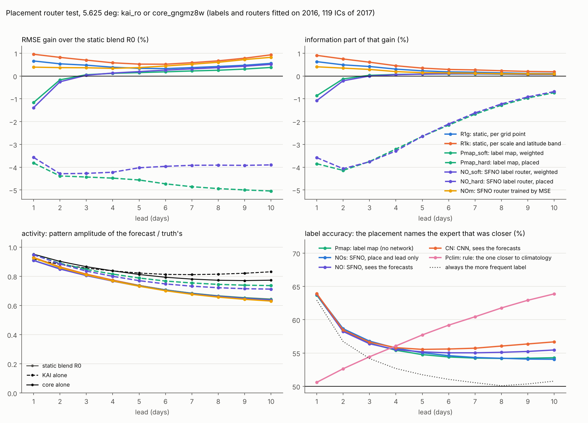

# 배치 라우터: KAI의 영역과 tendency core의 영역을 label로 나눠 SFNO로 배치하면? 5.625° 작은 시험 (2026-11-13)

제안(2026-11-13 21:12 ~ 21:14 KST, 요지): 혼합은 정보를 새로 만드는 단계가 아니라 지금 있는 예보를 잘 분배해서 예측 구조를 견고하게 하는 단계다. KAI가 잘하는 영역과 tendency core가 잘하는 영역이 다르므로, 그 영역에 label을 붙이고 neural operator(SFNO) 라우터가 "tendency label"과 "KAI label"을 구분해서 배치하도록 1단계로 학습한다. 구현은 github.com/neuraloperator/neuraloperator를 쓴다.

## 요약

**전제는 맞았습니다. 두 모델이 잘하는 영역은 실제로 다르고, 특히 규모(scale)에서 뚜렷합니다. 그런데 "누가 더 가까운가"라는 label로 한쪽을 골라 배치하면 지금의 혼합보다 3.6 ~ 4.3 % 나빠졌습니다. 영역 차이를 살리는 데 성공한 것은 label 학습이 아니라, 규모 × 위도대별로 가중을 다르게 주는 고정 혼합(학습 없음, +1.0 ~ +0.5 %)이었습니다.**

1. **영역은 다릅니다.** core의 영역은 지표 변수, z, t, 열대, 큰 규모(동서 평균과 행성 규모)이고, KAI의 영역은 v와 q, 그리고 작은 규모(동서 파수 10 이상)입니다. 작은 규모에서 core가 받는 최적 가중은 1일 0.68에서 10일 0.23까지 내려가고, 큰 규모에서는 10일에도 0.50 ~ 0.56입니다(2절).
2. **그런데 label은 약합니다.** 격자점 하나에서 core가 KAI보다 참값에 가까운 비율은 1 / 3 / 5 / 7 / 10일에 62.9 / 54.2 / 51.7 / 50.5 / 49.2 %입니다. 5일부터는 동전 던지기에 가깝습니다.
3. **label대로 한쪽만 고르는 배치는 혼합에 집니다.** SFNO label 라우터의 배치는 지금의 혼합(R0)보다 −3.6 / −4.3 / −4.0 / −3.9 / −3.9 %이고 650칸 가운데 646칸에서 나쁩니다. 이 가운데 정보 항이 −3.6 / −3.8 / −2.6 / −1.6 / −0.7 %입니다. 한쪽을 고르면 두 예보의 오차 가운데 서로 다른 부분이 평균으로 지워지는 이득을 버리기 때문입니다(4절).
4. **라우터의 확률을 가중으로 쓰면** 3일부터 혼합과 같아지고(0.0 / +0.2 / +0.3 / +0.5 %, 정보 0.0 ~ +0.1 %) 1일에는 −1.4 %입니다. "가까울 확률"은 "가장 좋은 가중"이 아니기 때문입니다.
5. **예보를 보는 것이 배치에 더한 정보는 없습니다.** 같은 SFNO에 예보를 보여 준 것과 장소만 보여 준 것의 정보 차이는 −0.1 / −0.5 / −0.3 / −0.1 / 0.0 %입니다. 긴 선행에서 예보를 본 라우터가 배운 것은 "기후값에 더 가까운 쪽을 고른다"였고(그 규칙 하나가 10일의 label을 63.9 % 맞힙니다), 그것은 골라서 하는 감쇠입니다(5절).
6. **SFNO와 CNN은 정보 항에서 차이가 없고**, 같은 SFNO를 label 대신 MSE로 학습하면 더 좋습니다(+1.8 / +0.3 / +0.2 / +0.2 / +0.3 %)(6절).
7. **제안의 방향에서 실제로 얻은 것: 규모별 배치.** 가중을 동서 파수 묶음(0 / 1~3 / 4~9 / 10 이상) × 위도대마다 따로 계산한 고정 혼합(R1k)은 지금의 혼합보다 +1.0 / +0.7 / +0.5 / +0.6 / +0.9 % 좋고(정보 +0.9 / +0.6 / +0.3 / +0.3 / +0.2 %), 650칸 가운데 626칸에서 좋고 나빠진 칸이 없습니다. 이 시험과 앞의 MoE 시험의 어떤 라우터보다 좋습니다. 학습이 없습니다(7절).
8. **"예측 활성"**: 한쪽을 고르는 배치는 활동도를 지킵니다(10일 0.71 ~ 0.74, 혼합 0.64). 다만 같은 활동도를 정보 손실 없이 주는 구조가 이미 있습니다. 되먹임 연결(loop)은 10일 활동도 0.76에 ACC가 혼합과 같습니다(8절).



## 1. 제안을 어떻게 옮겼나

말씀하신 것을 아래처럼 읽고 구현했습니다. 다르게 뜻하신 부분이 있으면 그 부분만 바꿔서 다시 돌릴 수 있습니다.

- **전문가 둘**: 미세조정 KAI(`kai_ro`)와 넓은 tendency core(`core_gngmz8w`, score Lr에서 가장 좋았던 core). 이 KAI는 저희가 4년으로 다시 학습한 것이고 원본 checkpoint가 아닙니다.
- **label**: 예보 하나(초기장, 선행일), 채널, 격자점마다 core가 KAI보다 참값에 가까우면 1(tendency label), 아니면 0(KAI label). 영역 label은 제곱 오차를 3 × 3 격자로 평균한 뒤 비교한 것입니다(9절).
- **라우터**: `neuralop.models.SFNO`(neuraloperator 2.0.0, torch-harmonics 0.9.4). 입력은 두 예보, 그 차이, 그날의 기후값, 위치, 선행일이고 출력은 채널과 격자점마다 logit 하나입니다. 폭 48, 4층, 0.65 M parameter.
- **1단계 학습**: label의 cross-entropy 하나로 학습합니다. epoch 수는 2016년에서 빼 둔 묶음(초기장 43개)의 loss로 고르고, 2016년 전체(초기장 178개)로 다시 학습했습니다.
- **쓰는 방법 둘**: 배치(p > 0.5인 곳은 core, 아닌 곳은 KAI)와 가중(p를 core의 가중으로).
- **평가**: 2017년 초기장 119개, 채점과 같은 식. 판정은 지금의 혼합(R0, 선행일 × 채널마다 가중 하나) 대비 전체 / 정보 / 진폭입니다.

대조(취약점을 가르기 위한 것):

| 이름 | 무엇 | 가르는 질문 |
| --- | --- | --- |
| R0, R1g | 지금의 혼합, 격자점별 고정 가중 | 기준 |
| R0k, R1k | 규모(동서 파수 묶음)별 고정 가중, 규모 × 위도대별 고정 가중. 닫힌 식 | 영역을 규모로 나눠 배치하면? |
| P0 | 측정한 표대로 배치: 선행일 × 채널마다 2016년 RMSE가 낮은 쪽 | 표만으로 배치하면? |
| Pmap | label 지도대로 배치: 선행일 × 채널 × 격자점마다 2016년에 더 자주 나온 label | network가 지도보다 나은가? |
| Pclim | 규칙: 예보가 기후값에 더 가까운 쪽 (맞춤 없음) | 라우터가 예보에서 배우는 것이 감쇠인가? |
| Poracle | 2017년의 참 label로 배치 | 배치의 상한 |
| NOs | 장소와 선행일만 보는 SFNO | 예보를 보는 것이 더하는 것 |
| CN | 같은 입력과 label의 CNN (0.50 M) | SFNO 구조가 더하는 것 |
| NOm | 같은 SFNO를 혼합 예보의 MSE로 학습 (R0에서 시작) | label 학습이 더하는 것 |

## 2. label: KAI의 영역과 core의 영역

2017년 예보에서 core가 KAI보다 참값에 가까운 격자점의 비율(%, 면적 가중, 선행 1 / 3 / 5 / 7 / 10일). 50보다 크면 core의 영역, 작으면 KAI의 영역입니다.

| 묶음 | 1일 | 3일 | 5일 | 7일 | 10일 |
| --- | --- | --- | --- | --- | --- |
| 전체 (65채널) | 62.9 | 54.2 | 51.7 | 50.5 | 49.2 |
| 지표 (t2m, msl, sp, tcwv, skt) | 75.7 | 66.0 | 62.5 | 60.4 | 58.7 |
| z | 71.3 | 59.8 | 55.9 | 54.0 | 51.7 |
| t | 67.0 | 55.5 | 52.2 | 50.4 | 48.5 |
| u | 59.0 | 52.1 | 50.4 | 49.5 | 48.8 |
| q | 58.8 | 50.9 | 49.0 | 48.1 | 47.1 |
| v | 53.3 | 47.7 | 46.7 | 46.5 | 46.1 |
| 열대 | 66.7 | 57.2 | 54.5 | 52.7 | 50.5 |
| 북쪽 중고위도 | 61.6 | 52.6 | 50.5 | 49.8 | 49.2 |
| 남쪽 중고위도 | 59.6 | 52.0 | 49.6 | 48.6 | 47.7 |

2016년의 RMSE로 보면 core가 KAI보다 좋은 채널은 65개 가운데 1일 65개, 3일 52개, 5일 44개, 7일 38개, 10일 29개입니다.

규모로 나누면 차이가 더 뚜렷합니다. 동서 파수 묶음마다 따로 계산한 core의 최적 가중입니다(R0k, 1에 가까우면 core의 영역).

| 규모 | 1일 | 3일 | 5일 | 7일 | 10일 |
| --- | --- | --- | --- | --- | --- |
| 묶음 없이 (지금의 혼합 R0) | 0.80 | 0.62 | 0.56 | 0.53 | 0.51 |
| 동서 평균 (k = 0) | 0.84 | 0.68 | 0.62 | 0.56 | 0.50 |
| 행성 규모 (k = 1~3) | 0.83 | 0.64 | 0.59 | 0.57 | 0.56 |
| 종관 규모 (k = 4~9) | 0.78 | 0.58 | 0.52 | 0.50 | 0.49 |
| 작은 규모 (k ≥ 10) | 0.68 | 0.47 | 0.39 | 0.32 | 0.23 |

읽는 법:

- "영역이 다르다"는 전제는 자료가 지지합니다. core는 지표와 z, 열대, 큰 규모에서, KAI는 v와 q, 작은 규모에서 상대적으로 낫습니다.
- 하지만 격자점 label의 차이는 작습니다. 가장 뚜렷한 지표 변수도 1일에 76 대 24이고, 대부분은 55 대 45 안쪽입니다. 5일 이후 전체는 반반입니다. 두 예보의 오차가 서로 많이 닮았기 때문에 "누가 더 가까운가"는 날마다 거의 우연으로 갈립니다.
- label이 얼마나 배울 수 있는 것인지를 cross-entropy로 보면(빼 둔 묶음, 동전은 0.6931): label 지도 0.6731, 장소만 보는 SFNO 0.6713, 예보를 보는 SFNO 0.6679, CNN 0.6650. 동전에서 4 % 내려간 것이 전부입니다.

## 3. 결과: 지금의 혼합(R0) 대비

이득 %, + = 좋아짐, 선행 1 / 3 / 5 / 7 / 10일. 65채널 nRMSE 기준, 항별 분해는 `scripts/eval_kai_breakdown.py`(정보 = 진폭을 가장 좋게 맞췄을 때 남는 pattern 항). 칸은 선행일 × 변수 650칸 가운데 95 % 구간이 0을 벗어난 수입니다.

| 변형 | 전체 | 정보 | 진폭 | 유의한 칸 (좋음 / 나쁨) | 10일 ACC | 10일 활동도 |
| --- | --- | --- | --- | --- | --- | --- |
| R0 지금의 혼합 | 기준 | | | | 0.259 | 0.64 |
| R1g 격자점별 고정 가중 | +0.7 / +0.5 / +0.3 / +0.4 / +0.6 | +0.6 / +0.4 / +0.2 / +0.2 / +0.1 | 0.0 / 0.0 / +0.1 / +0.2 / +0.4 | 612 / 0 | 0.264 | 0.64 |
| R0k 규모별 고정 가중 | +0.4 / +0.3 / +0.2 / +0.3 / +0.5 | +0.3 / +0.2 / +0.1 / +0.1 / +0.1 | 0.0 / 0.0 / 0.0 / +0.1 / +0.3 | 566 / 2 | 0.263 | 0.64 |
| **R1k 규모 × 위도대 고정 가중** | **+1.0 / +0.7 / +0.5 / +0.6 / +0.9** | **+0.9 / +0.6 / +0.3 / +0.3 / +0.2** | 0.0 / 0.0 / +0.1 / +0.2 / +0.6 | 626 / 0 | 0.267 | 0.63 |
| P0 표대로 배치 | −3.9 / −4.9 / −4.8 / −5.3 / −6.1 | −3.9 / −3.9 / −2.6 / −1.7 / −0.7 | −0.1 / −1.0 / −2.2 / −3.6 / −5.2 | 0 / 650 | 0.223 | 0.74 |
| Pmap label 지도대로 배치 | −3.8 / −4.4 / −4.6 / −4.9 / −5.0 | −3.9 / −3.8 / −2.7 / −1.7 / −0.7 | 0.0 / −0.7 / −2.0 / −3.2 / −4.4 | 1 / 643 | 0.232 | 0.74 |
| Pmap label 빈도를 가중으로 | −1.2 / +0.1 / +0.1 / +0.2 / +0.4 | −0.9 / 0.0 / +0.1 / +0.1 / +0.1 | −0.2 / 0.0 / +0.1 / +0.1 / +0.3 | 425 / 101 | 0.262 | 0.64 |
| NOs 장소만 보는 SFNO, 배치 | −3.5 / −4.0 / −4.2 / −4.7 / −5.3 | −3.5 / −3.3 / −2.3 / −1.5 / −0.6 | 0.0 / −0.7 / −1.8 / −3.2 / −4.7 | | 0.232 | 0.74 |
| **NO SFNO label 라우터, 배치** | **−3.6 / −4.3 / −4.0 / −3.9 / −3.9** | **−3.6 / −3.8 / −2.6 / −1.6 / −0.7** | 0.0 / −0.5 / −1.4 / −2.3 / −3.3 | 0 / 646 | 0.236 | 0.71 |
| **NO SFNO label 라우터, 가중** | **−1.4 / 0.0 / +0.2 / +0.3 / +0.5** | **−1.1 / 0.0 / +0.1 / +0.1 / +0.1** | −0.2 / 0.0 / +0.1 / +0.2 / +0.4 | 463 / 117 | 0.263 | 0.64 |
| CN CNN label 라우터, 배치 | −3.5 / −4.1 / −3.6 / −3.0 / −2.4 | −3.5 / −3.7 / −2.7 / −1.7 / −0.7 | 0.0 / −0.5 / −0.9 / −1.3 / −1.7 | | 0.235 | 0.68 |
| CN CNN label 라우터, 가중 | −1.1 / +0.1 / +0.3 / +0.6 / +1.0 | −0.9 / +0.1 / +0.1 / +0.1 / +0.1 | −0.2 / +0.1 / +0.2 / +0.4 / +0.8 | | 0.264 | 0.63 |
| NOm SFNO, MSE로 학습 | +0.4 / +0.4 / +0.4 / +0.5 / +0.8 | +0.4 / +0.3 / +0.1 / +0.1 / +0.1 | 0.0 / 0.0 / +0.2 / +0.3 / +0.7 | 557 / 4 | 0.264 | 0.63 |
| Pclim 기후값에 가까운 쪽 | −21.7 / −6.6 / −2.9 / −0.8 / +1.5 | −16.7 / −5.8 / −3.8 / −2.6 / −1.3 | −4.3 / −0.5 / +1.1 / +1.9 / +2.8 | 136 / 441 | 0.204 | 0.50 |
| Poracle 참 label로 배치 (상한) | +19.8 / +18.3 / +17.8 / +17.9 / +18.8 | +19.8 / +17.9 / +15.9 / +14.0 / +11.9 | −0.1 / +0.3 / +1.7 / +3.7 / +6.7 | 650 / 0 | 0.557 | 0.68 |

참고로 지금의 혼합(R0)은 KAI 혼자보다 +23.8 / +9.3 / +6.9 / +6.6 / +7.2 %(정보 +21.7 / +7.2 / +3.6 / +2.0 / +0.7 %), core 혼자보다 +3.8 / +5.7 / +6.2 / +6.6 / +7.5 %(정보 +3.7 / +4.4 / +3.2 / +2.0 / +1.0 %) 좋고, 650칸 모두에서 좋습니다. 혼자일 때의 10일 ACC는 KAI 0.214, core 0.218, 활동도는 0.83, 0.77입니다.

nRMSE 값(1 / 3 / 5 / 7 / 10일): KAI 0.2231 / 0.3366 / 0.4234 / 0.4830 / 0.5381, core 0.1766 / 0.3238 / 0.4206 / 0.4829 / 0.5399, R0 0.1699 / 0.3054 / 0.3943 / 0.4510 / 0.4995(score Lr의 `blend_core_gngmz8w@kai_ro`를 재현), R1k 0.1683 / 0.3032 / 0.3923 / 0.4483 / 0.4948, SFNO 배치 0.1760 / 0.3184 / 0.4102 / 0.4686 / 0.5190, SFNO 가중 0.1723 / 0.3053 / 0.3936 / 0.4496 / 0.4969, 참 label 배치 0.1363 / 0.2495 / 0.3242 / 0.3702 / 0.4054.

물리 단위 RMSE (선행 1 / 5 / 10일, 전체 표는 `variable_table_place.md`):

| 모델 | t2m (K) | t850 (K) | z500 (m²/s²) | u850 (m/s) | msl (hPa) |
| --- | --- | --- | --- | --- | --- |
| persistence | 1.43 / 2.71 / 3.04 | 2.30 / 4.03 / 4.28 | 504 / 974 / 1058 | 3.77 / 6.28 / 6.61 | 4.81 / 8.70 / 9.21 |
| climatology | 2.23 / 2.23 / 2.22 | 3.08 / 3.09 / 3.08 | 777 / 776 / 775 | 4.84 / 4.84 / 4.83 | 6.71 / 6.72 / 6.70 |
| 미세조정 KAI | 2.07 / 2.72 / 3.38 | 1.78 / 2.75 / 3.62 | 228 / 599 / 840 | 2.11 / 4.28 / 5.36 | 2.35 / 5.66 / 7.53 |
| 넓은 core | 0.88 / 2.07 / 2.76 | 1.18 / 2.78 / 3.78 | 147 / 586 / 815 | 1.79 / 4.35 / 5.40 | 1.76 / 5.58 / 7.38 |
| R0 지금의 혼합 | 0.87 / 1.98 / 2.59 | 1.15 / 2.55 / 3.37 | 144 / 557 / 774 | 1.72 / 4.07 / 5.03 | 1.71 / 5.29 / 6.99 |
| R1k 규모 × 위도대 고정 가중 | 0.87 / 1.97 / 2.56 | 1.14 / 2.54 / 3.34 | 143 / 556 / 774 | 1.71 / 4.06 / 5.00 | 1.70 / 5.29 / 6.95 |
| label 지도대로 배치 | 0.88 / 2.07 / 2.74 | 1.18 / 2.71 / 3.58 | 147 / 585 / 822 | 1.81 / 4.26 / 5.30 | 1.76 / 5.54 / 7.33 |
| SFNO label 라우터, 배치 | 0.88 / 2.07 / 2.72 | 1.18 / 2.69 / 3.50 | 148 / 585 / 809 | 1.79 / 4.26 / 5.31 | 1.77 / 5.52 / 7.25 |
| SFNO label 라우터, 가중 | 0.92 / 1.98 / 2.56 | 1.18 / 2.54 / 3.34 | 149 / 556 / 772 | 1.74 / 4.07 / 5.02 | 1.76 / 5.28 / 6.96 |
| SFNO, MSE로 학습 | 0.87 / 1.96 / 2.54 | 1.14 / 2.54 / 3.34 | 144 / 557 / 773 | 1.72 / 4.06 / 5.02 | 1.71 / 5.28 / 6.95 |

## 4. 왜 배치가 혼합에 지는가

- **한쪽을 고르면 평균의 이득을 버립니다.** 지금의 혼합이 더 좋은 쪽 전문가(core)보다 좋은 정도는 정보 항으로 +3.7 / +4.4 / +3.2 / +2.0 / +1.0 %입니다. 두 예보의 오차 가운데 서로 다른 부분이 섞을 때 지워지는 것입니다. SFNO 배치가 core보다 좋은 정도는 정보 +0.3 / +0.8 / +0.7 / +0.5 / +0.4 %로, 그 이득의 1 ~ 4할만 남습니다.
- **배치는 작은 규모에서 가장 크게 집니다.** SFNO 배치의 R0 대비 손실은 동서 평균 −0.2 / −3.4 / −4.0 / −3.2 / −1.2 %, 행성 규모 −2.3 ~ −3.9 %, 종관 규모 −3.0 ~ −3.9 %, 작은 규모 −5.8 / −8.7 / −10.5 / −12.5 / −14.5 %입니다. 고른 영역의 경계마다 두 예보가 맞닿는 이음매가 생기고, 작은 규모는 평균으로 지워지지도 않습니다.
- **배치가 혼합을 이기려면 label을 더 자주 맞혀야 합니다.** 참 label로 배치하면 +18 ~ +20 %이므로 배치라는 방식에 여지가 없는 것은 아닙니다. 하지만 라우터가 맞힌 비율은 63.8 / 56.4 / 55.2 / 55.0 / 55.5 %이고, 혼합과 같아지는 비율은 대략 69 / 65 / 64 / 63 / 63 %입니다(라우터의 결과와 참 label의 결과를 직선으로 이은 추정). 6 ~ 8 %p가 모자랍니다. 틀리는 자리가 고르게 흩어진다고 가정하면 77 / 67 / 66 / 66 / 67 %가 필요합니다.

| 배치 방법 | label을 맞힌 비율 % (1 / 3 / 5 / 7 / 10일) |
| --- | --- |
| 늘 더 흔한 쪽 | 62.9 / 54.2 / 51.7 / 50.5 / 50.8 |
| P0 표대로 | 62.9 / 54.9 / 53.4 / 52.8 / 51.9 |
| Pmap label 지도 (network 없음) | 63.7 / 56.5 / 54.8 / 54.2 / 54.3 |
| NOs 장소만 보는 SFNO | 63.8 / 56.8 / 55.0 / 54.3 / 54.1 |
| **NO 예보를 보는 SFNO** | **63.8 / 56.4 / 55.2 / 55.0 / 55.5** |
| CN 예보를 보는 CNN | 63.9 / 56.6 / 55.5 / 55.7 / 56.7 |
| Pclim 기후값에 가까운 쪽 (맞춤 없음) | 50.6 / 54.4 / 57.7 / 60.4 / 63.9 |

- **확률은 가중이 아닙니다.** 1일에 core가 더 가까울 확률은 63 %쯤이지만, MSE를 가장 낮추는 core의 가중은 0.80입니다(오차가 닮은 두 예보에서는 조금 더 좋은 쪽이 가중을 거의 다 가져갑니다). 그래서 확률을 그대로 가중으로 쓰면 1일에 −1.4 %입니다. 3일 이후에는 확률도 최적 가중도 0.5 근처라서 차이가 없습니다.

## 5. 예보를 본 라우터가 배운 것

같은 SFNO, 같은 label에서 예보를 보여 준 것(NO)과 장소와 선행일만 보여 준 것(NOs)의 차이입니다.

| 짝 | 전체 | 정보 | 진폭 |
| --- | --- | --- | --- |
| NO 대 NOs, 배치 | 0.0 / −0.3 / +0.1 / +0.8 / +1.3 | −0.1 / −0.5 / −0.3 / −0.1 / 0.0 | 0.0 / +0.2 / +0.4 / +0.8 / +1.3 |
| NO 대 NOs, 가중 | −0.1 / 0.0 / 0.0 / +0.1 / +0.2 | −0.1 / 0.0 / 0.0 / 0.0 / 0.0 | 0.0 / 0.0 / 0.0 / +0.1 / +0.2 |
| NO 대 label 지도, 배치 | +0.2 / +0.2 / +0.5 / +0.9 / +1.1 | +0.3 / 0.0 / 0.0 / +0.1 / 0.0 | 0.0 / +0.2 / +0.5 / +0.9 / +1.1 |

- 예보를 보면 7 ~ 10일의 RMSE가 0.8 ~ 1.3 % 좋아지지만 전부 진폭 항이고 정보 항은 0이거나 음수입니다. 활동도는 0.74 → 0.71로 내려갑니다.
- 무엇을 배웠는지는 Pclim 규칙이 보여 줍니다. "예보가 기후값에 더 가까운 쪽을 고른다"는 규칙은 맞춤이 전혀 없는데도 10일의 label을 63.9 % 맞힙니다. label 지도(54.3 %)와 예보를 보는 SFNO(55.5 %)보다 높습니다. 긴 선행에서 "누가 참값에 더 가까운가"의 가장 좋은 단서가 "누가 더 약하게 예보했는가"이기 때문입니다.
- 예보를 본 라우터의 선택이 이 규칙과 일치하는 비율은 10일에 56.9 %(SFNO), 60.0 %(CNN)이고, 장소만 본 라우터는 54.7 %입니다. label 학습을 더 잘할수록 이 규칙에 가까워지고, 그 끝은 Pclim입니다. Pclim은 10일 RMSE가 +1.5 % 좋지만 정보는 −1.3 %, 활동도는 0.50입니다.
- 즉 격자점 label을 맞히는 학습은 긴 선행에서 "견고한 배치"가 아니라 "더 흐린 쪽 고르기"로 갑니다. 앞의 MoE 시험에서 MSE로 학습한 라우터가 감쇠로 간 것과 같은 결론이 다른 loss에서도 나왔습니다.

## 6. SFNO 대 CNN, label 대 MSE

| 짝 | 전체 | 정보 | 진폭 |
| --- | --- | --- | --- |
| SFNO 대 CNN (같은 label, 배치) | −0.1 / −0.2 / −0.4 / −0.9 / −1.5 | −0.1 / −0.1 / +0.1 / +0.1 / 0.0 | 0.0 / −0.1 / −0.5 / −0.9 / −1.5 |
| SFNO 대 CNN (같은 label, 가중) | −0.2 / −0.1 / −0.1 / −0.3 / −0.5 | −0.2 / −0.1 / 0.0 / 0.0 / 0.0 | 0.0 / 0.0 / −0.1 / −0.2 / −0.4 |
| label 학습 대 MSE 학습 (같은 SFNO, 가중) | −1.8 / −0.3 / −0.2 / −0.2 / −0.3 | −1.5 / −0.3 / −0.1 / 0.0 / 0.0 | −0.2 / 0.0 / −0.1 / −0.2 / −0.3 |
| MSE로 학습한 SFNO 대 R1k 고정 가중 | −0.6 / −0.3 / −0.2 / −0.1 / −0.1 | −0.5 / −0.3 / −0.2 / −0.1 / −0.1 | 0.0 |

- SFNO와 CNN은 정보 항에서 같습니다. CNN이 RMSE로 조금 좋은 것은 진폭 항이고(5절의 규칙을 더 많이 배움), 구조의 우열로 읽을 수 없습니다.
- 같은 SFNO를 label로 학습한 것은 MSE로 학습한 것보다 나쁩니다. label은 오차의 크기와 두 오차의 닮은 정도를 버리고 부호만 남기기 때문입니다.
- MSE로 학습한 SFNO(+0.4 / +0.4 / +0.4 / +0.5 / +0.8 %)도 R1k 고정 가중(+1.0 / +0.7 / +0.5 / +0.6 / +0.9 %)보다 나쁩니다. 빼 둔 묶음의 loss는 4 epoch에서 최저이고 그 뒤로 올라갑니다(0.9755 → 0.9824, R0 0.9840). 한 해의 자료로는 network가 닫힌 식을 따라가지 못합니다.

## 7. 규모별 배치: 제안의 방향에서 얻은 것

SFNO가 CNN과 구조에서 다른 점은 규모(구면 조화 차수)마다 다른 연산을 한다는 것입니다. 그 부분만 학습 없이 꺼내면 "규모마다 다른 고정 가중"이 됩니다. 경도 방향의 Fourier 변환에서는 면적 가중 MSE가 파수마다 정확히 나뉘므로(Parseval), 파수 묶음마다 최적 가중을 닫힌 식으로 구할 수 있습니다. 혼합은 `KAI + irfft(w(k) · rfft(core − KAI))`입니다.

- **R0k**: 선행일 × 채널 × 파수 묶음(k = 0 / 1~3 / 4~9 / 10 이상). **R1k**: 여기에 위도대(22.5° 8개)를 더한 것.
- 2016년 안의 교차검증(상대 MSE, R0 = 1): R1 위도대 0.9933, R1g 격자점 0.9909, R0k 규모 0.9919, **R1k 규모 × 위도대 0.9838**.
- 2017년: R1k는 R0보다 +1.0 / +0.7 / +0.5 / +0.6 / +0.9 %, 정보 +0.9 / +0.6 / +0.3 / +0.3 / +0.2 %, 626칸 좋음 / 0칸 나쁨. 격자점별 가중(R1g)보다 +0.3 / +0.2 / +0.2 / +0.2 / +0.4 %(정보 +0.3 / +0.2 / +0.1 / +0.1 / +0.1 %) 좋습니다.
- 어디서: 동서 평균 +3.7 / +2.7 / +2.7 / +3.1 / +4.1 %, 행성 규모 +1.1 / +0.6 / +0.3 / +0.2 / +0.3 %, 종관 규모 +0.7 / +0.5 / +0.4 / +0.4 / +0.5 %, 작은 규모 +1.1 / +1.0 / +1.3 / +2.0 / +4.5 %. 변수로는 q +1.1 ~ +1.8 %, t +1.0 ~ +1.5 %가 크고 z는 +0.2 ~ +0.8 %입니다.
- 주의: 10일의 이득은 진폭 항이 더 큽니다(진폭 +0.6 %, 정보 +0.2 %). 7 ~ 10일에 작은 규모에서 얻는 +2.0 / +4.5 %는, 두 모델 모두 그 규모를 맞히지 못하는 선행이어서 최적 가중이 더 약한 쪽으로 간 결과로 봅니다(규모별로 항을 나누지는 않았습니다).
- 지표 변수는 격자점별 가중이 더 좋습니다(R1k 대 R1g −0.1 ~ −0.4 %, 50칸 가운데 37칸). 지표는 지형과 해륙 분포를 따라 영역이 갈리기 때문입니다. 변수마다 둘 가운데 나은 쪽을 고르는 것이 자연스러운 다음 단계인데 아직 하지 않았습니다.

정리하면, "영역을 나누어 배치한다"는 생각은 **가중을 연속으로 두고(고르지 않고), 영역을 규모와 위도대로 잡을 때** 이득이 됩니다.

## 8. 활동도 ("예측 활성")

| 모델 | 활동도 1 / 5 / 10일 | 10일 ACC | nRMSE 1 / 5 / 10일 |
| --- | --- | --- | --- |
| KAI 혼자 | 0.92 / 0.82 / 0.83 | 0.214 | 0.223 / 0.423 / 0.538 |
| core 혼자 | 0.95 / 0.81 / 0.77 | 0.218 | 0.177 / 0.421 / 0.540 |
| R0 지금의 혼합 | 0.93 / 0.74 / 0.64 | 0.259 | 0.170 / 0.394 / 0.500 |
| SFNO label 라우터, 배치 | 0.95 / 0.77 / 0.71 | 0.236 | 0.176 / 0.410 / 0.519 |
| label 지도대로 배치 | 0.95 / 0.79 / 0.74 | 0.232 | 0.176 / 0.412 / 0.525 |
| 되먹임 연결 (score Lr, `loop_core_gngmz8w@kai_ro`) | 0.93 / 0.79 / 0.76 | 0.257 | 0.170 / 0.399 / 0.522 |

- 한쪽을 고르면 섞지 않으므로 예보가 덜 흐려집니다(10일 0.71 ~ 0.74). 이것이 배치의 장점입니다.
- 하지만 같은 활동도를 정보 손실 없이 주는 구조가 이미 있습니다. 되먹임 연결은 10일 활동도 0.76에 ACC가 혼합과 같습니다(0.257 대 0.259). nRMSE는 1 ~ 3일에 혼합과 같고 5일에 1.3 %, 10일에 4.5 % 나쁜데 이것은 활동도의 값입니다. 배치는 모든 선행에서 3.6 ~ 4.3 % 나쁘고 ACC도 0.236으로 잃습니다.
- 그래서 "예측 활성"이 목적이면 혼합의 라우터보다 되먹임 연결 쪽이 맞는 자리라고 봅니다. 혼합은 RMSE를 낮추는 대신 흐려지는 구조이고, 그 둘을 한 번에 얻는 배치는 이 시험에서 찾지 못했습니다.

## 9. 영역 label (3 × 3 격자 평균)

제곱 오차를 3 × 3 격자(약 17° × 17°)로 평균한 뒤 비교한 label입니다. 격자점 label보다 덜 흔들립니다. 학습 없는 대조까지 끝났고 SFNO 라우터는 계산 중입니다(2026-11-13 22:20 KST).

- core가 더 가까운 영역의 비율: 73.8 / 56.4 / 51.7 / 49.4 / 46.6 % (격자점 label은 62.9 / 54.2 / 51.7 / 50.5 / 49.2 %). 1일에는 더 뚜렷해지고 5일 이후는 그대로 반반입니다.
- label 지도가 맞힌 비율: 75.3 / 61.5 / 58.5 / 57.7 / 58.2 %.
- label 지도대로 배치: nRMSE 0.1755 / 0.3177 / 0.4113 / 0.4723 / 0.5245, R0보다 −3.3 / −4.0 / −4.3 / −4.7 / −5.0 %.
- label 빈도를 가중으로: 0.1693 / 0.3044 / 0.3932 / 0.4495 / 0.4970, R0보다 +0.4 / +0.3 / +0.3 / +0.3 / +0.5 %. 격자점별 고정 가중 R1g(+0.7 / +0.5 / +0.3 / +0.4 / +0.6 %)에 가까워지지만 넘지 못합니다.
- 참 영역 label로 배치(상한): 0.1564 / 0.2701 / 0.3457 / 0.3935 / 0.4326, R0보다 +7.9 / +11.6 / +12.3 / +12.7 / +13.4 %.

## 10. 한계

1. **자료가 한 해입니다.** label과 라우터를 2016년 초기장 178개로 맞췄습니다. 다만 label의 약함(2절)은 자료량의 문제가 아니라 두 예보의 오차가 닮았다는 성질에서 옵니다.
2. **KAI가 원본이 아닙니다.** 4년으로 다시 학습한 KAI입니다. 32년 KAI에서는 영역의 경계가 달라질 수 있습니다.
3. **전문가 둘, 5.625°.** core는 넓은 core 하나만 썼습니다. 1.5°에서는 규모의 범위가 넓어서 규모별 배치의 여지가 더 클 수 있습니다(추측).
4. **SFNO의 격자.** 자료의 격자(위도 5.625° 간격의 칸 중심)는 torch-harmonics가 지원하는 격자가 아니어서 Gauss 격자로 취급했습니다(극 근처에서 최대 1.4° 차이). 구면 조화 변환이 정확하지 않습니다. 결과를 바꿀 정도라고 보지는 않지만 확인하지 않았습니다.
5. **SFNO의 크기와 seed.** 폭 48, 4층, seed 하나, 최대 8 epoch입니다. 다른 크기는 시험하지 않았습니다.
6. **label의 정의는 하나의 해석입니다.** 격자점마다 "더 가까운 쪽"으로 읽었습니다. 오차의 차이로 무게를 준 label, 규모별 label, 참 label을 흉내 내는 다른 단서(예: ensemble 퍼짐)는 시험하지 않았습니다.
7. R0k와 R1k의 파수 묶음 넷은 평가 script의 묶음을 그대로 쓴 것이고 고르지 않았습니다. 구면 조화 차수가 아니라 경도 방향 파수입니다.
8. 설치: `pip install torch-harmonics`가 torch를 2.15.0에서 2.14.1로 내렸습니다. 이 시험은 2.14.1에서 돌았습니다(전문가의 예보는 저장본이라 영향 없음).

## 11. 다음 단계 제안

1. **규모 × 위도대 고정 가중(R1k)을 혼합의 기본으로 넣는 것.** 학습이 없고, 나빠진 칸이 없고, 지금까지의 어떤 라우터보다 좋습니다. 지표 변수는 격자점별 가중(R1g)을 쓰도록 변수마다 교차검증으로 고르면 조금 더 얻을 것으로 봅니다. 채점 코드에는 아직 넣지 않았습니다.
2. **배치(고르기)를 살리려면 label을 맞힐 다른 단서가 필요합니다.** 지금 입력(두 예보, 기후값, 위치)으로는 55 ~ 64 %이고 63 ~ 69 %가 필요합니다. 후보는 예보의 불확실성을 직접 주는 것(seed가 다른 core들의 퍼짐, 초기장 섭동)인데, 그것이 label을 6 ~ 8 %p 올릴지는 모릅니다.
3. **"예측 활성"은 되먹임 연결에서.** 활동도를 지키면서 혼합의 정보를 갖는 것은 이미 되먹임 연결입니다. 라우터를 그쪽에 쓴다면 되먹임 가중(지금은 채널마다 하나)을 규모별로 나누는 것이 같은 생각의 연장입니다. rollout 안에서 맞춰야 해서 이 시험의 범위 밖입니다.

## 12. 재현

```bash
pip install neuraloperator torch-harmonics      # neuraloperator 2.0.0, torch-harmonics 0.9.4

# 전문가 예보 저장본은 docs/kai_blend_router.md 10절의 1번 (runs/kaitend/dump_router)
python scripts/kai_place_router.py --dump runs/kaitend/dump_router --cache data/era5_5p625/kaiday \
    --stats runs/kaitend/stats.npz --kai kai_ro --core core_gngmz8w --out runs/kaitend/place_A      # 약 37분, CPU 4개
python scripts/kai_place_router.py --dump runs/kaitend/dump_router --cache data/era5_5p625/kaiday \
    --stats runs/kaitend/stats.npz --kai kai_ro --core core_gngmz8w --out runs/kaitend/place_B \
    --label-win 1 --routers NO NOs                                                                   # 영역 label
python scripts/eval_kai_breakdown.py --stats runs/kaitend/stats.npz runs/kaitend/place_A/score_place.json \
    runs/kaitend/place_A/score_place_raw.npz runs/kaitend/place_A/breakdown "NO_hard:R0" "NO_soft:R0" "R1k:R0" "NO_hard:NOs_hard"
python scripts/plot_kai_place_router.py runs/kaitend/place_A runs/kaitend/stats.npz docs/kai_place_router/fig_place.png
```

`--routers`를 빈 목록으로 주면 학습 없는 대조만 4분에 돕니다.
