# KAI-α에 tendency core 올리기: 위치, 약점, 장기 장, 기억항, 물리항의 기억항, 최종 보완 모델 (2026-11-10)

## 요청을 이렇게 읽었습니다

소유자 요청(2026-11-10~11)은 일곱 번에 걸쳐 좁혀졌습니다.

1. "tendency core 파트를 KAI에 올려 보고, 원본과 비교해서 위치를 찾는다." 처음에는 KAI의 출력을 경향 형태로 바꾸는 것으로 읽었고, 소유자가 고쳤습니다: **core는 따로 학습하고, KAI의 step 가운데 어디에 넣을지를 확인한다.**
2. "(1) 약점의 극복 (2) 그 후 KAI에 적합한 구조로 적용 및 위치 판단." 단독 점수가 아니라 KAI의 예측력을 올리는 연결로 판정합니다.
3. "단기 장은 강하지만 장기 장이 너무 약하다. field에 대한 학습의 확장과 장의 확장이 필요하다."
4. "기억의 문제인 것 같다. Mori-Zwanzig를 GRU로 구현하고, 시간 예측 전에 과거의 시간 적분을 입력으로 넣는다." 이어서 "기억 loss는 단항이 아니라 sequence에 대한 Mori-Zwanzig 형태여야 한다."
5. "tendency core는 G(x)로 48개의 물리항인데, 이 물리항에 추가로 기억항도 만들어야 하지 않나."
6. "최종에서 좋은 결과를 확인하고 최종 보완 모델을 설계한다." (원문의 "보안"을 "보완"으로 읽었습니다.)
7. (2026-11-11) "분리했던 Mori-Zwanzig의 form들을 전부 합쳐 보면", "memory 구조로 장기적인 기억(3~5일)을 확실히, 그 효과를 memory 구조와 loss 구조로", 그리고 "kernel 식을 memory 항에 녹이고, 물리 tendency를 시간 누적해서 memory 항으로 넣는다." 7절이 이 요청입니다(학습과 채점은 끝났습니다, 7.1 ~ 7.9).

평가에 대한 요청도 둘 있었습니다: 좋아지고 나빠지는 정도를 항별로 나눌 것, 그리고 좋아지면 +, 나빠지면 −로 일관되게 쓸 것. 이 문서의 모든 변화량은 **이득**입니다(RMSE 이득 = RMSE 감소율 %, ACC 이득 = 증가량, + = 좋아짐).

tendency core의 정의는 소유자와 맞춘 문장을 씁니다: 물리 변수로 표현된 상태를 받아, 고정된 solver 안의 경향 함수 f를 rollout 오차로 학습하고, 그 결과 자료에 담긴 역학과 물리의 관계를 학습하는 구조입니다. NeuralGCM의 f는 방정식(고정) + 망이고, 우리 f는 망뿐입니다.

## 설정

| 부분 | 내용 |
| --- | --- |
| 자료 | ERA5 5.625°, 일평균(00/06/12/18 UTC), 67채널(채점 65채널). 학습 2012~15, 검증 2016, 시험 2017 (IC 119개, 선행 1~10일) |
| KAI | `third_party/kai` InceptionNeXt, 시험 크기 (2,2,4,2)/(24,48,64,96) 0.43 M, 2000 iteration. 원래 크기 7.57 M은 CPU에서 학습할 수 없습니다 |
| tendency core | `pgcfm.dyncore.DynCore`, dx/dt = f(x), Heun 한 step = 1일, hidden 48, 블록 (2,2), 0.19 M, 3000 iteration, rollout 1~4일 curriculum |
| 코드 | `pgcfm/kai_tend.py`(core, 위치 arm, 기억 core), `scripts/run_kai_tendency.py`(학습, 채점), `scripts/eval_kai_breakdown.py`(항별 평가), `scripts/diag_kai_memory.py`(잔차 기억 진단), `scripts/diag_kai_physmem.py`(물리항의 기억 진단), `scripts/plot_kai_longrange.py`(선행별 그림) |
| 환경 | CPU 4코어. core 학습 33분, KAI 12분, 채점 arm당 약 1분 |

지표는 65채널 정규화 RMSE(nRMSE; 지속성 0.381 / 0.581 / 0.625 / 0.654, 기후값 0.486), 이상 상관(ACC), 활동도(예측 이상장의 진폭 / 실제 진폭, 1이면 실제와 같은 세기)입니다. 표의 선행은 1 / 3 / 5 / 10일입니다.

## 1. 위치: KAI의 어디에 넣는가

| arm | 넣는 곳 | nRMSE 1 / 3 / 5 / 10일 |
| --- | --- | --- |
| kai | 원본 | 0.225 / 0.357 / 0.459 / 0.595 |
| res | 출력을 x + 망으로 (경향 형태만) | 0.207 / 0.375 / 0.482 / 0.618 |
| in, s2 | 입력, 2번째 stage에 core의 경향 τ | 0.220 / 0.363 / 0.479 / 0.755 |
| s4 | 마지막 stage | 발산 |
| out | core 예측 + KAI가 보정 | 0.192 / 0.347 / 0.455 / 0.597 |
| stack (대조) | core 자리에 학습된 res KAI | 0.185 / 0.344 / 0.455 / 0.608 |
| blend | 두 예측을 선행 × 채널 가중으로 섞음 (2016에서 맞춤, 학습 없음) | 0.197 / 0.331 / 0.417 / 0.517 |

- 망 안쪽(in, s1~s4)에 넣으면 1일은 조금 좋아지지만 rollout에서 무너집니다. τ를 0으로 두면 지속성으로 떨어지므로 망이 τ에 의존하게 되고, core의 오차가 KAI 안에서 증폭됩니다.
- 출력 위치(out)의 1~5일 이득은 대조 stack이 그대로 재현합니다. 즉 core 고유의 효과가 아니라 2단 구조의 일반 효과입니다.
- **core 고유의 이득은 섞는 위치(blend)에서 납니다.** KAI 대비 1 / 3 / 5 / 10일 +12 / +7 / +9 / +13 %, 650칸(변수 × 선행) 모두 좋아집니다. 두 모델의 오차가 서로 다르기 때문입니다(core는 지표, 경계층, 성층권과 3일 이후의 z, KAI는 상층 바람).

## 2. 약점의 극복

- **W1 전구 평균 drift (해결).** ClimODE ResidualBlock의 BatchNorm + Dropout은 eval 모드에서 IC와 무관한 편향을 만들고, 경향 모델은 이를 적분합니다(z500 전구 평균 −0.14 σ / 10일). GroupNorm으로 바꾼 core_gn은 편향 0, nRMSE 0.231 / 0.384 / 0.480 / 0.615에서 0.223 / 0.360 / 0.443 / 0.551이 됩니다. 이후 모든 core는 `--core-norm gn`입니다. 6 h core(12~26단계)는 아직 확인하지 않았습니다.
- **W2 상층 바람의 1일 오차.** 하루에 Heun 2 step(core_gn2)은 상층 바람 1일을 3 %만 줄이고 비용이 1.75배라 채택하지 않았습니다. 이 약점은 연결에서 KAI가 맡습니다(blend가 v250 1일에 KAI 0.77의 가중을 줍니다).
- **W3 흐림.** z500 k4~9 진폭이 10일에 0.57(KAI 0.71)입니다. 3절과 4절의 주제입니다.

## 3. 장기 장: 학습의 확장과 장의 확장

| arm | nRMSE 1 / 3 / 5 / 10일 | ACC 10일 | 활동도 10일 |
| --- | --- | --- | --- |
| KAI | 0.225 / 0.357 / 0.459 / 0.595 | 0.174 | 1.02 |
| 일 core (core_gn) | 0.223 / 0.360 / 0.443 / 0.551 | 0.193 | 0.79 |
| 3일 장 + 일 core | 10일 0.505 | 0.197 | |
| 5일 + 3일 장 + 일 core | 10일 0.494 | 0.166 | |
| 일 core, rollout 1~8일 학습 (core_gnk8) | 0.234 / 0.369 / 0.436 / 0.511 | 0.221 | 0.64 |
| blend(KAI, core_gn) | 0.197 / 0.331 / 0.417 / 0.517 | 0.227 | 0.69 |
| loop(KAI, core_gn; 매일 섞어 되먹임) | 0.197 / 0.331 / 0.420 / 0.539 | 0.226 | 0.79 |
| blend(KAI, core_gnh, core_gnk8) | 0.193 / 0.328 / 0.409 / 0.493 | 0.251 | 0.59 |

오차를 항으로 나누면 장기 RMSE 차이의 정체가 보입니다. 예측마다 MSE = 편향² + s_o²(1 − r²) + s_o²(a − r)²이고(s_o 실제 진폭, a 활동도, r 상관), 둘째 항은 상관이 올라야만 줄어드는 **정보 항**, 셋째 항은 RMSE가 장의 세기에 매기는 **진폭 비용**입니다(a = r로 약해진 장은 비용 0). 기여도는 65채널 nRMSE 이득에 정확히 더해지도록 만들었습니다.

| A 대 B, nRMSE 이득 % (1 / 5 / 10일) | 전체 | 정보 | 진폭 |
| --- | --- | --- | --- |
| core_gn 대 KAI | +0.5 / +3.5 / +7.3 | −1.1 / −0.2 / 0.0 | +1.2 / +3.5 / +7.0 |
| blend(KAI, core_gn) 대 KAI | +12.2 / +9.3 / +13.0 | +10.4 / +2.8 / +0.6 | +1.3 / +6.2 / +12.1 |
| blend(KAI, core_gnh, core_gnk8) 대 KAI | +14.1 / +11.0 / +17.0 | +12.2 / +3.3 / +0.9 | +1.4 / +7.4 / +15.7 |
| core_gnk8 대 core_gn | −5.0 / +1.7 / +7.3 | −4.9 / −0.5 / +0.4 | −0.1 / +2.2 / +6.9 |
| loop 대 blend | 0.0 / −0.9 / −4.2 | 0.0 / +0.1 / +0.1 | 0.0 / −0.9 / −4.3 |

- **7~10일의 RMSE 차이는 거의 모두 진폭입니다.** 긴 step(3일, 5일 장)과 긴 rollout 학습은 장을 기후값 쪽으로 약하게 만들어 RMSE를 줄일 뿐, 정보는 10일에 1 % 이하로만 늡니다. 긴 step은 자기 첫 step에서 정보를 잃습니다(3일 ACC 0.564 대 일 step 세 번 0.686).
- 단기(1일)의 이득은 진짜 정보입니다. blend의 1일 +12 % 가운데 +10 %가 정보 항입니다.
- loop은 blend와 같은 정보를 더 센 장(활동도 0.79 대 0.69)으로 냅니다. RMSE는 그만큼 손해입니다. 센 장기 장이 목표라면 RMSE만으로 판정하면 안 됩니다.
- 그래서 장기 arm의 판정 기준은 **7~10일의 정보 항과 활동도**입니다.

## 4. 기억 항: Mori-Zwanzig를 GRU로

소유자 가설(2026-11-10): 장기 장이 약한 것은 기억의 문제다. 분해된 상태(일평균, 5.625°)의 정확한 방정식은 dx/dt = Markov 항 + 기억 적분 + noise이고(Mori-Zwanzig; 첨부 논문 Widder, arXiv 2607.25855은 비정상, 비해밀턴 계에서 이 직교 동역학 방정식의 약해 존재 증명이며 kernel 추정이나 학습 방법은 없습니다), 일 core는 Markov 항만 가집니다.

### 4.1 구현

| core | 기억 | 입력 | loss |
| --- | --- | --- | --- |
| core_gn | 없음 | x | rollout 1~4일 |
| core_gnh | 1일 (lag 하나) | x, 어제부터의 변화 | 같음 |
| core_gnm (`--core-mem 8`) | ConvGRU 상태 m (24채널), IC 전 8일로 예열, 매 step 전에 [x, 변화]로 갱신 | x, m | 같음 |
| core_gnmz (`--core-mem 3 --core-mz`) | 같은 GRU, sequence 첫날에 빈 기억에서 시작, 세 번째 입력으로 예측 오차(innovation) | x, m | sequence의 모든 날의 1일 예측 + rollout, 잔차의 lag 1, lag 2 상관 벌점(직교 조건) |
| core_gnsq (`--core-mem 3 --core-mz --core-nomem`, 대조) | 없음 (기억 상태를 0으로 고정) | x | core_gnmz와 같음 |

core_gnmz가 소유자가 요청한 sequence 형태입니다("기억 loss는 단항이 아니라 sequence에 대한 Mori-Zwanzig 형태"). 첫 예측은 Markov 항만으로, 이후 예측은 그때까지의 기억으로 내고, noise 항이 과거와 직교해야 한다는 조건을 잔차의 시차 상관 벌점으로 넣었습니다.

### 4.2 결과 (2017, IC 119개; nRMSE 이득 %, 선행 1 / 3 / 5 / 7 / 10일)

| 비교 | 전체 | 정보 항 | 진폭 비용 |
| --- | --- | --- | --- |
| core_gnm 대 core_gn | +5.0 / +1.9 / +0.2 / −0.8 / −1.6 | +4.9 / +1.5 / +0.3 / 0.0 / 0.0 | +0.1 / +0.4 / −0.1 / −0.7 / −1.4 |
| core_gnmz 대 core_gn | +8.9 / +3.2 / +1.7 / +1.4 / +1.0 | +8.9 / +2.7 / +1.0 / +0.6 / +0.3 | +0.1 / +0.5 / +0.7 / +1.0 / +1.1 |
| core_gnmz 대 core_gnm | +4.1 / +1.3 / +1.5 / +2.2 / +2.5 | +4.1 / +1.2 / +0.7 / +0.6 / +0.3 | 0.0 / +0.1 / +0.8 / +1.7 / +2.5 |
| core_gnsq 대 core_gn (sequence 학습만의 몫) | +1.8 / −0.9 / −1.9 / −1.7 / −1.6 | +1.9 / −0.5 / −0.9 / −0.5 / −0.1 | −0.1 / −0.4 / −0.9 / −1.2 / −1.4 |
| **core_gnmz 대 core_gnsq (기억 항의 몫)** | +7.2 / +4.1 / +3.5 / +3.1 / +2.5 | +7.0 / +3.1 / +1.9 / +1.1 / +0.3 | +0.1 / +0.9 / +1.6 / +2.1 / +2.5 |
| blend(KAI, core_gnmz) 대 blend(KAI, core_gnsq) | +4.3 / +1.9 / +1.6 / +1.2 / +0.9 | +4.3 / +1.6 / +1.1 / +0.7 / +0.2 | 0.0 / +0.3 / +0.5 / +0.6 / +0.9 |
| blend(KAI, core_gnmz, core_gnk8) 대 KAI | +16.6 / +9.1 / +11.6 / +14.3 / +17.4 | +14.6 / +5.2 / +3.7 / +2.4 / +1.0 | +1.5 / +3.6 / +7.6 / +11.5 / +16.0 |

| | nRMSE 1 / 3 / 5 / 10일 | ACC 10일 | 1 step 검증 손실 | 잔차에 남은 기억 |
| --- | --- | --- | --- | --- |
| core_gn | 0.223 / 0.360 / 0.443 / 0.551 | 0.193 | 0.2751 | 4.5 % |
| core_gnh | 0.216 / 0.358 / 0.445 / 0.563 | 0.187 | 0.2669 | 3.5 % |
| core_gnm | 0.212 / 0.353 / 0.442 / 0.560 | 0.192 | 0.2621 | 2.6 % |
| core_gnmz | 0.203 / 0.349 / 0.436 / 0.545 | 0.198 | 0.2522 | 1.2 % |
| core_gnsq (대조) | 0.219 / 0.363 / 0.452 / 0.560 | 0.182 | 0.2693 | 2.2 % |

"잔차에 남은 기억"은 2016년 1 step 잔차의 분산 가운데 과거 잔차의 선형 결합으로 설명되는 비율입니다(`scripts/diag_kai_memory.py`). 직교 조건이 만족되면 0입니다.

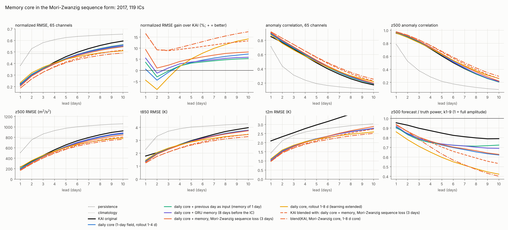

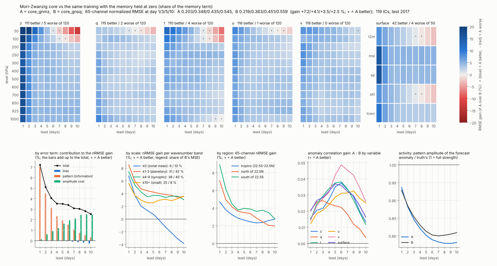

### 4.3 취약점 기준으로 본 것

1. **기억은 실제로 있고, 길이는 1~2일입니다.** 일 core의 잔차는 lag 1에 +0.09(z +0.27), lag 2에 −0.11의 자기상관을 가지고 lag 4부터 0입니다. 6시간 상태 네 개를 평균해 하루를 만드는 투영이 만드는 기억입니다(이론값 약 0.23). 학습된 GRU도 그만큼만 씁니다: 기억을 줄였을 때 1일 예측의 손실은 core_gnm에서 0일 −14.8 %, 1일 −3.2 %, 2일 −1.1 %, 4일 −0.1 %, core_gnmz에서 0일 −4.6 %, 1일 −0.3 %, 2일 0.0 %입니다.
2. **기억은 1~5일의 정보를 늘리고 장기 정보는 거의 늘리지 못합니다.** core_gnmz의 정보 이득은 1일 +8.9 %에서 10일 +0.3 %로 줄어듭니다. 장기 장이 약한 것은 기억만으로 풀리지 않습니다. 7~10일에 남는 것은 과거로 예측되지 않는 noise 항이고, 이는 앙상블(FM 편차)의 몫입니다.
3. **sequence 형태가 단순 기억보다 낫고, 그 이득은 기억 항의 것입니다.** 모든 선행에서 core_gnm보다 좋고(650칸 중 540칸), 잔차에 남은 기억을 2.6 %에서 1.2 %로 줄입니다. 대조로 같은 sequence 학습을 기억만 0으로 두고 돌리면(core_gnsq) 일 core 대비 1일에 +1.8 %뿐이고 3일부터는 오히려 나쁩니다(−0.9 / −1.9 / −1.7 / −1.6 %, 650칸 중 62칸 좋아지고 446칸 나빠짐). 기억 항의 몫(core_gnmz 대 core_gnsq)은 전체 +7.2 / +4.1 / +3.5 / +3.1 / +2.5 %, 정보 항 +7.0 / +3.1 / +1.9 / +1.1 / +0.3 %이고 613칸이 좋아집니다(1일 z +18.9 %, 지표 +11.7 %). KAI와 섞은 뒤에도 +4.3 / +1.9 / +1.6 / +1.2 / +0.9 %가 남습니다.
   1일의 +8.9 %를 나누면 sequence 학습 +1.8, 기억 망이 과거 없이 주는 몫 +3.0(IC에서 기억을 비운 core_gnmz 대 core_gnsq), 과거 며칠의 정보 +4.4입니다. 대조를 돌리기 전에는 빈 기억 시험(일 core 대비 +4.7 %)만 보고 '1일 이득의 절반쯤은 sequence 학습의 효과'라고 추정했는데, 틀린 추정이었습니다. 빈 기억에서도 GRU가 현재 상태를 한 번 받아 trunk에 넘기므로 그 시험은 기억 망을 끄지 못합니다.
4. **기억 core는 자유 rollout에서 동서 평균이 흐릅니다.** core_gnmz의 전구 평균 편향은 10일에 0.051σ(core_gn 0.022σ, core_gnm 0.037σ)이고 상층 q(−0.12~−0.16σ)와 성층권 z, t가 원인입니다. IC에서 기억을 비워도 같으므로(0.043σ) 예열 구간의 문제가 아니라, 학습한 rollout 길이(4일)를 넘어 자기 상태로 기억을 계속 갱신할 때 생기는 되먹임입니다. KAI와 섞으면 대부분 상쇄됩니다(3자 blend 0.025σ, KAI의 상층 q 편향은 부호가 반대).
5. 기억을 IC에서 얼리면(rollout 중 갱신 없음) 3일에 −47~−56 %로 무너집니다. 기억은 rollout 중에 갱신되어야 합니다.

## 5. 물리항 G(x)와 그 기억항

소유자 지적(18:10 KST): "tendency core는 G(x)로 48개의 물리항인데, 이 물리항에 추가로 기억항도 만들어야 하지 않나." 확인해 보니 이 KAI 시험의 일 core에는 G(x)가 없었습니다. G(x) = −R0(x)(이산 원시방정식 연산자가 낸 u, v, T, q × 12층의 경향, 18단계 `OperatorFeatures`)는 6시간 GPU core(dyn_gfeat, blend_band+)에만 들어가 있었고, 4절의 기억도 상태, 변화, 예측 오차를 적분한 것이었습니다. Mori-Zwanzig로 보면 일평균 상태만으로 계산한 G(x)가 Markov 항의 물리 부분이고, 하루 안의 운동이 더하는 부분이 기억 적분과 noise입니다.

### 5.1 학습 전 진단 (2016, 물리항이 있는 48채널, 설명되는 분산의 비율)

| 대상 | 오늘의 G(x)만 | + 어제의 G(x) | + 2~6일 전까지 |
| --- | --- | --- | --- |
| 실제 일 경향 | 4.9 % | 8.8 % | 9.1 % |
| core_gn이 못 맞힌 잔차 | 2.4 % | 3.6 % | 3.7 % |

물리항의 기억은 실제로 있고 길이는 하루입니다. 어제의 G와는 음의 상관(−0.15)이라 쓸모 있는 것은 물리 경향의 변화(오늘 − 어제)입니다. 잔차 자체의 기억(2.5 %)과는 다른 정보라 둘을 합치면 5.2 %입니다(`scripts/diag_kai_physmem.py`).

### 5.2 구현 (`--core-gfeat`)

- core_gng: 상태 + G(x) 48채널 (기억 없음).
- core_gngmz (`--core-gfeat --core-mem 3 --core-mz`): trunk 입력 [x, G(x), m], 기억 입력 [x, 변화, 예측 오차, G(x_t), G(x_{t−1})]. 변화와 어제의 G가 함께 들어가므로 "물리항이 지난 하루에 놓친 것"이 기억 입력의 선형 결합입니다. loss는 4절의 sequence 형태입니다.

### 5.3 결과: 2 × 2 (일 core 대비 nRMSE 이득 %, 선행 1 / 3 / 5 / 7 / 10일)

| core | 전체 | 정보 항 | 1 step 검증 손실 | 잔차 크기 |
| --- | --- | --- | --- | --- |
| core_gn (기준) | | | 0.2751 | 0.633 |
| core_gng: 물리항만 | +5.2 / +1.3 / −0.1 / −0.1 / +0.3 | +5.1 / +0.9 / −0.2 / −0.2 / −0.1 | 0.2637 | 0.602 |
| core_gnmz: 기억항만 | +8.9 / +3.2 / +1.7 / +1.4 / +1.0 | +8.9 / +2.7 / +1.0 / +0.6 / +0.3 | 0.2522 | 0.576 |
| core_gngmz: 물리항 + 기억항 | +12.7 / +4.0 / +1.1 / +0.3 / −0.5 | +12.5 / +3.4 / +0.5 / −0.1 / −0.3 | 0.2449 | 0.552 |

- 물리항의 기억항이 주는 몫(core_gngmz 대 core_gng): +7.8 / +2.7 / +1.2 / +0.4 / −0.8.
- 물리항이 주는 몫(core_gngmz 대 core_gnmz): +4.1 / +0.8 / −0.6 / −1.2 / −1.5.

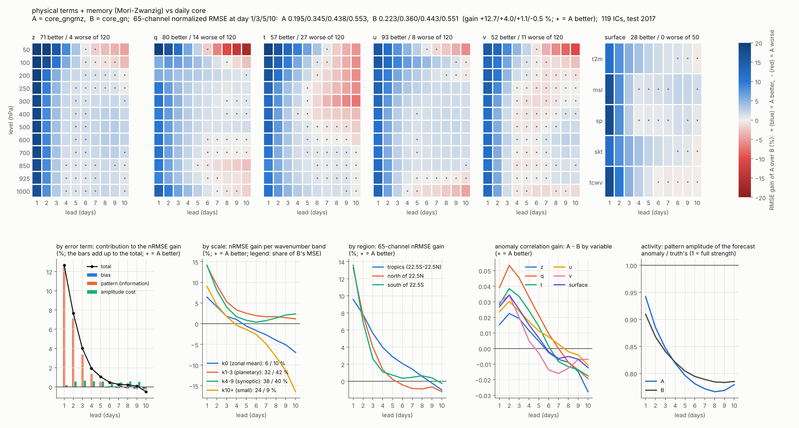

### 5.4 취약점 기준으로 본 것

1. **물리항과 기억항은 1~3일에서 서로 더해집니다.** 1일 이득이 물리항 +5.2, 기억항 +8.9, 둘 다 +12.7 %이고 거의 전부 정보 항입니다.
2. **물리항은 core 단독의 장기를 해칩니다.** 5일부터 정보 항이 음수가 되고 10일 ACC가 0.198에서 0.176으로 떨어집니다. G(x)가 core 자신의 틀어진 상태에서 계산되어 오차를 되먹이는 18단계의 현상입니다. 학습 중에도 rollout 길이를 늘리는 구간에서 core_gng의 검증 손실이 다시 올랐습니다(0.2610에서 0.2667).
3. 이 약점은 KAI와 매일 결합하면 사라집니다(6절).


## 6. KAI 연결과 최종 보완 모델

### 6.1 연결 방식 (core = core_gngmz, KAI 대비)

| 연결 | nRMSE 1 / 3 / 5 / 10일 | 10일 ACC | 10일 활동도 | 전체 이득 % (1 / 3 / 5 / 7 / 10일) | 정보 항 이득 % |
| --- | --- | --- | --- | --- | --- |
| KAI 원본 | 0.225 / 0.357 / 0.459 / 0.595 | 0.174 | 1.02 | | |
| core 단독 | 0.195 / 0.346 / 0.438 / 0.554 | 0.176 | 0.78 | +13.1 / +3.1 / +4.6 / +5.8 / +6.9 | +11.2 / +0.6 / +0.3 / 0.0 / −0.2 |
| 혼합 (blend) | 0.182 / 0.323 / 0.414 / 0.518 | 0.216 | 0.68 | +18.9 / +9.6 / +9.9 / +11.0 / +12.8 | +16.8 / +5.7 / +3.1 / +1.6 / +0.4 |
| 3자 혼합 (+ core_gnk8) | 0.182 / 0.322 / 0.405 / 0.491 | 0.252 | 0.57 | +18.9 / +9.8 / +11.8 / +14.3 / +17.5 | +16.8 / +5.8 / +3.8 / +2.3 / +0.9 |
| **매일 섞어 되먹임 (loop)** | 0.182 / 0.321 / 0.415 / 0.538 | 0.225 | 0.78 | +18.9 / +10.1 / +9.7 / +9.4 / +9.5 | +16.8 / +6.3 / +3.7 / +1.9 / +0.6 |
| **RMSE용 출력 (되먹임 궤적 + core_gnk8 혼합)** | 0.182 / 0.319 / 0.403 / 0.492 | 0.258 | 0.59 | +18.9 / +10.5 / +12.4 / +14.4 / +17.2 | +16.8 / +6.5 / +4.4 / +2.7 / +1.1 |

- **혼합이 잘 되는 이유.** KAI와 core는 오차 크기가 비슷하고(RMSE 비 0.87~0.95) 오차의 상관이 1일 0.56, 3~10일 0.63~0.69입니다(이 문단의 수치는 core_gnm으로 잰 값입니다). 겹치지 않는 오차는 평균에서 지워지고, 가중이 채널과 선행마다 따로라 나쁜 쪽은 거의 쓰이지 않습니다(1일 t2m의 KAI 가중 0.09, v250은 0.72).
- **되먹임 연결은 혼합보다 정보가 많고 장이 셉니다.** 정보 항이 3~10일에 +0.3~0.7 % 많고 활동도가 0.78(혼합 0.68)입니다. 10일 RMSE가 혼합보다 높은 것(−3.8 %)은 전부 진폭 비용입니다.
- **되먹임 안에서는 물리항의 장기 손실이 사라집니다.** loop(KAI, core_gngmz) 대 loop(KAI, core_gnmz)가 1 / 3 / 5 / 7 / 10일에 +2.8 / +1.2 / +0.6 / +0.1 / 0.0입니다(core 단독에서는 +4.1 / +0.8 / −0.6 / −1.2 / −1.5). KAI가 매일 상태를 바로잡아 G(x)가 틀어진 상태에서 계산되지 않습니다.
- **기억 core의 동서 평균 흐름도 사라집니다.** 10일 전구 평균 편향이 core 단독 0.039σ에서 0.030σ로(KAI 0.037σ), 상층 q는 −0.07σ에서 −0.01σ로 줄어듭니다.
- **RMSE용 출력은 3자 혼합과 같은 RMSE를 더 많은 정보로 냅니다.** 되먹임 궤적에 1~8일 core(core_gnk8)를 선행 × 채널 가중으로 섞으면 10일 nRMSE가 0.538에서 0.492가 됩니다(3자 혼합 0.491; 3자 혼합 대비 전체 0.0 / +0.7 / +0.7 / +0.2 / −0.3 %). 정보 항은 3자 혼합보다 0.0 / +0.7 / +0.7 / +0.4 / +0.2 % 많고, 10일 ACC 0.258은 이 시험에서 채점한 모든 조합 가운데 가장 높습니다. 다만 되먹임 궤적에 더해지는 RMSE 이득(10일 +8.5 %)은 대부분 진폭 비용이고(+7.8 %, 정보 +0.5 %) 활동도가 0.78에서 0.59로 내려갑니다. 센 장이 필요한 용도에는 되먹임 궤적을 그대로 씁니다.
- 되먹임 연결은 KAI 대비 650칸이 모두 좋아집니다(RMSE용 출력도 650칸 모두). 항목별 1일 / 10일 RMSE 이득은 지표 +48 / +33 %, z +34 / +8 %, t +32 / +10 %, q +23 / +15 %, u +17 / +8 %, v +8 / +6 %입니다.

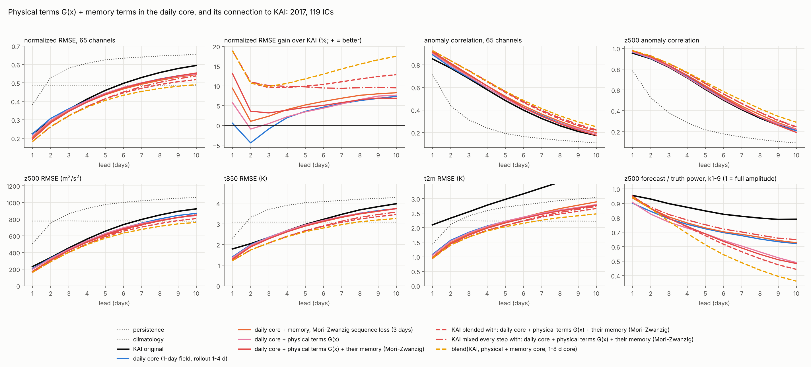

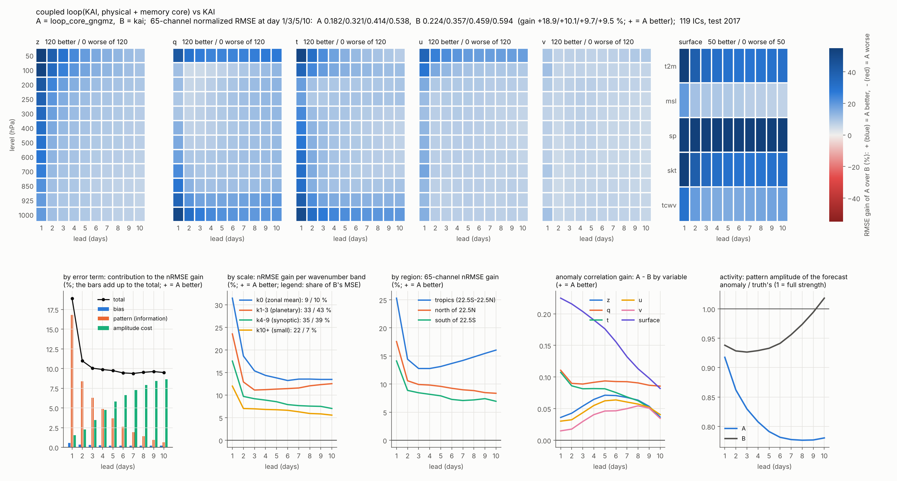

### 6.2 최종 보완 모델

    x(t+1) = w ⊙ KAI(x(t)) + (1 − w) ⊙ Core(x(t), G(x(t)), m(t))
    m(t)   = GRU(m(t−1), [x(t), x(t) − x(t−1), e(t), G(x(t)), G(x(t−1))])
    e(t)   = x(t) − Core가 낸 x(t)의 예측

| 요소 | 내용 | 근거 |
| --- | --- | --- |
| core의 정규화 | GroupNorm, dropout 없음 | 전구 평균 drift 제거 (2절) |
| 물리항 | G(x) 48채널을 core 입력으로 | 1일 +5.2 % (5절) |
| 기억항 | ConvGRU 24채널, 물리항까지 적분 | 1일 +7.8 % (물리항 위에서), 기억 길이 1일 (4, 5절) |
| 학습 | Mori-Zwanzig sequence loss (3일 sequence + rollout 1~4일 + 직교 벌점) | 단순 기억보다 모든 선행에서 좋음, 잔차에 남은 기억 1.0 %. 이득은 학습 방식이 아니라 기억 항의 것(대조 core_gnsq, 4.3) |
| 위치 | KAI 밖, 출력의 병렬 위치 | 망 안쪽은 rollout에서 무너짐 (1절) |
| 결합 | 채널별 가중 w(67개, 2016에서 맞춤)로 매일 섞고, 섞은 상태를 KAI, core, 기억의 다음 입력으로 | 정보는 혼합 이상, 활동도 0.78, 물리항과 기억의 약점 상쇄 (6.1) |
| RMSE용 출력 | 위 궤적에 1~8일 rollout core(core_gnk8)를 선행 × 채널 가중으로 섞음 | 10일 nRMSE 0.492(3자 혼합 0.491), ACC 0.258(가장 높음), 정보 항은 3자 혼합 이상 (6.1) |

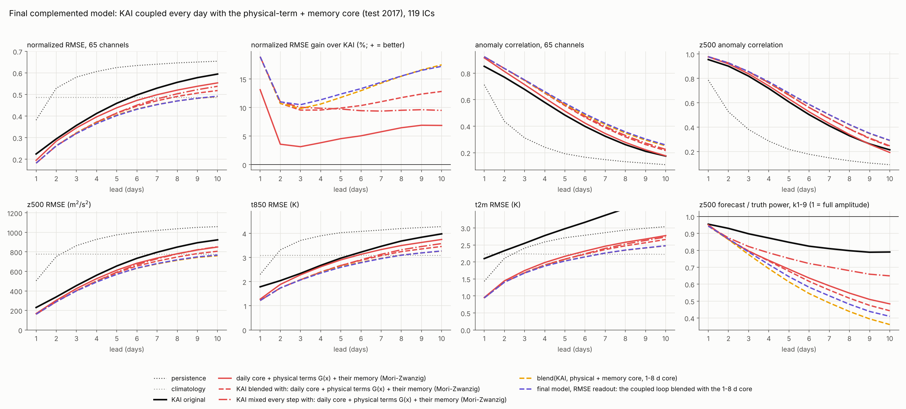

MZ core는 섞은 상태와 자기 예측의 차이를 예측 오차로 받으므로, KAI가 바로잡은 양이 기억의 입력이 됩니다. 한 번의 하루 step으로 정의되어 있어 10일 넘게도 그대로 굴릴 수 있습니다.

### 6.3 남은 약점

1. **시험 크기.** KAI는 0.43 M, 2000 iteration의 시험 크기이고 시험 연도는 2017 하나입니다. 원래 크기(7.57 M)의 KAI에서는 가중이 KAI 쪽으로 옮겨갈 수 있습니다. 아래 명령의 `--depths 3 3 15 3 --dims 48 96 192 288`로 GPU에서 확인해야 합니다.
2. **장기 정보는 여전히 작습니다.** 최종 모델의 10일 정보 이득은 KAI 대비 +0.6 %입니다. 기억과 물리항은 1~5일의 정보를 늘리고, 7~10일에 남는 것은 과거로 예측되지 않는 noise 항입니다. 장기 장의 세기는 평균 예측이 아니라 앙상블(FM 편차)로 채워야 하는 부분이고, 논문의 주 가정(회귀 평균 + FM 편차)과 이어집니다.
3. **활동도 0.78.** 되먹임 연결이 혼합(0.68)보다 세지만 실제(1)보다는 약합니다.
4. **기억 항의 이득 가운데 과거의 정보는 절반쯤입니다.** 기억 항의 1일 +7.2 % 가운데 +3.0은 과거 없이도 나오는 기억 망 경로의 몫이고, 기억이 실제로 쓰는 과거도 하루입니다(4.3). 기억을 더 길게 해서 장기 정보를 얻을 여지는 작습니다.
5. 가중 w는 채널마다 하나의 수이고 학습되지 않습니다. KAI를 얼린 core와 함께 rollout에서 미세조정하는 구조(gate arm, 코드에 있음)는 아직 돌리지 않았습니다.
6. **KAI 대비 7~10일의 이득은 rollout 미세조정한 KAI가 그대로 냅니다(7.6).** 최종 모델은 그 KAI 대비 +18.4 / +4.7 / +2.1 / +0.7 / 0.0 %이고, core가 더하는 것은 1~5일의 정보입니다. 또 같은 구조를 8일 sequence로 학습한 core_gngmz8이 연결에서 1일 +1.9 %, 3일 +0.4 % 더 좋아 core 교체를 제안했습니다(7.5).


## 7. 장기 기억: 형태의 통합, 누적, memory 항 안의 kernel (2026-11-11)

### 7.1 Mori-Zwanzig 형태를 따로 쓴 것과 합친 것 (일 core 대비 nRMSE 이득 %, 선행 1 / 3 / 5 / 7 / 10일)

| core | 들어간 형태 | 이득 |
|---|---|---|
| core_gnm | GRU (8일), 보통 loss | +5.0 / +1.9 / +0.2 / −0.8 / −1.6 |
| core_gnsq | sequence loss + 직교 loss, 기억은 0 | +1.8 / −0.9 / −1.9 / −1.7 / −1.6 |
| core_gng | 물리항 G(x)만 | +5.2 / +1.3 / −0.1 / −0.1 / +0.3 |
| core_gnmz | GRU + sequence loss + 직교 loss | +8.9 / +3.2 / +1.7 / +1.4 / +1.0 |
| core_gngmz | 위 전부 + 물리항의 기억 (3일 sequence) | +12.7 / +4.0 / +1.1 / +0.3 / −0.5 |

합친 것이 부분의 합보다 큽니다(1일: 5.0 + 1.8 < 8.9). 최종 모델의 core_gngmz가 이미 통합형이고, 합쳐지지 않은 형태는 8일 창 하나였습니다. 그것까지 넣은 core_gngmz8(`--core-gfeat --core-mem 8 --core-mz`)이 아래 장기 기억 구조들의 기준입니다.

### 7.2 이 구현을 memory 구조라고 할 수 있는가

하루짜리 기억으로는 그렇습니다. 근거는 셋입니다: 기억을 0으로 둔 대조(4.2절), 잔차에 남은 기억 4.5 % → 1.2 %, 기억을 자르거나 얼리는 시험. 장기 기억이나 엄밀한 Mori-Zwanzig 분해는 아닙니다: kernel을 추정하지 않았고, 직교 조건은 시차 1~2의 약한 벌점이며, 잡음 항이 없습니다. 논문에서는 "Mori-Zwanzig-motivated memory closure learned with a GRU"(Ma, Wang & E 2018)로 쓰는 것이 맞습니다.

### 7.3 장기 기억 구조 세 가지

학습된 GRU는 과거 하루만 씁니다. 3~5일의 과거를 구조로 보장하는 방법을 셋 구현했습니다.

| core | 구조 | 옵션 |
|---|---|---|
| core_gngmzL | 기억의 입력을 3일, 5일의 **고정** 지수 kernel로 누적한 z를 tendency 옆의 따로 선 항 g(z)로 | `--core-acc 3 5` |
| core_gngmzP | **kernel을 memory 항 안에**: 물리 tendency G, 같은 채널의 추세, innovation을 학습되는 kernel 시간으로 누적해 GRU 기억의 입력으로 | `--core-pacc 3 5` |
| core_gngmzK | 대조: 지난 8일의 기억 상태를 kernel network로 합친 M을 따로 선 항 g(M)으로 | `--core-kern 8` |

core_gngmzP가 소유자의 마지막 안입니다. tendency core는 물리항을 받아들이는 구조이므로 kernel도 옆에 세우지 않고 memory 항에 녹입니다. 이산 Mori-Zwanzig 식(Venturi & Li 2023, 식 92~97, 115)에서 기억은 `h(n+1) = A·h(n) + c(n)`이라는 누적 점화식이고 kernel은 수축 연산 A의 거듭제곱이라 지수로 옅어집니다(Theorem 6). 이 논문은 신경망의 layer를 시간으로 본 이론이므로 식의 형태에 대한 근거이고, 날씨 기억의 길이를 정해 주지는 않습니다.

    P_k(t) = a_k P_k(t−1) + (1 − a_k) G(x_t)        물리 tendency의 시간 누적 (48 물리항)
    D_k(t) = a_k D_k(t−1) + (1 − a_k) 추세(t)        같은 채널의 관측 추세 (D − P = 물리항이 그 기간에 놓친 양)
    E_k(t) = b_k E_k(t−1) + (1 − b_k) e(t)           innovation의 누적 (66채널)
    a_k = exp(−1/τ_k),  τ_k는 물리항(채널)마다 학습, 2~10일, 3일과 5일에서 시작
    m_t = GRU(m_{t−1}, [x_t, 추세, e_t, G_t, G_{t−1}, P_k, D_k, E_k]),   dx/dt = f(x, G(x), m)

τ의 하한이 2일이라 하루짜리 기억으로 돌아갈 수 없고, 학습 뒤의 τ가 물리항별 kernel 시간의 추정값입니다. loss는 세 구조 모두 같습니다: 하루의 잔차가 그 앞 3일, 5일에 걸쳐 누적된 잔차와 상관되지 않게 하는 직교 항(`--mz-acc-orth`)을 sequence loss에 더합니다.

### 7.4 학습 전 진단 (2016, core_gngmz, 선형, 격자점별)

`scripts/diag_kai_longmem.py`: IC 시점에 아는 과거가 선행 L일 예측 오차의 분산을 얼마나 설명하는가(%). 오늘의 상태와 어제 값만으로 1.2 / 1.5 / 1.2 / 1.0 %(선행 1 / 3 / 5 / 7일)이고, 3일과 5일로 누적한 과거가 +1.2 / +1.1 / +1.0 / +0.9 %p를 더합니다. q가 가장 크고(+1.7 ~ +2.0) z가 가장 작습니다.

무엇을 누적해야 하는지는 `--phys`로 봤습니다(물리항이 있는 48채널, 기준에 G(x_d), G(x_{d−1}) 포함).

| 더한 누적 | 1일 | 3일 | 5일 | 7일 |
|---|---|---|---|---|
| 물리 tendency G | +0.03 | +0.02 | +0.04 | +0.02 |
| 그 위에 추세 | +0.16 | +0.21 | +0.23 | +0.18 |
| 그 위에 innovation | +0.96 | +0.94 | +0.75 | +0.69 |

물리 tendency의 누적만으로는 정보가 거의 없고, 정보는 innovation의 누적(며칠 동안 같은 부호로 이어지는 예측 오차)에 있습니다. 그래서 core_gngmzP는 셋을 함께 누적합니다. 다만 선형 진단은 하한이고, rollout에서는 innovation이 0이 되는 반면 G와 추세는 계속 들어옵니다. 어느 누적이 일하는지는 채점에서 따로 끄고 잽니다(`~nophys`, `~noinn`).

### 7.5 결과 (2017, IC 119개; nRMSE 이득 %, 선행 1 / 3 / 5 / 7 / 10일)

| core | 단독: 최종 core(core_gngmz) 대비 | KAI 되먹임 연결: 최종 모델 대비 | 그 연결의 KAI 대비 |
|---|---|---|---|
| core_gngmz8 (같은 구조, 8일 sequence) | +2.9 / +0.4 / −0.6 / −0.6 / −0.9 | +1.9 / +0.4 / −0.2 / −0.1 / +0.2 | +20.5 / +10.4 / +9.5 / +9.3 / +9.7 |
| core_gngmzP (memory 항 안의 kernel) | +0.6 / −1.7 / −1.2 / −0.6 / −0.3 | +0.5 / −0.6 / −0.5 / −0.3 / +0.4 | +19.3 / +9.5 / +9.3 / +9.1 / +9.9 |
| core_gngmzL (고정 kernel 누적, 따로 선 항) | +2.5 / +0.3 / 0.0 / +0.4 / +1.1 | +1.3 / 0.0 / −0.2 / −0.1 / +0.3 | +19.9 / +10.1 / +9.5 / +9.3 / +9.8 |
| core_gngmzK (kernel network 대조, 따로 선 항) | +1.6 / −0.8 / −1.0 / −0.9 / +0.2 | +0.9 / −0.4 / −0.6 / −0.8 / −0.3 | +19.7 / +9.7 / +9.2 / +8.7 / +9.2 |

- **8일 sequence로 학습하는 것만으로 좋아집니다.** core_gngmz8은 최종 core와 구조와 parameter 수(259,842)가 같고 학습 열의 길이만 3일에서 8일로 늘렸습니다. 단독의 정보 항 이득이 +2.8 / +0.7 / −0.1 / −0.2 / −0.1이고, 긴 선행일의 손실은 진폭 항과 작은 규모(k10+)입니다. KAI 연결에서는 정보 항 +1.8 / +0.5 / 0.0 / 0.0 / 0.0, 유의하게 좋은 칸 227, 나쁜 칸 51이고 10일 ACC 0.228(최종 모델 0.225), 활동도는 0.78로 같습니다. RMSE용 출력도 +1.9 / +0.5 / +0.1 / +0.1 / +0.1입니다. **최종 모델의 core를 core_gngmz8로 바꾸는 것을 제안한 상태입니다.**
- **누적만의 효과는 손실입니다.** 같은 8일 sequence에서 누적의 유무만 다른 비교(core_gngmzP 대 core_gngmz8)가 −2.3 / −2.1 / −0.6 / 0.0 / +0.6이고 정보 항이 −2.1 / −1.9 / −0.7 / −0.2 / −0.1입니다(좋은 칸 74, 나쁜 칸 324). 연결에서도 −1.4 / −1.1 / −0.3 / −0.1 / +0.2입니다. 위 표에서 core_gngmzP가 최종 core보다 1일에 좋았던 것은 누적이 아니라 8일 sequence의 효과였습니다. 누적 입력 324채널이 기억의 입력에 더해지면서 3000 iteration 안에서는 짧은 선행일의 정보를 잃은 것으로 봅니다(한 단계 검증 오차 0.2436 대 0.2379).
- **3~8일째의 과거는 조금 쓰입니다.** 기억에 마지막 N일만 넣었을 때의 손실(8일 전체 대비):

| 기억 | core_gngmz8 | core_gngmzP | core_gngmzL | core_gngmzK |
|---|---|---|---|---|
| 0일 | −4.3 / −2.6 / −1.7 / −1.0 / −0.3 | −4.5 / −2.7 / −2.0 / −1.4 / −0.7 | −6.1 / −4.0 / −2.6 / −1.4 / −0.6 | −5.8 / −3.0 / −1.9 / −1.4 / −1.5 |
| 1일 | −0.3 / −0.7 / −0.6 / −0.4 / −0.1 | −0.4 / −0.6 / −0.8 / −0.5 / −0.1 | −1.4 / −1.3 / −0.9 / −0.3 / −0.2 | −1.0 / −0.9 / −0.7 / −0.6 / −0.8 |
| 2일 | +0.1 / −0.2 / −0.2 / −0.2 / 0.0 | −0.1 / −0.4 / −0.5 / −0.3 / −0.1 | −0.4 / −0.6 / −0.4 / 0.0 / 0.0 | −0.3 / −0.4 / −0.3 / −0.2 / −0.4 |
| 4일 | +0.1 / 0.0 / 0.0 / 0.0 / +0.1 | 0.0 / −0.1 / −0.1 / 0.0 / 0.0 | 0.0 / −0.1 / 0.0 / +0.2 / +0.2 | 0.0 / 0.0 / 0.0 / 0.0 / −0.1 |

  8일 sequence로 학습한 기준 core는 3~8일째의 과거를 3~5일 예보에 +0.2쯤 씁니다(3일 sequence의 최종 core는 0). 누적은 이것을 +0.4 ~ +0.5로 늘리지만 위의 손실이 더 큽니다.
- **누적을 채점 때 끈 시험(core_gngmzP).** 전부 끄면 −0.4 / −1.4 / −2.1 / −2.4 / −2.4(정보 항 −0.2 / −0.7 / −0.6 / −0.3 / 0.0), 물리 tendency와 추세의 누적만 끄면 −0.3 / −0.9 / −1.4 / −1.6 / −1.7로 거의 진폭 항, innovation의 누적만 끄면 0.0 / −0.5 / −0.6 / −0.5 / −0.4(정보 항 −0.1 / −0.4 / −0.4 / −0.2 / 0.0)입니다. 정보는 innovation의 누적에서 오고, 물리 tendency의 누적은 긴 선행일의 진폭을 조절합니다. 끄는 시험은 그 항과 함께 학습된 모델에서 효과를 크게 잡으므로 상한입니다.
- 학습된 kernel 시간은 2.86 ~ 3.07일과 4.80 ~ 5.14일로 처음 값(3, 5)에서 거의 움직이지 않았습니다. kernel 시간의 추정값이라고 할 수 없습니다.
- **고정 kernel 누적을 따로 선 항으로 넣은 core(core_gngmzL, 305,916; score Lj).** 8일 기준 core 대비 단독 −0.4 / −0.1 / +0.6 / +1.0 / +2.0인데, 정보 항은 −0.5 / −0.4 / 0.0 / +0.1 / +0.1이고 진폭 항이 0.0 / +0.3 / +0.5 / +0.7 / +1.7입니다. 긴 선행일의 이득은 진폭입니다. 구조는 의도대로 2~4일째의 과거를 더 씁니다(1일보다 오래된 과거의 몫이 1.4 / 1.3 / 0.9 %, 기준 core는 0.3 / 0.7 / 0.6 %; 3~4일째의 몫 0.4 / 0.6 / 0.4 %). 5~8일째는 쓰지 않습니다. 누적을 기억의 입력으로 넣은 core_gngmzP보다는 낫습니다(+1.8 / +1.9 / +1.2 / +0.9 / +1.3, 정보 항 +1.6 / +1.5 / +0.7 / +0.4 / +0.3). 채점 때 이 항을 끄면 −5.4 / −9.5 / −12.4 / −14.7 / −18.5이고 10일 활동도가 0.76에서 1.08로 올라갑니다. 이 항은 진폭과 동서 평균을 조절합니다. KAI 연결에서는 8일 기준 core의 연결보다 −0.6 / −0.4 / 0.0 / 0.0 / +0.1(정보 항 −0.6 / −0.5 / −0.1 / −0.1 / −0.1, 좋은 칸 99, 나쁜 칸 177)이라 **최종 core는 그대로 core_gngmz8입니다.** parameter가 46,074개 많은데 iteration은 같았으므로 짧은 선행일의 손실은 학습 부족일 수 있습니다(추측이고, 같은 parameter 수의 대조는 학습하지 않았습니다).

- **kernel network를 따로 선 항으로 둔 대조(core_gngmzK, 320,228; score Lm).** 지난 8일의 기억 상태를 M(t) = Σ K_s(x, m) · m(t − s)로 합쳐 tendency에 넣은 형태입니다. 8일 기준 core 대비 단독 −1.3 / −1.2 / −0.4 / −0.2 / +1.1이고 정보 항이 −1.2 / −1.2 / −0.5 / −0.3 / +0.1입니다(좋은 칸 74, 나쁜 칸 313). 10일의 +1.1은 진폭 항과 작은 규모(k10+ +7.1)입니다. KAI 연결에서는 −1.0 / −0.8 / −0.4 / −0.7 / −0.5로 모든 선행일에서 지고(좋은 칸 14, 나쁜 칸 348), 큰 규모의 위치 정보에서 집니다(z −2.0 / −2.2 / −1.2 / −1.5 / −1.0, 행성파 −1.4 / −1.3 / −1.1 / −1.0 / −0.4). RMSE용 출력의 KAI 대비 이득은 +19.7 / +10.3 / +12.2 / +14.2 / +17.1입니다. memory 항 안의 kernel(core_gngmzP)보다는 단독 1~3일에 낫고(+1.0 / +0.8 / +0.2 / −0.3 / +0.5) 연결의 7~10일에 못합니다(+0.4 / +0.2 / −0.1 / −0.5 / −0.7). **장기 기억 구조 세 가지 모두 8일 기준 core를 넘지 못했습니다.**
- 이 core는 kernel이 드러나 있어 읽을 수 있습니다. 배운 k0(지연 0~7일, 기억 channel 평균)가 0.39 / 0.21 / 0.13 / 0.10 / 0.06 / 0.04 / 0.03 / 0.00으로, 처음 값(0.26 / 0.20 / 0.16 / 0.12 / 0.09 / 0.07 / 0.06 / 0.04)에서 최근 쪽으로 움직였습니다. 평균 지연이 2.3일에서 1.4일로 줄었고 지연 0~3일이 87 %입니다. 기억 자르기(위 표)와 같은 방향입니다: 2일째의 과거가 0.7 / 0.5 / 0.4 %, 3~4일째가 0.3 / 0.4 / 0.3 %이고 5~8일째는 쓰이지 않습니다. 채점 때 kernel 항을 끄면 −6.9 / −11.1 / −12.5 / −13.3 / −14.8(정보 항 −4.5 / −4.4 / −2.9 / −1.4 / −0.4), kernel의 network만 끄고 k0만 남기면 −2.3 / −4.6 / −6.4 / −7.9 / −10.3(정보 항 −1.6 / −1.5 / −1.0 / −0.6 / −0.3, 동서 평균 오차 +58 %)입니다. network가 하는 일은 대부분 동서 평균과 진폭의 조절입니다. 끄는 시험은 상한입니다.

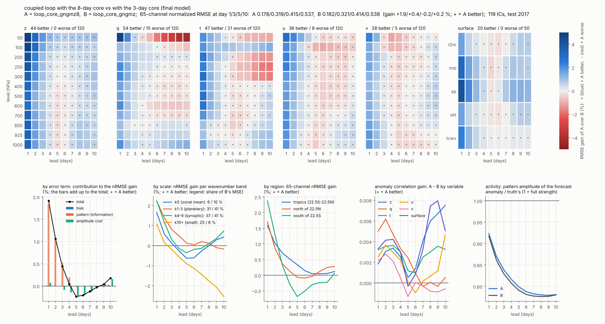

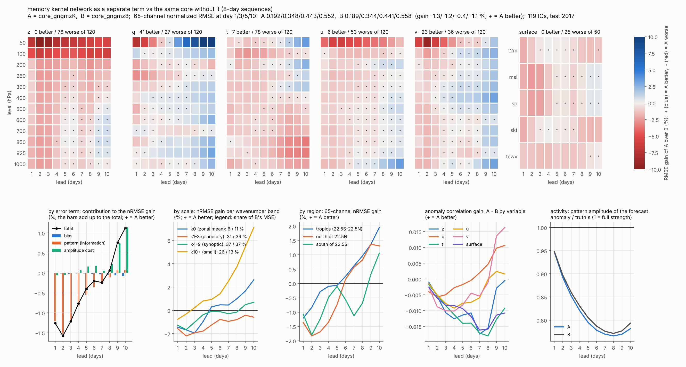

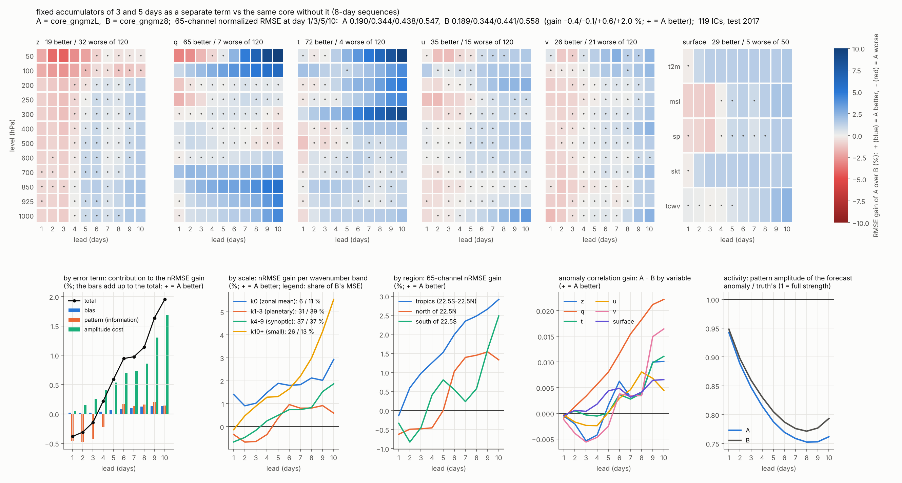

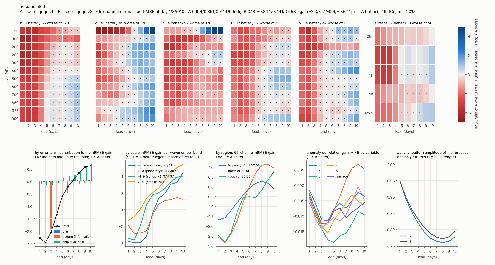

### 7.6 공정성 기준선: rollout으로 미세조정한 KAI (kai_ro)

같은 KAI(432,997)를 2~3일 rollout 손실로 1000 iteration 더 학습한 것입니다(`--arm kai --tag kai_ro --init kai --rollout 2 3 --lr 3e-4 --iters 1000`).

| 비교 | 전체 | 정보 항 | 진폭 항 | 10일 활동도 |
|---|---|---|---|---|
| kai_ro 대 KAI | +0.7 / +5.7 / +7.8 / +8.8 / +9.5 | +0.6 / +3.4 / +2.7 / +1.6 / +0.7 | +0.1 / +2.3 / +5.1 / +7.1 / +8.8 | 0.83 대 1.02 |
| 최종 모델 대 kai_ro | +18.4 / +4.7 / +2.1 / +0.7 / 0.0 | +16.4 / +3.2 / +1.1 / +0.3 / 0.0 | +1.4 / +1.2 / +0.7 / +0.1 / −0.2 | 0.78 대 0.83 |
| loop(KAI, core_gngmz8) 대 kai_ro | +19.9 / +5.1 / +1.8 / +0.5 / +0.2 | +17.9 / +3.7 / +1.1 / +0.3 / 0.0 | +1.4 / +1.1 / +0.5 / 0.0 / 0.0 | 0.78 대 0.83 |
| RMSE용 출력(core_gngmz8) 대 kai_ro | +19.9 / +5.6 / +5.0 / +6.3 / +8.6 | +17.9 / +3.9 / +1.9 / +1.2 / +0.5 | +1.4 / +1.5 / +2.8 / +4.8 / +7.7 | 0.59 대 0.83 |

- **KAI 대비 7~10일의 이득(+9.5 %)은 core의 것이 아닙니다.** KAI를 rollout으로 미세조정하는 것만으로 같은 크기가 나오고, 그 대부분은 진폭 항입니다(활동도 1.02 → 0.83). 6절의 "KAI 대비" 수치는 이 기준선과 함께 읽어야 합니다.
- **core가 더하는 것은 1~5일의 정보입니다.** kai_ro 대비 정보 항이 1일 +16 ~ +18, 3일 +3 ~ +4, 5일 +1, 7일 +0.3, 10일 0입니다.
- 7~10일에 연결 모델이 kai_ro를 이기는 곳은 지표(t2m 10일 +19 %), 하층의 비습과 925~1000 hPa 기온, 50~100 hPa, 열대(+5 %)이고, 지는 곳은 자유 대류권의 z, u, v(−1 ~ −3.5 %)와 중위도입니다.
- 한계: kai_ro는 KAI보다 1000 iteration을 더 학습했고, 위 표의 연결 모델은 KAI 쪽이 미세조정하지 않은 KAI입니다. 그래서 kai_ro 위에 core를 연결한 모델을 따로 채점했습니다(아래).

**kai_ro 위에 core를 연결한 모델 (score Ln; `--blend-bases kai kai_ro`, loop_core_gngmz8@kai_ro).** 새로 학습한 것은 없습니다.

| 비교 | 전체 | 정보 항 | 진폭 항 |
|---|---|---|---|
| loop(kai_ro, core_gngmz8) 대 kai_ro | +20.1 / +6.6 / +3.7 / +2.5 / +2.1 | +18.2 / +4.9 / +2.0 / +0.9 / +0.3 | +1.4 / +1.4 / +1.5 / +1.4 / +1.6 |
| loop(kai_ro, core_gngmz) 대 kai_ro | +18.6 / +6.2 / +4.2 / +2.9 / +2.2 | +16.7 / +4.5 / +2.1 / +1.0 / +0.3 | +1.3 / +1.5 / +1.8 / +1.7 / +1.8 |
| loop(kai_ro, core_gngmz8) 대 loop(KAI, core_gngmz8) | +0.3 / +1.6 / +2.0 / +2.0 / +1.9 | +0.4 / +1.2 / +1.0 / +0.6 / +0.3 | −0.1 / +0.3 / +1.0 / +1.4 / +1.7 |
| loop(kai_ro, core_gngmz8) 대 KAI | +20.7 / +11.9 / +11.3 / +11.0 / +11.4 | +18.6 / +7.9 / +4.6 / +2.5 / +0.9 | +1.5 / +3.7 / +6.5 / +8.4 / +10.3 |
| RMSE용 출력(kai_ro 쪽) 대 kai_ro | +20.1 / +6.8 / +6.0 / +7.0 / +9.0 | +18.2 / +4.9 / +2.6 / +1.6 / +0.7 | +1.4 / +1.6 / +3.1 / +5.1 / +8.0 |

- **공정한 기준선 위에서도 core가 더합니다.** kai_ro에 core를 연결하면 kai_ro 단독보다 모든 선행일에 낫습니다(유의한 칸 528개 이득, 1개 손실; nRMSE 0.178 / 0.314 / 0.407 / 0.471 / 0.527 대 0.223 / 0.336 / 0.423 / 0.483 / 0.538; 10일 ACC 0.239 대 0.214). 위에서 "7일부터 기준선과 같다"고 한 것은 연결 모델의 KAI 쪽만 미세조정하지 않았기 때문이었습니다.
- **core가 더하는 정보는 7일까지입니다.** 10일의 +2.1 %는 정보 +0.3과 진폭 +1.6입니다.
- **KAI를 미세조정한 효과와 core의 효과는 더해집니다.** 가장 좋은 조합은 kai_ro + core_gngmz8 연결입니다(8일 기준 core가 1일에 1.5 %p, 3일에 0.4 %p 크고, 3일 sequence core가 5~10일에 0.1 ~ 0.5 %p 큽니다).
- 약한 곳: v는 7일부터 이득이 없고, 작은 규모(k10+)는 10일에 −1.4 %, 남반구 중고위도는 10일에 +0.1 %입니다. core를 연결한 채로 KAI를 미세조정한 것은 아닙니다.

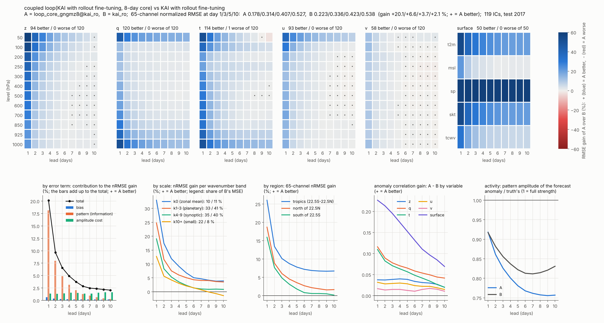

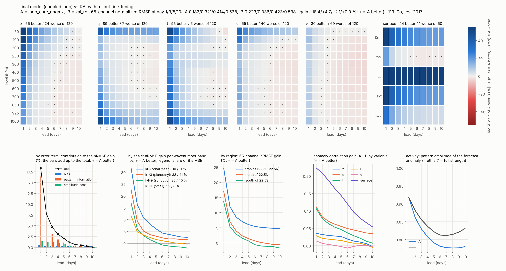

### 7.7 물리항 없는 기억 core를 8일 sequence로 (core_gnmz8, score Lo)

소유자(2026-11-11): "가장 좋은 것은 MZ loss + GRU + 기억항"(core_gnmz, 물리항 G(x) 없음, 3일 sequence), "8일 core까지 해보면". 두 가지로 읽고 둘 다 채점했습니다. (가) 같은 core를 8일 sequence로 학습한 core_gnmz8(`--core-mem 8 --core-mz`, 234,498). (나) 그 core와 8일 기준 core(core_gngmz8, 물리항 있음)를 함께 사용: KAI와 두 core를 선행일별, 변수별 가중치로 섞은 출력(`--blend-multi core_gnmz8+core_gngmz8`, 가중치는 2016년).

| 비교 | 전체 | 정보 항 | 진폭 항 |
|---|---|---|---|
| core_gnmz8 대 core_gnmz (단독) | +2.6 / +0.8 / −0.2 / −0.6 / −0.5 | +2.5 / +0.8 / 0.0 / −0.2 / −0.1 | 0.0 / 0.0 / −0.2 / −0.4 / −0.4 |
| core_gnmz8 대 core_gngmz8 (단독) | −4.6 / −0.5 / +1.0 / +1.2 / +1.9 | −4.5 / −0.5 / +0.6 / +0.7 / +0.5 | −0.1 / +0.1 / +0.5 / +0.6 / +1.5 |
| loop(KAI, core_gnmz8) 대 loop(KAI, core_gngmz8) | −3.3 / −1.2 / −0.4 / −0.6 / −1.0 | −3.2 / −1.1 / −0.4 / −0.3 / −0.1 | −0.1 / 0.0 / 0.0 / −0.3 / −0.9 |
| loop(kai_ro, core_gnmz8) 대 loop(kai_ro, core_gngmz8) | −3.3 / −0.9 / +0.1 / 0.0 / −0.2 | −3.1 / −0.9 / −0.1 / −0.2 / −0.1 | −0.1 / 0.0 / +0.2 / +0.2 / −0.2 |
| loop(kai_ro, core_gnmz8) 대 kai_ro | +17.5 / +5.7 / +3.8 / +2.5 / +1.8 | +15.7 / +4.0 / +1.9 / +0.7 / +0.2 | +1.3 / +1.5 / +1.7 / +1.5 / +1.4 |
| loop(kai_ro, core_gnmz) 대 kai_ro | +16.3 / +5.4 / +4.0 / +3.3 / +2.8 | +14.5 / +3.6 / +1.9 / +0.9 / +0.4 | +1.2 / +1.5 / +1.9 / +2.1 / +2.2 |
| blend(KAI, 두 core) 대 blend(KAI, core_gngmz8) | +0.7 / +1.3 / +2.2 / +2.7 / +3.5 | +0.7 / +1.1 / +1.2 / +1.0 / +0.5 | 0.0 / +0.2 / +1.0 / +1.7 / +2.9 |
| blend(kai_ro, 두 core) 대 blend(kai_ro, core_gngmz8) | +0.6 / +0.8 / +1.2 / +1.5 / +2.0 | +0.7 / +0.7 / +0.8 / +0.6 / +0.3 | 0.0 / +0.1 / +0.4 / +0.8 / +1.7 |
| blend(kai_ro, 두 core) 대 kai_ro | +20.6 / +7.4 / +6.3 / +6.7 / +8.2 | +18.7 / +5.4 / +2.9 / +1.6 / +0.6 | +1.3 / +1.7 / +3.1 / +4.9 / +7.4 |
| blend(kai_ro, 두 core) 대 RMSE용 출력(kai_ro 쪽, 7.6) | +0.6 / +0.6 / +0.3 / −0.3 / −1.0 | | |

기억을 자른 시험(기억 8일 대비 전체 이득): core_gnmz8 0일 −5.9 / −3.3 / −2.8 / −2.5 / −1.2(정보 −5.7 / −2.1 / −1.1 / −0.5 / −0.1), 최근 1일 −0.7 / −0.9 / −1.1 / −0.9 / −0.2(정보 −0.5 / −0.2 / −0.2 / −0.1 / 0.0), 최근 2일 0.0 / −0.3 / −0.6 / −0.6 / −0.2, 최근 4일 +0.1 / −0.1 / −0.3 / −0.2 / +0.1. core_gnmz 0일 −4.6 / −2.6 / −2.3 / −1.8 / −0.7, 최근 1일 −0.3 / −0.4 / −0.5 / −0.4 / −0.1. core_gngmz8 0일 −4.3 / −2.6 / −1.7 / −1.0 / −0.3. 한 step 잔차(2016): core_gnmz 0.5759, core_gnmz8 0.5614, core_gngmz8 0.5366.

- **8일 sequence 학습은 물리항 없는 core에도 짧은 선행의 이득을 줍니다**(1일 +2.6 %, 물리항이 있는 core는 +2.9 %). 5~10일의 손실 0.2 ~ 0.6 %는 주로 진폭(동서 평균)입니다.
- **단독으로는 5일부터 물리항 없는 core가 낫습니다**(+1.0 / +1.2 / +1.9, 정보 +0.6 / +0.7 / +0.5; 10일 ACC 0.192 대 0.175). 이득은 작은 규모에 몰려 있습니다(k10+ +4.2 / +8.9 / +21.7). 물리항은 예보 자신의 상태에서 계산하므로 혼자 달릴 때 작은 규모의 오차가 쌓이는 것으로 읽습니다. 1~3일은 물리항이 있는 쪽이 낫습니다.
- **연결에서는 물리항이 있는 core가 낫거나 같습니다**(KAI 위 유의한 칸 10개 이득, 403개 손실; kai_ro 위 56 대 265). KAI가 상태를 잡아 주므로 물리항 core의 긴 선행 약점이 사라집니다. 가장 좋은 궤적 모델은 그대로 kai_ro + core_gngmz8 연결입니다.
- **물리항이 없으면 기억항이 더 많은 일을 합니다**(기억 제거 1일 −5.9 % 대 −4.3 %). 8일 학습은 이틀 이상 지난 과거를 더 쓰게 하지만 그 대부분은 진폭 조절이고, 5~8일 전의 몫은 0.3 % 이하입니다.
- **두 core를 함께 섞으면 한 core만 섞을 때보다 낫습니다**(650칸 가운데 647칸 이득, 손실 0칸). 가중치(KAI / core_gnmz8 / core_gngmz8, 변수 평균)는 1일 0.23 / 0.26 / 0.51, 10일 0.27 / 0.41 / 0.33입니다. 다만 장이 약해지는 출력이고(10일 활동도 0.60 ~ 0.62), 지금의 RMSE용 출력과는 5일까지 비슷하고 7~10일은 집니다.
- 한계: 혼합의 이득이 "물리항 없는 core"라서인지 "두 번째 core"라서인지는 같은 구조의 core 둘을 섞는 대조가 없어 아직 가르지 못했습니다. 두 core를 KAI와 매일 되먹이는 연결은 아직 채점하지 않았습니다. (둘 다 7.8에서 채점했습니다.)

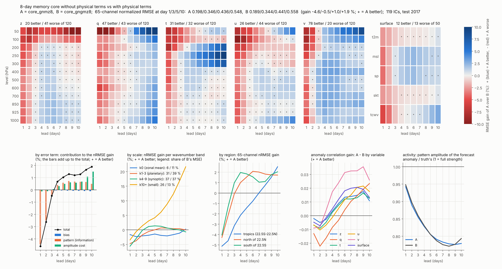

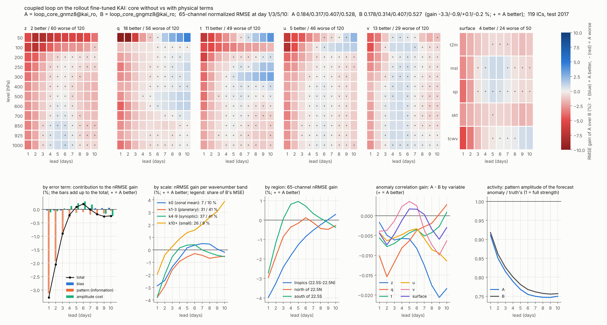

### 7.8 KAI와 두 core를 매일 되먹이는 연결, "두 번째 core" 대조 (score Lp)

7.7의 한계 두 가지를 채점했습니다. 새 학습은 없습니다. (가) 두 core 연결: KAI, core_gnmz8(물리항 없음), core_gngmz8(물리항 있음)을 매일 섞고 섞은 상태를 셋 모두의 다음 입력으로 되먹입니다(`--loop-multi core_gnmz8+core_gngmz8`, 가중치는 2016년에서 맞춘 선행 1일의 변수별 값). (나) 대조: 두 번째 core도 물리항이 있는 core_gngmz(같은 구조, 3일 sequence)로 바꾼 연결과 혼합(`core_gngmz+core_gngmz8`).

| 비교 | 전체 | 정보 항 | 진폭 항 |
|---|---|---|---|
| loop(KAI, 두 core) 대 loop(KAI, core_gngmz8) | +0.7 / +1.2 / +1.1 / +0.5 / −0.3 | +0.7 / +1.0 / +0.7 / +0.3 / +0.1 | 0.0 / +0.2 / +0.3 / +0.1 / −0.4 |
| 대조: loop(KAI, 물리항 core 둘) 대 loop(KAI, core_gngmz8) | +0.2 / +0.4 / +0.5 / +0.4 / +0.2 | +0.2 / +0.3 / +0.3 / +0.2 / +0.1 | 0.0 / +0.1 / +0.2 / +0.2 / +0.1 |
| loop(KAI, 두 core) 대 대조 | +0.5 / +0.8 / +0.5 / +0.1 / −0.5 | +0.5 / +0.7 / +0.4 / +0.1 / +0.1 | 0.0 / +0.1 / +0.1 / −0.1 / −0.6 |
| loop(kai_ro, 두 core) 대 loop(kai_ro, core_gngmz8) | +0.6 / +1.0 / +0.8 / +0.2 / −0.5 | +0.7 / +0.9 / +0.6 / +0.2 / +0.1 | 0.0 / +0.1 / +0.2 / 0.0 / −0.6 |
| 대조: loop(kai_ro, 물리항 core 둘) 대 loop(kai_ro, core_gngmz8) | +0.2 / +0.4 / +0.4 / +0.3 / +0.1 | +0.2 / +0.3 / +0.3 / +0.1 / 0.0 | 0.0 / +0.1 / +0.2 / +0.2 / 0.0 |
| loop(kai_ro, 두 core) 대 대조 | +0.5 / +0.7 / +0.4 / −0.1 / −0.5 | +0.5 / +0.6 / +0.4 / +0.1 / 0.0 | 0.0 / 0.0 / 0.0 / −0.2 / −0.6 |
| loop(kai_ro, 두 core) 대 kai_ro | +20.6 / +7.5 / +4.5 / +2.7 / +1.6 | +18.7 / +5.7 / +2.6 / +1.2 / +0.3 | +1.3 / +1.5 / +1.7 / +1.3 / +1.1 |
| loop(KAI, 두 core) 대 KAI | +21.0 / +11.5 / +10.5 / +9.7 / +9.4 | +18.8 / +7.7 / +4.3 / +2.2 / +0.7 | +1.6 / +3.6 / +5.9 / +7.3 / +8.4 |
| blend(KAI, 물리항 core 둘) 대 blend(KAI, core_gngmz8), 대조 | +0.2 / +0.6 / +1.1 / +1.5 / +2.2 | +0.2 / +0.4 / +0.5 / +0.4 / +0.2 | 0.0 / +0.2 / +0.6 / +1.0 / +2.0 |
| blend(KAI, 두 core) 대 blend(KAI, 물리항 core 둘) | +0.5 / +0.8 / +1.2 / +1.3 / +1.3 | +0.5 / +0.7 / +0.8 / +0.6 / +0.3 | 0.0 / +0.1 / +0.4 / +0.7 / +1.0 |
| RMSE용 출력(loop(kai_ro, 두 core) + core_gnk8) 대 RMSE용 출력(kai_ro 쪽, 7.6) | +0.6 / +0.8 / +0.4 / 0.0 / −0.2 | +0.7 / +0.8 / +0.4 / +0.1 / 0.0 | 0.0 / 0.0 / 0.0 / −0.1 / −0.2 |
| 같은 RMSE용 출력 대 blend(kai_ro, 두 core) (7.7) | 0.0 / +0.2 / +0.1 / +0.3 / +0.8 | 0.0 / +0.3 / +0.1 / +0.1 / +0.1 | 0.0 / −0.1 / −0.1 / +0.2 / +0.5 |
| 같은 RMSE용 출력 대 kai_ro | +20.6 / +7.6 / +6.3 / +7.0 / +8.9 | +18.7 / +5.7 / +3.0 / +1.7 / +0.7 | +1.3 / +1.6 / +3.0 / +5.0 / +7.8 |

nRMSE(kai_ro 위): 두 core 연결 0.177 / 0.311 / 0.404 / 0.470 / 0.529, core_gngmz8만 0.178 / 0.314 / 0.407 / 0.471 / 0.527, 대조 0.178 / 0.313 / 0.405 / 0.469 / 0.526, RMSE용 출력 0.177 / 0.311 / 0.396 / 0.449 / 0.490. ACC: 두 core 연결 0.929 / 0.764 / 0.584 / 0.418 / 0.243, core_gngmz8만 0.928 / 0.758 / 0.575 / 0.411 / 0.239. 선행일 전체(kai_ro 위, 두 core 대 한 core): +0.6 / +0.8 / +1.0 / +1.0 / +0.8 / +0.6 / +0.2 / −0.1 / −0.3 / −0.5. 가중치(KAI / core_gnmz8 / core_gngmz8, 변수 평균): 0.24 / 0.25 / 0.51, 대조(KAI / core_gngmz / core_gngmz8) 0.26 / 0.19 / 0.55; 변수군별로 z 0.12 / 0.35 / 0.53, 지표 0.02 / 0.62 / 0.36, v 0.47 / 0.13 / 0.40.

- **두 core를 함께 되먹이면 선행 1~7일에 0.2 ~ 1.0 % 좋아지고, 정보는 모든 선행일에서 늡니다**(kai_ro 위 유의한 칸 477개 이득, 81개 손실). 선행 9~10일의 손실은 진폭입니다(활동도 0.76 → 0.77; z, u, v의 진폭 항 −0.9 / −0.6 / −1.3).
- **이득의 3분의 1에서 절반은 "core가 하나 더 있어서"입니다**(대조 +0.2 / +0.4 / +0.4 / +0.3 / +0.1). 나머지(+0.5 / +0.7 / +0.4, 정보 +0.5 / +0.6 / +0.4)가 두 번째 core가 물리항 없는 기억 core라서 생기는 몫이고, z(+2.3 / +1.2 / +0.7)와 지표 변수(+1.4 / +1.2 / +0.9)에 몰려 있습니다. 두 core가 서로 다른 정보를 갖는다고 읽습니다. **(이 해석은 7.9의 같은 조건 대조에서 기각됐습니다: 대조의 core_gngmz가 3일 학습의 약한 core여서 "core 하나 더"의 몫을 작게 쟀습니다.)**
- **7.7의 혼합 이득도 같은 방식으로 갈립니다.** 선행 5~10일의 절반 이상(+1.1 / +1.5 / +2.2)은 같은 구조의 core를 하나 더 섞어도 나오고 대부분 진폭입니다. 물리항 없는 core의 몫은 +0.5 / +0.8 / +1.2 / +1.3 / +1.3(정보 +0.5 / +0.7 / +0.8 / +0.6 / +0.3)입니다.
- **궤적 모델**: loop(kai_ro, 두 core)가 선행 1~7일에서 loop(kai_ro, core_gngmz8)를 조금 넘고 9~10일은 집니다. 차이가 1 % 이하이고 core 계산이 두 배(parameter 43.3만 + 49.4만)라서, 가장 좋은 조합을 바꿀지는 정하지 않았습니다. **(7.9: 가장 좋은 조합은 loop(kai_ro, core_gngmz8 둘)입니다.)**
- **RMSE용 출력**: 두 core 연결의 것이 선행 1~5일에 지금까지 가장 낮고(0.177 / 0.311 / 0.396), 7~10일은 7.6의 것과 같습니다.
- 한계: core의 학습 seed가 하나입니다(초기장에 대한 신뢰구간은 좁습니다: 선행 3일 +1.0, +0.9 ~ +1.1). 대조의 두 번째 core는 3일 sequence, core_gnmz8은 8일 sequence로 학습해서 "물리항이 없어서"와 "sequence 길이가 달라서"를 완전히 가르지 못합니다. 가중치를 선행일에 따라 바꾸는 연결은 시험하지 않았습니다.

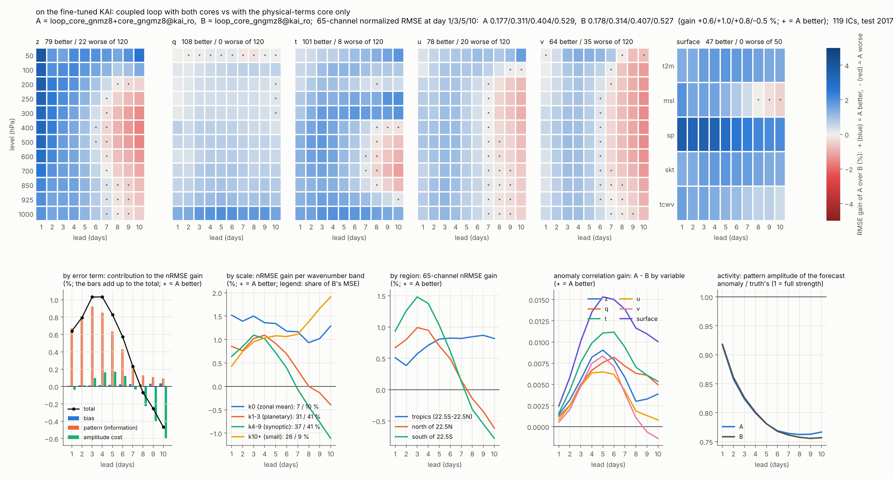

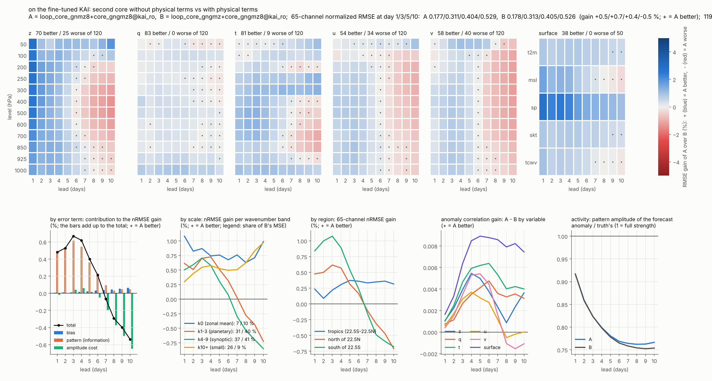

### 7.9 seed 대조: 두 core 연결의 이득은 "따로 학습한 core 둘의 평균"의 것 (score Lq)

소유자(2026-11-12): "현재 가장 best가 그럼 두 core 되먹임 연결인가요?" 7.8의 차이가 1 % 이하인데 학습 seed가 하나였고, 대조의 두 번째 core가 3일 학습이었습니다. core_gngmz8을 seed만 바꿔 하나 더 학습했습니다(core_gngmz8s1, `--seed 1`, 같은 설정, 259,842, 한 step 검증 loss 0.2372 대 0.2379).

| 비교 | 전체 | 정보 항 | 진폭 항 |
|---|---|---|---|
| seed 차이: core_gngmz8s1 대 core_gngmz8 (단독) | +0.1 / −0.1 / +0.2 / +0.2 / +0.1 | +0.2 / −0.2 / 0.0 / +0.1 / +0.1 | 0.0 / +0.1 / +0.2 / +0.1 / 0.0 |
| seed 차이: loop(KAI, core_gngmz8s1) 대 loop(KAI, core_gngmz8) | +0.1 / 0.0 / +0.3 / +0.2 / −0.1 | +0.1 / 0.0 / +0.2 / +0.1 / +0.1 | 0.0 / 0.0 / +0.1 / +0.1 / −0.2 |
| seed 차이: loop(kai_ro, core_gngmz8s1) 대 loop(kai_ro, core_gngmz8) | +0.1 / 0.0 / +0.4 / +0.3 / −0.1 | +0.1 / 0.0 / +0.2 / +0.1 / 0.0 | 0.0 / 0.0 / +0.1 / +0.1 / −0.2 |
| 같은 조건의 대조: loop(KAI, core_gngmz8 둘) 대 loop(KAI, core_gngmz8) | +1.7 / +1.5 / +1.3 / +0.9 / +0.3 | +1.7 / +1.3 / +0.9 / +0.5 / +0.1 | 0.0 / +0.2 / +0.4 / +0.3 / +0.1 |
| 같은 조건의 대조: loop(kai_ro, core_gngmz8 둘) 대 loop(kai_ro, core_gngmz8) | +1.7 / +1.3 / +1.0 / +0.6 / 0.0 | +1.6 / +1.1 / +0.8 / +0.4 / +0.1 | 0.0 / +0.1 / +0.2 / +0.1 / −0.2 |
| loop(KAI, core_gnmz8 + core_gngmz8) 대 loop(KAI, core_gngmz8 둘) | −1.0 / −0.3 / −0.3 / −0.4 / −0.6 | −1.0 / −0.3 / −0.2 / −0.2 / 0.0 | 0.0 / 0.0 / −0.1 / −0.2 / −0.5 |
| loop(kai_ro, core_gnmz8 + core_gngmz8) 대 loop(kai_ro, core_gngmz8 둘) | −1.0 / −0.3 / −0.2 / −0.3 / −0.5 | −1.0 / −0.2 / −0.2 / −0.2 / 0.0 | 0.0 / 0.0 / 0.0 / −0.1 / −0.4 |
| 재현: loop(kai_ro, core_gnmz8 + core_gngmz8s1) 대 loop(kai_ro, core_gngmz8s1) | +0.6 / +1.0 / +0.7 / +0.2 / −0.5 | +0.6 / +0.9 / +0.6 / +0.2 / +0.1 | 0.0 / +0.1 / +0.1 / −0.1 / −0.6 |
| loop(kai_ro, core_gngmz8 둘) 대 kai_ro | +21.5 / +7.8 / +4.7 / +3.0 / +2.1 | +19.4 / +5.9 / +2.8 / +1.3 / +0.4 | +1.4 / +1.5 / +1.7 / +1.5 / +1.4 |
| blend(KAI, core_gngmz8 둘) 대 blend(KAI, core_gngmz8) | +1.7 / +1.3 / +1.8 / +2.2 / +2.9 | +1.7 / +1.1 / +0.9 / +0.7 / +0.3 | 0.0 / +0.2 / +0.9 / +1.6 / +2.6 |
| blend(KAI, core_gnmz8 + core_gngmz8) 대 blend(KAI, core_gngmz8 둘) | −1.0 / 0.0 / +0.4 / +0.5 / +0.6 | −1.0 / 0.0 / +0.3 / +0.3 / +0.2 | 0.0 / 0.0 / +0.1 / +0.2 / +0.4 |
| blend(kai_ro, core_gnmz8 + core_gngmz8) 대 blend(kai_ro, core_gngmz8 둘) | −1.0 / −0.1 / +0.1 / +0.2 / +0.2 | −1.0 / −0.1 / +0.2 / +0.2 / +0.1 | 0.0 / 0.0 / 0.0 / 0.0 / +0.1 |

nRMSE(kai_ro 위): core_gngmz8 둘 연결 0.175 / 0.310 / 0.403 / 0.468 / 0.527, core_gnmz8 + core_gngmz8 연결 0.177 / 0.311 / 0.404 / 0.470 / 0.529, core_gngmz8만 0.178 / 0.314 / 0.407 / 0.471 / 0.527. ACC 0.931 / 0.766 / 0.587 / 0.424 / 0.248 대 0.929 / 0.764 / 0.584 / 0.418 / 0.243 대 0.928 / 0.758 / 0.575 / 0.411 / 0.239. 가중치(KAI / seed 1 / seed 0, 변수 평균) 0.23 / 0.41 / 0.36; core_gnmz8 + core_gngmz8은 0.24 / 0.25 / 0.51.

- **가장 좋은 궤적 모델은 loop(kai_ro, core_gngmz8 둘)입니다.** 한 core 연결보다 선행 1~7일에 +1.7 / +1.3 / +1.0 / +0.6 좋고 10일은 같습니다(유의한 칸 505개 이득, 25개 손실). 7.8의 두 core 연결보다 모든 선행일에서 좋습니다(18칸 대 340칸).
- **7.8의 해석을 고칩니다.** 이득은 "서로 다른 구조의 core"의 것이 아니라 "따로 학습한 core 둘을 평균하는 효과"입니다. 물리항 없는 기억 core는 두 번째 core로서 seed만 다른 물리항 core보다 못합니다(선행 1일 −1.0은 분명하고, 3~7일의 −0.2 ~ −0.3은 seed 차이와 같은 크기). 7.8의 대조는 약한 core(3일 학습, 단독 선행 1일 nRMSE 0.195 대 0.190)여서 "core 하나 더"의 몫을 작게 쟀습니다.
- **seed 차이는 65채널 nRMSE로 0.1 ~ 0.4 %**이고, 변수 하나로는 더 큽니다(t2m 연결에서 +0.6 ~ +1.6 %). 7.5 ~ 7.8의 0.5 % 아래 차이는 이 크기 안입니다.
- 기억 core를 더한 이득 자체는 다른 seed의 core 위에서 그대로 재현됩니다(+0.6 / +1.0 / +0.7 / +0.2 / −0.5). 7.8의 수는 우연이 아니었고 해석이 틀렸습니다.
- 혼합(되먹임 없음)의 선행 5~10일에는 기억 core 쪽의 몫이 조금 남습니다(KAI 위 +0.4 / +0.5 / +0.6, 작은 규모; kai_ro 위에서는 seed 차이 안).
- 한계: seed는 둘뿐입니다. core를 셋 이상으로 늘린 것, 같은 계산량의 넓은 core 하나(평균의 효과인지 크기의 효과인지), KAI의 seed 둘은 시험하지 않았습니다.

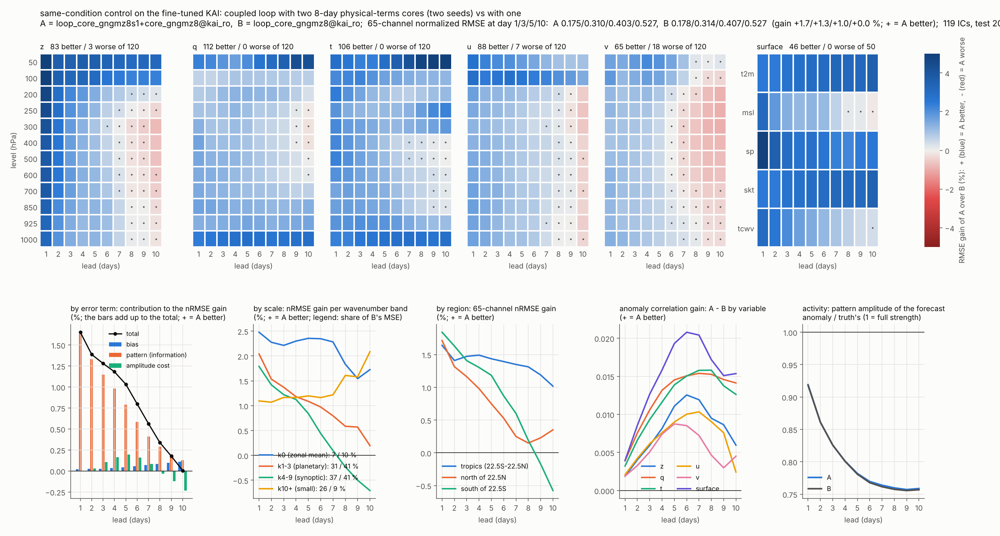

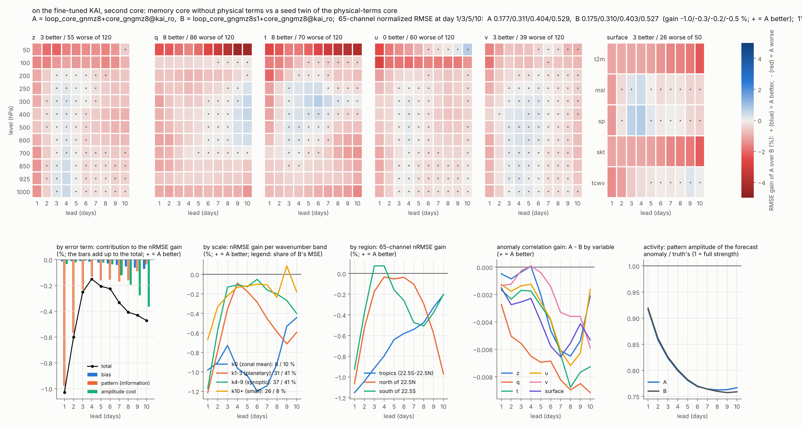

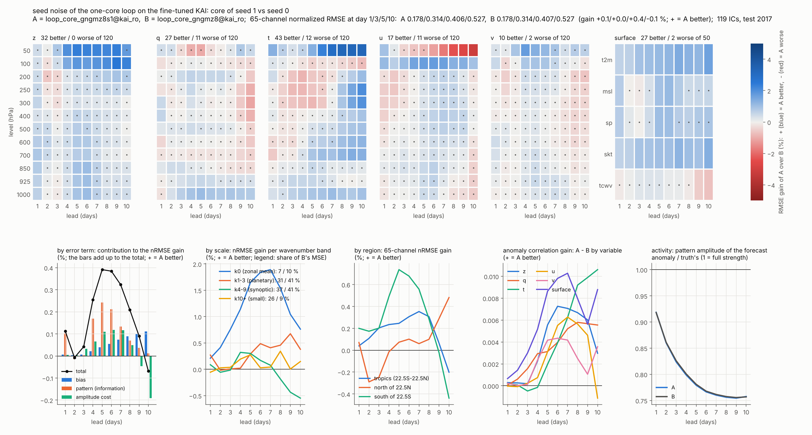

변수별 RMSE(물리 단위)는 `scripts/kai_variable_table.py`로 만듭니다(소유자 사본 `variable_table_Li.md`, `variable_table_Ln.md`, `variable_table_Lo.md`, `variable_table_Lm.md`, `variable_table_Lp.md`, `variable_table_Lq.md`, heat map과 그래프는 https://claude.ai/artifact/7U5voj1VdLQbR5w9n6UCbB).

## 8. 지금의 core 구조, best 모델, 두 core의 학습부터 평가까지 (2026-11-12)

소유자 요청(2026-11-12 13:38 KST "현재 tendency core의 구조는?", 14:21 KST "이것도 git에 올려주시고, 이후 이 두 개 core에 대한 학습 평가까지의 명령어 제공")에 따라, 지금 쓰는 구조와 명령을 한곳에 모았습니다.

### 8.1 tendency core의 구조 (8일 기준 core `core_gngmz8`, parameter 259,842개)

하루 tendency를 내는 residual CNN에 물리항 48개와 ConvGRU 기억항을 입력으로 넣고, Mori-Zwanzig 형태의 8일 sequence loss로 학습한 것입니다.

```
dx/dt = f( x, G(x), m, 위치, 시간 )          하루 1 step, Heun 적분 (f를 두 번 계산)
m_t   = ConvGRU( m_(t-1), enc[ x_t, 추세_t, e_t, G(x_t), G(x_(t-1)) ] )
```

- **x**: 정규화한 상태 66채널(z, t, q, u, v 각 12층 60개 + 지표 t2m, sp, tcwv, msl, skt, tisr). tisr는 예측하지 않고 다음 날 값을 자료에서 넣습니다.
- **G(x)**: 원시방정식 이산 연산자가 계산한 u, v, T, q의 tendency 48채널(4변수 × 12층). 적분하지 않고 입력으로만 씁니다(gradient 없음, 채널별 RMS로 나누고 ±5에서 자름, 지면 아래는 0).
- **m**: 기억항, 24채널 ConvGRU 상태. 매일 step 전에 갱신하고, 입력은 오늘 상태, 관측 추세 (x_t − x_(t−1)), 전날 예보가 놓친 오차 e_t(innovation), 오늘과 어제의 G(x)입니다. 초기 시각 전 8일로 채우고, 예보 중에는 예보한 상태로 이어 갑니다(그때 e = 0).

| 부분 | 내용 | parameter |
| --- | --- | --- |
| trunk | ClimODE의 residual CNN. 입력 150채널(x 66 + m 24 + G 48 + 위치·지형 8 + 시간 4), residual block 4개(폭 48, 3×3 conv, 경도 순환 / 위도 반사 padding), BatchNorm 대신 GroupNorm, dropout 없음 | 218,352 |
| head | 1×1 conv 48 → 66, 0으로 초기화(처음에는 persistence), 출력에 변수별 하루 증분 표준편차를 곱함 | 3,234 |
| 기억 encoder | 1×1 conv 294 → 24 (x 66 + 추세 66 + e 66 + G 48 + 어제 G 48) | 7,080 |
| ConvGRU | 3×3 conv gate와 후보, 24채널 | 31,176 |

step 끝에 q와 tcwv가 음수가 되지 않게 하는 보정(전구 질량 보존, PositiveMass)이 붙습니다. 학습: 초기 시각 전 8일을 빈 기억에서 시작해 하루씩 예보하고(첫날은 Markov 항만), 그 8개 예보와 이어지는 1~4일 rollout을 함께 loss에 넣습니다(위도 가중 MSE, 하루 증분 표준편차 단위). 여기에 연속한 하루 예보 잔차의 lag 1, 2 상관의 제곱을 더합니다("잡음 항은 과거와 직교"). 2012~2015년, 3000 iteration, batch 8, AdamW 4e-4, cosine. 코드는 `pgcfm/kai_tend.py`(`MemCore`, `ConvGRUCell`), `pgcfm/dyncore.py`(`DynCore`, `OperatorFeatures`), 옵션은 `--core-norm gn --core-gfeat --core-mem 8 --core-mz`입니다.

시험했지만 이 core를 넘지 못해 넣지 않은 것: 3·5일 고정 누적 기억(7.5절), 기억 kernel network(7.5절), 물리 tendency의 시간 누적(7.5절), 물리항을 뺀 기억 core(7.7절).

### 8.2 best 모델: 미세조정 KAI + 8일 기준 core 둘(seed 0, 1)의 되먹임 연결

```
x(t+1) = K(x) + w1 ⊙ ( C0(x) − K(x) ) + w2 ⊙ ( C1(x) − K(x) )
```

K = rollout으로 미세조정한 KAI(kai_ro, 7.6절), C0와 C1 = 8.1절의 core를 seed만 달리해 따로 학습한 둘(초기 가중치와 표본 순서만 다름). w1, w2는 채널별 가중(0 이상, 합 1 이하; 검증 연도 2016년의 1일 예보에서 최소제곱으로 정함)이고, 섞은 상태를 매일 KAI와 두 core에 되먹입니다. 두 core의 기억은 각자 따로 있고 섞은 상태를 따라갑니다. 65채널 평균 가중은 KAI 0.23, core 둘 0.36(seed 0)과 0.41(seed 1)입니다. 근거는 7.9절입니다: core 하나 연결 대비 +1.7 / +1.3 / +1.0 / +0.6 / 0.0 %(1 / 3 / 5 / 7 / 10일), 미세조정 KAI 단독 대비 +21.5 / +7.8 / +4.7 / +3.0 / +2.1 %. 이득이 "평균 효과"인지 "parameter가 두 배라서"인지는 아직 가르지 못했습니다(같은 parameter 수의 넓은 core 하나와의 대조가 다음 채점입니다).

### 8.3 두 core의 학습부터 평가까지 (5.625°, 이 문서의 수치를 낸 명령)

```bash
# 0. 코드와 환경 (한 번). 이미 clone이 있으면 그 폴더에서 git fetch origin && git checkout claude/project-thread-wjjayb && git pull --ff-only origin claude/project-thread-wjjayb
git clone https://github.com/nayehyeon61-glitch/physical_guide_flowmatching.git && cd physical_guide_flowmatching
git checkout claude/project-thread-wjjayb
pip install torch && pip install -r requirements.txt
pip install git+https://github.com/patrick-kidger/torchcubicspline.git

# 1. 자료: ERA5 5.625° 2012~2017 (WeatherBench2에서 내려받음)
python scripts/wb2_to_kai.py --out data/era5_5p625 --all-hours --years 2012 2013 2014 2015 2016 2017
R="python scripts/run_kai_tendency.py --out runs/kaitend"        # GPU라면 끝에 --device cuda

# 2. KAI(시험 크기 0.43 M)와 rollout 미세조정 KAI
$R --arm kai --tag kai
$R --arm kai --tag kai_ro --init kai --rollout 2 3 --lr 3e-4 --iters 1000

# 3. core 둘: 같은 구조, 같은 학습, seed만 다름 (끊기면 같은 명령으로 이어서 함)
C="--arm core --core-norm gn --iters 3000 --log-every 250 --core-gfeat --core-mem 8 --core-mz --resume"
$R $C --tag core_gngmz8
$R $C --tag core_gngmz8s1 --seed 1

# 3b. (대조, 선택) 두 core와 parameter 수가 같은 넓은 core 하나: hidden 72, 기억 34채널 (520,966개), seed 0
$R $C --tag core_gngmz8w --core-hidden 72 --core-mem-ch 34

# 4. 평가 (2017년 초기장 119개, 선행 1~10일): core 단독, core 하나 연결, core 둘 연결, kai와 kai_ro 위에서
#    3b를 했다면 --score-cores와 --loop-blend 끝에 core_gngmz8w를, --pairs에 "loop_core_gngmz8w@kai_ro:loop_$M@kai_ro"를 더합니다
A=core_gngmz8; B=core_gngmz8s1; M="$B+$A"
$R --score kai kai_ro --score-cores $A $B --blend-bases kai kai_ro --loop-blend $A $B \
   --blend-multi $M --loop-multi $M \
   --pairs "loop_$M@kai_ro:loop_$A@kai_ro" "loop_$M@kai_ro:kai_ro" "loop_$B@kai_ro:loop_$A@kai_ro" "$B:$A" \
   2>&1 | tee runs/kaitend/score_two.log

# 5. 항별 분해(전체 / 정보 / 진폭, 변수군, 규모, 지역, 계절)와 변수별 표(물리 단위)
python scripts/eval_kai_breakdown.py --stats runs/kaitend/stats.npz runs/kaitend/score.json runs/kaitend/score_raw.npz \
   runs/kaitend/breakdown_two \
   "loop_$M@kai_ro:loop_$A@kai_ro=fine-tuned KAI: coupled loop with two cores (seed 0, 1) vs with one" \
   "loop_$M@kai_ro:kai_ro=coupled loop(fine-tuned KAI, two cores) vs fine-tuned KAI" \
   "loop_$B@kai_ro:loop_$A@kai_ro=seed difference of the one-core loop" \
   2>&1 | tee runs/kaitend/breakdown_two.txt
python scripts/kai_variable_table.py runs/kaitend/score.json runs/kaitend/variable_table_two.md \
   "kai=KAI" "kai_ro=KAI (rollout fine-tuned)" "$A=core (seed 0)" "$B=core (seed 1)" \
   "loop_$A@kai_ro=fine-tuned KAI + core loop" "loop_$M@kai_ro=fine-tuned KAI + two cores loop" \
   --base kai_ro --pairs "loop_$M@kai_ro:loop_$A@kai_ro" "loop_$M@kai_ro:kai_ro"
```

- 시간(CPU 4코어): KAI 10분, 미세조정 13분, core 하나에 2시간 45분(넓은 core는 약 6시간), 평가 약 25분. 메모리는 14 GB 안에서 한 번에 학습 하나만 돌려야 합니다.
- 결과: `runs/kaitend/score_two.log`(모델별 nRMSE, ACC, 쌍별 차이), `score.json`과 `score_raw.npz`(전체 수치), `breakdown_two.txt`와 `breakdown_two/`(항별 표와 그림), `variable_table_two.md`.
- **부호**: `score_two.log`의 `pairs` 줄은 "a의 b 대비 nRMSE 변화"라서 음수가 좋아진 것입니다. 항별 분해와 변수별 표, 이 문서의 표는 모두 이득(+ = 좋아짐)으로 적습니다.
- 같은 seed로 다시 학습해도 기계와 thread 수에 따라 끝자리가 달라질 수 있습니다. seed만 바꾼 차이는 65채널 평균으로 0.1~0.4 %, 변수 하나로는 1~1.5 %였습니다(7.9절). 그보다 작은 차이는 읽지 않는 것이 맞습니다.

### 8.4 KAI의 해상도(1.5°, GPU)에서

같은 일을 `scripts/run_kai_plus.sh`가 한 번에 합니다(자료, KAI, 미세조정 KAI, core +, seed가 다른 둘째 core +, 평가, 항별 분해, 변수별 표; `WIDE=1`이면 넓은 core 대조까지). 명령은 `docs/kai_tendency_plus.md` 5.2절에 있습니다.

1.5° 일평균 본 학습(GPU, core 하나, 6,000 iteration)의 결과는 `docs/kai_tendency_plus_1p5_daily.md`에 있습니다. 미세조정 KAI + core 연결이 5.625°의 최종 모델보다 정규화 RMSE가 1 / 3 / 5 / 7 / 10일에 +28.7 / +24.8 / +15.0 / +6.4 / −1.2 % 좋고, ACC는 모든 선행일에서 높습니다. 그 대부분은 KAI가 커진(0.43 M → 7.57 M) 몫이고, core 하나가 미세조정 KAI에 보태는 몫은 +1.7 / +1.8 / +3.2 / +3.7 / +3.5 %로 5.625°(+20.1 / +6.6 / +3.7 / +2.5 / +2.1 %)보다 짧은 선행일에서 훨씬 작습니다. 5일 이후의 정보 이득은 두 해상도에서 비슷합니다. 비교와 취약점(1일 이득이 하루 변화가 작은 sp, skt, z50에 몰리는 loss 가중의 차이)은 그 문서의 8절에 있습니다.

## 재현

```bash
python scripts/wb2_to_kai.py --out data/era5_5p625 --all-hours --years 2012 2013 2014 2015 2016 2017
R="python scripts/run_kai_tendency.py --out runs/kaitend"
C="--arm core --core-norm gn --iters 3000"
$R --arm kai --tag kai
$R $C --tag core_gn
$R $C --tag core_gnh --core-hist
$R $C --tag core_gnk8 --curriculum 1 2 4 6 8
$R $C --tag core_gnm --core-mem 8
$R $C --tag core_gnmz --core-mem 3 --core-mz
$R $C --tag core_gng --core-gfeat
$R $C --tag core_gngmz --core-gfeat --core-mem 3 --core-mz      # 최종 모델의 core
$R $C --tag core_gnsq --core-mem 3 --core-mz --core-nomem        # 대조: 기억을 0으로 둔 sequence 학습
$R $C --tag core_gngmz8 --core-gfeat --core-mem 8 --core-mz                 # 7절: 8일 sequence 기준
$R $C --tag core_gngmzP --core-gfeat --core-mem 8 --core-mz --core-pacc 3 5  # memory 항 안의 kernel (물리 tendency, 추세, innovation 누적)
$R $C --tag core_gngmzL --core-gfeat --core-mem 8 --core-mz --core-acc 3 5   # 고정 kernel 누적, 따로 선 항
$R $C --tag core_gngmzK --core-gfeat --core-mem 8 --core-mz --core-kern 8    # 대조: kernel network, 따로 선 항
$R $C --tag core_gnmz8 --core-mem 8 --core-mz                                # 7.7: 물리항 없는 기억 core, 8일 sequence

# 최종 모델: KAI와 core_gngmz를 매일 섞어 되먹이는 연결(loop_core_gngmz), RMSE용 출력(blend_core_gnk8@loop_core_gngmz)
$R --score kai --score-cores core_gngmz core_gnk8 --loop-blend core_gngmz \
   --blend-multi core_gngmz+core_gnk8 --blend-loop loop_core_gngmz+core_gnk8
# 2 × 2 (물리항 × 기억항)과 연결 방식. 예측을 메모리에 들고 있으므로 14 GB에서는 core 5개까지만 한 번에 채점합니다
$R --score kai --score-cores core_gn core_gnmz core_gng core_gngmz core_gnk8 --mem-warm 0 1 --mem-freeze \
   --loop-blend core_gn core_gnmz core_gng core_gngmz --blend-multi core_gnmz+core_gnk8 core_gngmz+core_gnk8
# 기억 항의 대조
$R --score kai --score-cores core_gn core_gnsq core_gnmz core_gnk8 --mem-warm 0 \
   --blend-multi core_gnsq+core_gnk8 core_gnmz+core_gnk8
# 7.5: 장기 기억 구조의 대조 (score Lm; Lj는 core_gngmzL로 같은 명령)
$R --score kai --score-cores core_gngmz8 core_gngmzP core_gngmzK core_gnk8 --mem-warm 0 1 2 4 \
   --loop-blend core_gngmz8 core_gngmzP core_gngmzK --blend-loop loop_core_gngmzK+core_gnk8
# 7.7: 물리항 없는 8일 기억 core. 단독, kai와 kai_ro 위의 연결, 두 core 혼합
$R --score kai kai_ro --score-cores core_gnmz core_gnmz8 core_gngmz8 core_gnk8 --mem-warm 0 1 2 4 \
   --blend-bases kai kai_ro --loop-blend core_gnmz core_gnmz8 core_gngmz8 \
   --blend-multi core_gnmz8+core_gngmz8 core_gnmz+core_gngmz8
# 7.8: KAI와 두 core의 되먹임 연결(--loop-multi), 대조(물리항 core 둘), 연결의 RMSE용 출력
$R --score kai kai_ro --score-cores core_gnmz8 core_gngmz8 core_gngmz core_gnk8 --blend-bases kai kai_ro \
   --loop-blend core_gngmz8 --blend-multi core_gnmz8+core_gngmz8 core_gngmz+core_gngmz8 \
   --loop-multi core_gnmz8+core_gngmz8 core_gngmz+core_gngmz8 \
   --blend-loop "loop_core_gnmz8+core_gngmz8@kai_ro+core_gnk8" "loop_core_gngmz8@kai_ro+core_gnk8"
# 7.9: seed 대조. 8일 기준 core를 seed만 바꿔 학습하고 같은 조건의 대조를 채점
$R $C --tag core_gngmz8s1 --core-gfeat --core-mem 8 --core-mz --seed 1
$R --score kai kai_ro --score-cores core_gnmz8 core_gngmz8 core_gngmz8s1 --blend-bases kai kai_ro \
   --loop-blend core_gngmz8 core_gngmz8s1 \
   --blend-multi core_gnmz8+core_gngmz8 core_gngmz8s1+core_gngmz8 core_gnmz8+core_gngmz8s1 \
   --loop-multi core_gnmz8+core_gngmz8 core_gngmz8s1+core_gngmz8 core_gnmz8+core_gngmz8s1
# 항별 평가 (A:B = A의 B 대비 이득), 진단
python scripts/eval_kai_breakdown.py runs/kaitend/score.json runs/kaitend/score_raw.npz out \
   "loop_core_gngmz:kai" "loop_core_gngmz:blend_core_gngmz" "core_gngmz:core_gng" "core_gngmz:core_gnmz"
python scripts/diag_kai_memory.py --cores core_gn core_gnmz core_gngmz --lags 6
python scripts/diag_kai_physmem.py --cores core_gn core_gnh
python scripts/diag_kai_longmem.py --cores core_gngmz            # 누적한 과거의 정보; --phys: 물리 tendency의 누적
python scripts/plot_kai_longrange.py runs/kaitend/score.json runs/kaitend/score_raw.npz out.png kai core_gn core_gngmz blend_core_gngmz loop_core_gngmz

# 원래 크기의 KAI (GPU): 모든 명령에 같은 크기를 줍니다
$R --arm kai --tag kai --depths 3 3 15 3 --dims 48 96 192 288 --iters 20000
```

결과 파일: `runs/kaitend/score_L{d,f,g,fin,h}.json`(채점; Lfin = 최종 모델, Lh = 대조), `breakdown_L*/breakdown_L*.txt`(항별 표), `diag_memory_L*.log`, `diag_physmem.json`. 이 문서의 그림과 표는 `docs/kai_tendency/`에 있습니다.
