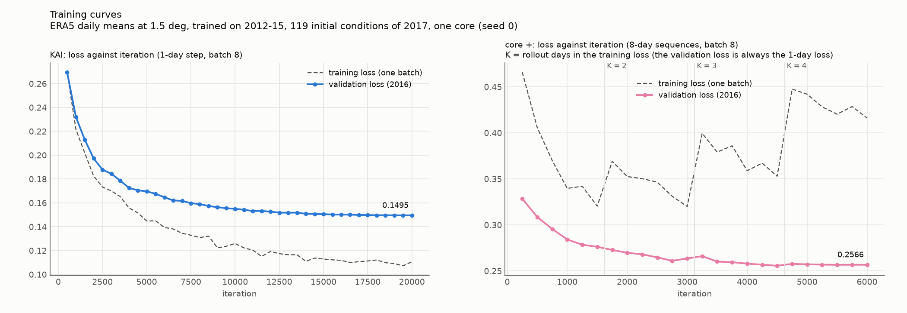
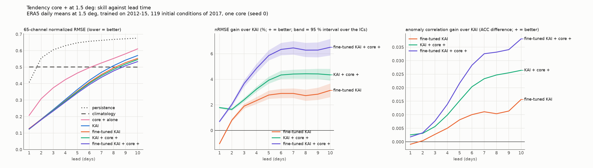
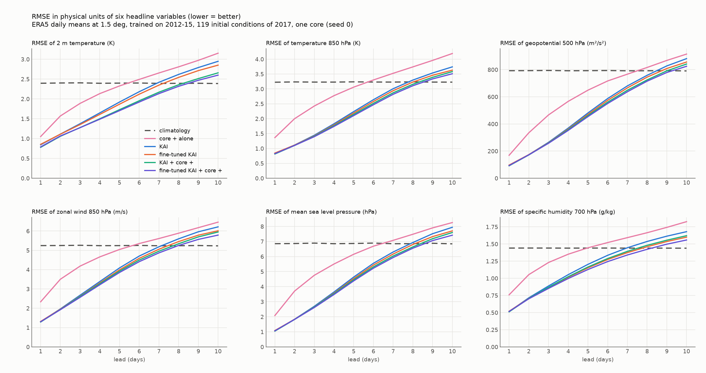
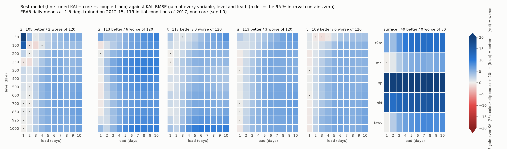
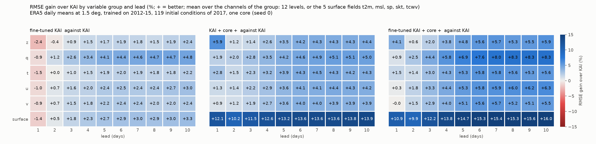
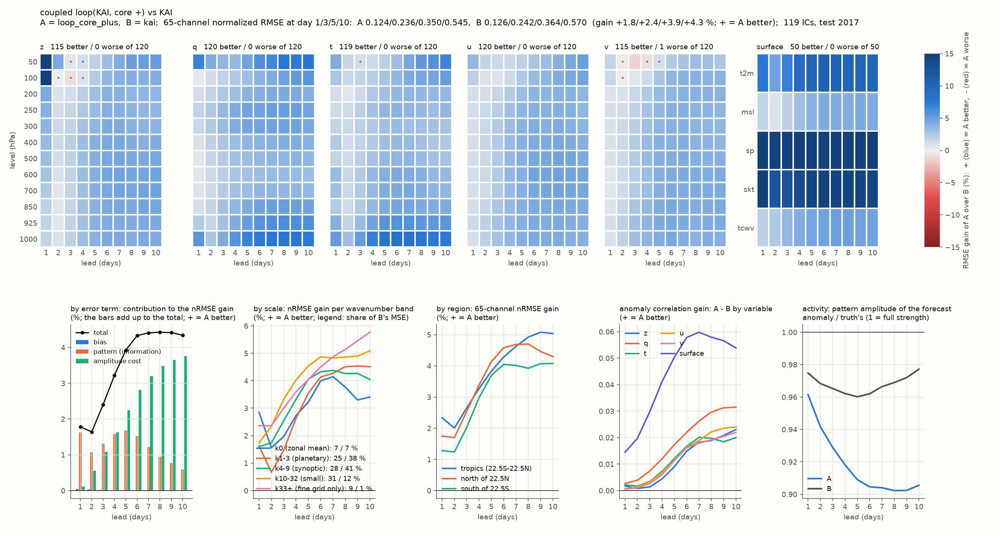
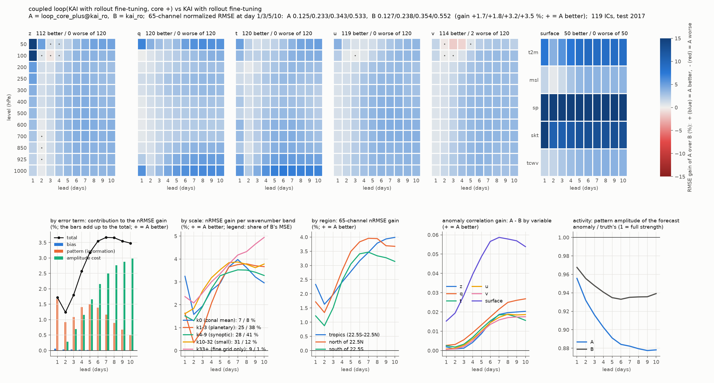
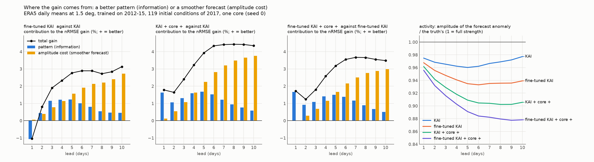
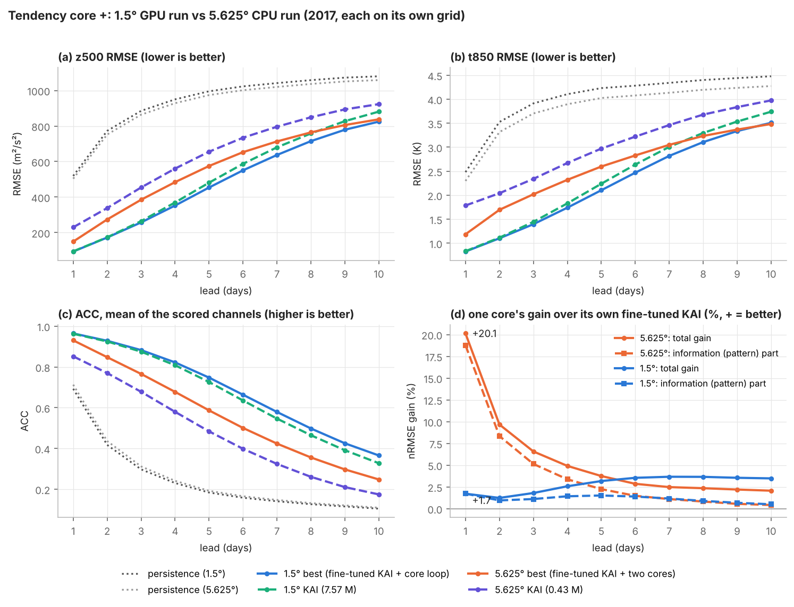

# Tendency core +: 1.5° 일평균 본 학습의 결과 (2026-11-12)

`docs/kai_tendency_plus.md`의 구조를 GPU에서 원래 크기로 처음 끝까지 학습하고 채점한 결과입니다. 그 문서에는 1.5°의 성능 수치가 없었고, 이 문서가 그 수치입니다.

**요약**

- KAI에 tendency core +를 되먹임으로 연결하면(`loop_core_plus`) 선행 1~10일 모두에서 KAI보다 좋아집니다. 65채널 정규화 RMSE의 이득이 1일 +1.8 %, 5일 +3.9 %, 10일 +4.3 %이고, 650개 셀 가운데 639개에서 유의하게 좋아지고 1개에서 나빠집니다.
- 이득은 지표 변수에서 가장 큽니다(지표 묶음 +12~14 %, t2m +7.6~10.3 %). 상층 변수는 +1~5 %입니다.
- 가장 좋은 조합은 rollout 미세조정 KAI 위의 연결(`loop_core_plus@kai_ro`)이고, 원래 KAI 대비 1일 +0.7 %, 5일 +5.9 %, 10일 +6.5 %입니다.
- core + 단독 예보는 KAI보다 크게 나쁩니다(1일 −64.6 %, 10일 −7.1 %). core는 단독 모델이 아니라 KAI에 붙이는 부품으로 읽어야 합니다.
- **5.625° 최종 모델 대비**(8절): 정규화 RMSE가 1 / 3 / 5 / 7 / 10일에 +28.7 / +24.8 / +15.0 / +6.4 / −1.2 % 좋고 ACC는 모든 선행일에서 높습니다. 그 대부분은 KAI가 커진 몫이고, core가 보태는 몫은 1일 +20.1 → +1.7 %로 줄었습니다. 5일 이후 core의 정보 이득은 두 해상도에서 비슷합니다.
- **주의**: 선행일이 길어질수록 연결의 이득은 대부분 예측이 매끄러워진 데서 옵니다(5절). 10일의 +4.3 % 가운데 패턴(정보)의 몫은 +0.6 %입니다.

부호는 이 문서 전체에서 이득입니다(+ = 좋아짐). `score.log`의 `pairs` 줄만 반대 부호(a의 b 대비 변화, 음수가 좋아짐)입니다.

## 1. 실행한 것

| 항목 | 값 |
| --- | --- |
| 자료 | lustre의 0.25° 일평균(`ERA5_0p25_DAILY`, `SRC=daily`)을 1.5°(121 × 240)로 변환, 13개 기압면, 65채널 |
| 연도 | 학습 2012~2015, 검증 2016, 시험 2017 |
| 채점 | 2017년의 초기장 119개(3일 간격), 선행 1~10일, 1.5° 격자에서 |
| KAI | (3, 3, 15, 3) / (48, 96, 192, 288), batch 8, 20,000 iteration, 블록 단위 checkpoint |
| 미세조정 KAI | 위 KAI에서 2~3일 rollout, batch 4, 1,000 iteration |
| core + | 물리항 + GRU 기억항 + MZ, hidden 48, 블록 (2, 2), substep 4, 8일 sequence, batch 8, **6,000 iteration** |
| 코드 | commit `b32e25d` + 수정 3건(commit `2303de3`과 같은 내용) |
| 명령 | `CORE_ITERS=6000 SRC=daily bash scripts/run_kai_plus.sh` (smoke와 짧은 시험을 먼저 통과) |

기본값과 다른 점이 둘 있습니다.

- **core iteration 6,000**: 기본값 3,000은 5.625°에서 물려받은 값이라 두 배로 잡았습니다. cosine 학습률과 curriculum이 전체 iteration 수에 따라 정해지므로 3,000의 결과와는 다른 학습입니다. 3,000과의 비교는 하지 않았습니다.
- **core 하나**: 실행 당시의 driver(`b32e25d`)에는 둘째 core(`TWIN`)가 없었습니다. 지금 driver의 `TWIN=0`에 해당하고, 파일 이름도 `*_plus.*`입니다. 같은 폴더에서 지금 driver를 다시 실행하면 둘째 core의 학습과 두 core 평가만 이어서 합니다.

## 2. 학습 시간과 메모리 (GPU에서 처음 잰 값)

GPU는 NVIDIA L40S(46 GB) 한 장입니다. KAI의 처음 2,000 iteration만 RTX PRO 6000 Blackwell에서 돌았습니다(중간에 멈추고 이어서 학습).

| 단계 | iteration | 시간 | iteration당 | GPU 메모리 | 최종 검증 loss |
| --- | --- | --- | --- | --- | --- |
| 자료 변환 (2012~2017) | | 53분 | | | |
| KAI | 20,000 | 6.1시간 | 1.09초 (Blackwell에서는 약 0.55초) | 9.1 GB | 0.1495 |
| 미세조정 KAI | 1,000 | 0.35시간 | 1.26초 | 10.1 GB | 0.1506 |
| core + | 6,000 | 11.8시간 | 7.07초 | 12.6 GB | 0.2566 |
| 채점, 분해, 표 | | 36분 | | | |

- 메모리는 `kai_tendency_plus.md` 5절의 어림(KAI 12~16 GB, core + 약 13 GB)과 맞거나 더 적습니다. 24 GB GPU에 들어갑니다.
- core +의 검증 loss(1일 loss)는 4,500 iteration에서 가장 낮았고(0.2556), 학습 loss의 rollout이 4일로 늘어난 4,750부터는 0.2576에서 0.2566으로 조금 내려온 뒤 5,500부터 변하지 않습니다(0.25662, 0.25669, 0.25664). 학습률이 0으로 가는 구간이라 수렴인지 일정의 끝인지는 이 실행만으로 가를 수 없습니다.


- 이 실행에서 버그 3건을 찾아 고쳤습니다(commit `2303de3`): Python 3.11에서의 f-string 구문 오류, 365일 연도와 366일 기후값의 길이 불일치, `--resume`에서 난수 상태의 장치.

## 3. 점수

65채널 정규화 RMSE와 ACC, 선행 1 / 3 / 5 / 10일입니다.

| 모델 | nRMSE | ACC |
| --- | --- | --- |
| persistence | 0.407 / 0.605 / 0.648 / 0.676 | 0.693 / 0.297 / 0.184 / 0.105 |
| climatology | 0.501 / 0.501 / 0.501 / 0.500 | 0 |
| KAI | 0.126 / 0.242 / 0.364 / 0.571 | 0.963 / 0.875 / 0.726 / 0.328 |
| 미세조정 KAI (`kai_ro`) | 0.127 / 0.238 / 0.354 / 0.553 | 0.962 / 0.878 / 0.734 / 0.343 |
| core + 단독 (`core_plus`) | 0.207 / 0.375 / 0.464 / 0.611 | 0.911 / 0.679 / 0.459 / 0.121 |
| KAI + core + 연결 (`loop_core_plus`) | 0.124 / 0.237 / 0.350 / 0.546 | 0.965 / 0.881 / 0.741 / 0.354 |
| 미세조정 KAI + core + 연결 (`loop_core_plus@kai_ro`) | 0.125 / 0.234 / 0.343 / 0.533 | 0.965 / 0.883 / 0.748 / 0.366 |
| 선행일별 혼합, KAI 위 (`blend_core_plus`) | 0.124 / 0.236 / 0.343 / 0.509 | 0.965 / 0.879 / 0.734 / 0.322 |
| 선행일별 혼합, 미세조정 KAI 위 (`blend_core_plus@kai_ro`) | 0.125 / 0.234 / 0.338 / 0.501 | 0.965 / 0.881 / 0.741 / 0.337 |



왼쪽은 모델별 nRMSE, 가운데는 KAI 대비 nRMSE 이득(띠는 95 % 신뢰구간), 오른쪽은 KAI 대비 ACC 차이입니다.

선행일별 혼합은 10일의 nRMSE가 가장 낮지만 ACC는 연결보다 낮습니다. 혼합은 선행일마다 가중을 따로 정해 섞는 방식입니다.

주요 변수의 RMSE, 선행 1 / 5 / 10일입니다. 65채널 전체는 [`variable_table_plus.md`](kai_tendency_plus_1p5_daily/variable_table_plus.md)에 있습니다.

| 모델 | t2m (K) | t850 (K) | z500 (m²/s²) | u850 (m/s) | msl (hPa) |
| --- | --- | --- | --- | --- | --- |
| persistence | 1.61 / 2.93 / 3.26 | 2.48 / 4.23 / 4.48 | 519 / 996 / 1080 | 4.29 / 6.86 / 7.18 | 4.97 / 8.90 / 9.41 |
| climatology | 2.39 / 2.40 / 2.39 | 3.23 / 3.24 / 3.23 | 792 / 792 / 791 | 5.25 / 5.24 / 5.23 | 6.85 / 6.87 / 6.84 |
| KAI | 0.84 / 1.92 / 2.95 | 0.83 / 2.24 / 3.74 | 94.6 / 481 / 881 | 1.30 / 4.09 / 6.22 | 1.07 / 4.64 / 7.94 |
| 미세조정 KAI | 0.86 / 1.87 / 2.85 | 0.85 / 2.19 / 3.63 | 96.7 / 470 / 856 | 1.32 / 3.99 / 6.01 | 1.09 / 4.54 / 7.70 |
| core + 단독 | 1.05 / 2.33 / 3.15 | 1.36 / 3.06 / 4.19 | 169 / 649 / 915 | 2.33 / 5.04 / 6.46 | 2.08 / 6.15 / 8.26 |
| KAI + core + 연결 | 0.78 / 1.73 / 2.66 | 0.81 / 2.14 / 3.58 | 91.6 / 462 / 841 | 1.29 / 3.92 / 5.95 | 1.05 / 4.46 / 7.60 |
| 미세조정 KAI + core + 연결 | 0.79 / 1.70 / 2.60 | 0.83 / 2.10 / 3.51 | 93.4 / 454 / 825 | 1.30 / 3.85 / 5.79 | 1.07 / 4.39 / 7.42 |



climatology를 이기는 마지막 선행일입니다.

| 모델 | t2m | t850 | z500 | u850 | msl |
| --- | --- | --- | --- | --- | --- |
| KAI | 6 | 7 | 8 | 7 | 7 |
| 미세조정 KAI | 7 | 8 | 8 | 7 | 8 |
| core + 단독 | 5 | 5 | 7 | 5 | 6 |
| KAI + core + 연결 | 8 | 8 | 9 | 7 | 8 |
| 미세조정 KAI + core + 연결 | 8 | 8 | 9 | 7 | 8 |

## 4. 쌍별 비교

65채널 nRMSE의 이득 %, 선행 1 / 3 / 5 / 10일, 대괄호는 95 % 신뢰구간입니다. 셀은 채널 65개 × 선행일 10개 = 650개 가운데 유의하게 좋아진 수 / 나빠진 수입니다.

| 비교 | 1일 | 3일 | 5일 | 10일 | 셀 |
| --- | --- | --- | --- | --- | --- |
| KAI + core + 연결 대 KAI | +1.8 [+1.7, +1.8] | +2.4 [+2.3, +2.5] | +3.9 [+3.6, +4.2] | +4.3 [+3.9, +4.8] | 639 / 1 |
| 미세조정 KAI + core + 연결 대 미세조정 KAI | +1.7 [+1.6, +1.8] | +1.8 [+1.6, +2.0] | +3.2 [+2.9, +3.4] | +3.5 [+3.0, +4.0] | 635 / 2 |
| 미세조정 KAI + core + 연결 대 KAI | +0.7 [+0.6, +0.8] | +3.7 [+3.4, +3.9] | +5.9 [+5.4, +6.3] | +6.5 [+5.9, +7.1] | 606 / 17 |
| 미세조정 KAI 대 KAI | −1.0 [−1.1, −1.0] | +1.9 [+1.7, +2.1] | +2.8 [+2.5, +3.1] | +3.1 [+2.6, +3.7] | 538 / 73 |
| 연결: 미세조정 KAI 위 대 KAI 위 | −1.1 [−1.1, −1.1] | +1.3 [+1.1, +1.5] | +2.0 [+1.7, +2.3] | +2.3 [+1.8, +2.8] | 517 / 81 |
| core + 단독 대 KAI | −64.6 [−65.8, −63.7] | −54.5 [−55.9, −53.3] | −27.4 [−29.0, −25.9] | −7.1 [−8.2, −6.0] | 16 / 619 |

- **core의 몫과 미세조정의 몫은 거의 더해집니다.** 5일에서 미세조정 +2.8 %, 그 위의 core 연결 +3.2 %, 합쳐서 KAI 대비 +5.9 %입니다.
- **미세조정은 1일을 약 1 % 나쁘게 합니다.** 그래서 1일만 보면 미세조정하지 않은 KAI 위의 연결이 가장 좋습니다(0.124). 3일부터는 미세조정 KAI 위의 연결이 낫습니다.

변수 묶음별 RMSE 이득 %, 선행 1 / 3 / 5 / 7 / 10일입니다.

| 묶음 | KAI + core + 연결 대 KAI | 미세조정 KAI + core + 연결 대 미세조정 KAI |
| --- | --- | --- |
| z | +5.9 / +1.4 / +3.5 / +4.3 / +4.4 | +6.3 / +1.1 / +3.1 / +4.0 / +3.6 |
| q | +1.9 / +2.8 / +4.2 / +4.9 / +5.0 | +1.7 / +1.9 / +2.9 / +3.6 / +3.7 |
| t | +2.8 / +2.3 / +3.9 / +4.5 / +4.3 | +3.0 / +2.0 / +3.5 / +4.0 / +3.5 |
| u | +1.3 / +2.2 / +3.6 / +4.1 / +4.2 | +1.3 / +1.7 / +3.0 / +3.6 / +3.4 |
| v | +0.9 / +1.9 / +3.6 / +4.0 / +3.9 | +0.9 / +1.4 / +2.9 / +3.4 / +3.1 |
| 지표 | +12.1 / +11.5 / +13.2 / +13.6 / +13.9 | +12.2 / +10.6 / +12.2 / +12.7 / +13.1 |

가장 좋은 모델(미세조정 KAI + core + 연결)의 KAI 대비 RMSE 이득을 변수, 기압면, 선행일마다 그린 히트맵입니다. 점은 95 % 신뢰구간이 0을 포함하는 칸입니다. 600개 상층 칸 가운데 557개, 지표 50개 칸 가운데 49개에서 유의하게 좋아집니다. 나빠지는 칸 17개는 대부분 선행 1일입니다(미세조정이 1일을 나쁘게 하는 몫).



변수 묶음과 선행일로 줄인 히트맵입니다(묶음 안 채널들의 이득 평균). 왼쪽부터 미세조정만, core 연결만, 둘 다입니다.



- **지표 묶음의 큰 이득은 두 변수에서 옵니다.** 가장 좋은 모델의 KAI 대비 이득이 지표 기압(sp)에서 +30~37 %(1일 RMSE 243 → 164 Pa), 지표면 온도(skt)에서 +12~16 %입니다. t2m은 +4~12 %이고, msl은 0~+7 %로 상층 변수와 비슷한 수준입니다. sp의 이득이 유난히 큰 이유는 8.5절에 적었습니다(KAI와 core의 loss 가중의 차이).
- **z의 1일 이득은 성층권에 몰려 있습니다**(z50 +26 %, z100 +15 %). 3일부터는 다른 기압면과 같은 수준입니다.

지역(열대, 북반구, 남반구)과 계절(DJF, MAM, JJA, SON)로 나눠도 이득의 부호와 크기가 같습니다. 규모별로도 zonal mean부터 가장 작은 규모까지 모두 양수입니다. 값은 [`breakdown_plus.txt`](kai_tendency_plus_1p5_daily/breakdown_plus.txt)에 있습니다.





## 5. 이득이 어디서 오는가: 정보와 진폭

nRMSE 이득을 패턴(정보)과 진폭 비용으로 나눈 값입니다. 선행 1 / 3 / 5 / 7 / 10일, 합이 전체 이득입니다. activity는 예측 편차의 크기를 관측과 비교한 비율(1이 관측과 같음)입니다.

| 비교 | 패턴 (정보) | 진폭 비용 | 전체 | activity (연결) | activity (기준) |
| --- | --- | --- | --- | --- | --- |
| KAI + core + 연결 대 KAI | +1.6 / +1.3 / +1.7 / +1.2 / +0.6 | +0.1 / +1.1 / +2.2 / +3.2 / +3.8 | +1.8 / +2.4 / +3.9 / +4.4 / +4.3 | 0.96 / 0.93 / 0.91 / 0.90 / 0.91 | 0.97 / 0.97 / 0.96 / 0.97 / 0.98 |
| 미세조정 KAI + core + 연결 대 미세조정 KAI | +1.7 / +1.1 / +1.5 / +1.2 / +0.5 | −0.0 / +0.7 / +1.7 / +2.5 / +3.0 | +1.7 / +1.8 / +3.2 / +3.7 / +3.5 | 0.96 / 0.92 / 0.89 / 0.88 / 0.88 | 0.97 / 0.95 / 0.93 / 0.94 / 0.94 |
| 미세조정 KAI 대 KAI | −1.1 / +1.1 / +1.2 / +0.8 / +0.4 | +0.1 / +0.8 / +1.6 / +2.1 / +2.7 | −1.0 / +1.9 / +2.8 / +2.9 / +3.1 | 0.97 / 0.95 / 0.93 / 0.94 / 0.94 | 0.97 / 0.97 / 0.96 / 0.97 / 0.98 |



- **1일의 이득은 거의 전부 정보입니다**(+1.6 가운데 진폭 +0.1). 예측의 진폭은 그대로이고 패턴이 맞아진 것입니다.
- **5일부터는 진폭의 몫이 더 큽니다.** 연결한 예측은 KAI보다 매끄럽습니다(10일의 activity 0.91 대 0.98, 미세조정 KAI 위에서는 0.88 대 0.94). 매끄러운 예측은 RMSE에서 유리하므로, 긴 선행일의 이득을 그대로 "더 맞는 예측"으로 읽으면 안 됩니다.
- 그래도 패턴의 몫은 모든 선행일에서 양수이고, ACC도 모든 선행일에서 올라갑니다(10일 0.328 → 0.354, 미세조정 위에서 0.343 → 0.366). ACC는 진폭에 영향을 받지 않는 지표입니다.
- rollout 미세조정도 같은 성격입니다. 3일 이후의 이득 가운데 절반 이상이 진폭입니다.

## 6. core + 단독과 기억항

- **core + 단독**은 KAI보다 1일에 64.6 % 나쁘고, 그 대부분이 패턴입니다(−63.6). 예측도 뚜렷하게 매끄럽습니다(activity 5일 0.71, KAI 0.96). 가장 작은 규모(k33 이상)의 오차는 선행일이 갈수록 커집니다(10일에 KAI의 약 3.9배). 단독 예보로는 쓸 수 없습니다.
- **기억항**: 기억을 0일로 끊으면 core 단독의 nRMSE가 1일 3.8 %, 3일 2.2 %, 5일 1.1 % 나빠지고 10일에는 차이가 없습니다(−0.2 %). 기억을 1일만 줘도 8일과 거의 같습니다(1일 +0.2 %, 3일 +0.6 % 나쁨). 기억항은 짧은 선행일에서 일하고, 그 몫의 대부분은 하루 전의 정보입니다. 기억의 효과는 z(1일 −13.8 %)와 지표(−8.6 %), 큰 규모(zonal mean −10.2 %, planetary −7.2 %)에서 큽니다.

## 7. 한계와 다음에 확인할 것

1. **시험 연도 하나, seed 하나.** 2017년의 초기장 119개이고 KAI와 core 모두 seed 0 하나입니다. 신뢰구간은 초기장 사이의 변동만 담고, 학습의 변동(seed)은 담지 않습니다. 5.625°에서 seed만 바꾼 차이는 약 1~2 %였으므로, 1.5°의 +1.8~4.3 %가 그보다 뚜렷이 큰지는 둘째 core(`TWIN=1`)의 seed 차이로 확인해야 합니다.
2. **core iteration 3,000과 6,000의 비교가 없습니다.** 6,000이 필요한지, 더 늘리면 나아지는지 모릅니다.
3. **긴 선행일의 이득은 대부분 매끄러움입니다**(5절). 진폭을 맞춘 뒤의 비교나 spectrum을 함께 보는 평가가 필요합니다.
4. **학습 연도 4년.** KAI의 원래 학습(수십 년)보다 훨씬 짧습니다. 여기의 KAI는 같은 자료로 학습한 대조이고, 공개된 KAI의 성능이 아닙니다.
5. **5.625° 결과와 같은 격자에서 비교하지 못했습니다.** 각자의 격자에서 채점한 값으로 8절에 나란히 놓았고, 같은 격자의 비교에는 예측을 5.625°로 평균한 뒤 채점하는 단계가 필요합니다(`kai_tendency_plus.md` 6절의 7번).
6. substep 수(4 대 2, 1), 망의 크기(hidden 96), 극 지역의 오차는 `kai_tendency_plus.md` 6절에 적은 대로 아직 확인하지 않았습니다.

## 8. 5.625° 최종 모델과의 비교: 얼마나 좋아졌나

1.5°의 수치를 지금까지의 5.625° CPU 최종 모델(`docs/kai_tendency.md` 7.9절, score Lq)과 나란히 놓았습니다. 두 실행은 각자의 격자에서 채점했으므로, 해상도 간 비교에는 ACC, persistence 대비 이득, climatology 대비 비율처럼 격자마다 정규화한 지표를 함께 적었습니다. 그림은 `python scripts/plot_kai_plus_vs_5p625.py`로 그립니다(5.625°의 `score_Lq.json`과 `breakdown_Ln/breakdown.json`은 저장소 밖의 `runs/kaitend/`에 있습니다).

### 요약

1. **최종 모델끼리 비교하면 크게 좋아졌습니다.** 1.5° 최종 모델(미세조정 KAI + core 되먹임)은 5.625° 최종 모델(미세조정 KAI + core 둘 되먹임)보다 65채널 정규화 RMSE가 선행 1 / 3 / 5 / 7 / 10일에 **+28.7 / +24.8 / +15.0 / +6.4 / −1.2 %** 좋습니다. ACC는 모든 선행일에서 높습니다(1일 0.931 → 0.965, 5일 0.587 → 0.748, 10일 0.248 → 0.366).
2. **좋아진 것의 대부분은 KAI가 커진 몫입니다.** KAI가 0.43 M에서 7.57 M parameter로 커졌고, 1.5° KAI 단독이 이미 5.625° 최종 모델보다 모든 선행일의 ACC가 높습니다. KAI끼리의 차이가 +43.9 / +32.0 / +20.8 / +11.5 / +4.1 %입니다.
3. **core가 보태는 몫은 줄었습니다.** 같은 core(259,842개) 하나를 붙였을 때 미세조정 KAI 대비 이득이 5.625°에서 +20.1 / +6.6 / +3.7 / +2.5 / +2.1 %, 1.5°에서 +1.7 / +1.8 / +3.2 / +3.7 / +3.5 %입니다. 5.625°의 1일 +20 %는 대부분 작은 KAI의 약점을 메운 것이었습니다. 반면 **5일 이후의 패턴(정보) 이득은 두 해상도에서 거의 같습니다**(7일 +1.1 대 +1.2 %, 10일 +0.4 대 +0.5 %).
4. **1.5°에서 core의 이득은 1일에는 정보이고, 5일부터는 대부분 매끄러움(진폭)입니다.** 10일의 +3.5 % 가운데 정보는 +0.5 %입니다.
5. **새로 확인한 취약점은 loss의 가중입니다.** 1일 이득은 sp(지표 기압), skt, z50, z100에 몰려 있습니다(+16~34 %, 나머지는 +1~3 %). 날마다의 변화가 작은 변수들입니다. KAI의 loss는 전체 표준편차로 정규화한 장의 상대 L2라서 이런 변수의 오차가 거의 보이지 않고, core의 loss는 오차를 하루 변화의 표준편차로 나누므로 같은 변수를 수백 배 무겁게 봅니다. 그래서 1일 이득의 일부는 core의 동역학이 아니라 loss 가중의 차이일 수 있습니다. KAI의 sp는 5일부터 climatology보다 나쁘고, 최종 모델도 10일에는 climatology보다 나쁩니다.



(a) z500 RMSE, (b) t850 RMSE, (c) 65채널 평균 ACC, (d) core 하나를 미세조정 KAI에 붙였을 때의 이득(실선 전체, 점선 정보). 점선 회색이 persistence입니다. 두 해상도는 각자의 격자에서 채점했습니다.

### 8.1 비교한 두 실행

| 항목 | 5.625° (지금까지의 최종 모델, score Lq) | 1.5° (이번 GPU 본 학습) |
| --- | --- | --- |
| 자료 | WeatherBench2 5.625° 일평균, 32 × 64 | lustre 0.25° 일평균을 1.5°로, 121 × 240 (격자점 14배) |
| 학습 / 검증 / 시험 | 2012~2015 / 2016 / 2017 | 같음 |
| 채점 | 2017년 초기장 119개, 선행 1~10일 | 같음 |
| KAI | 0.43 M parameter, CPU | 7.57 M parameter, 20,000 iteration, GPU (L40S) |
| core | core_gngmz8 둘(seed 0, 1), 각 259,842개, 3,000 iteration | core + 하나, 259,842개, 6,000 iteration |
| 최종 모델 | 미세조정 KAI + core 둘 되먹임 | 미세조정 KAI + core 하나 되먹임 |

1.5°에는 아직 둘째 core가 없어서, 최종 모델끼리는 core 둘 대 core 하나의 비교입니다. core의 몫(8.4절)은 core 하나끼리 비교했습니다.

### 8.2 전체 점수

65채널 정규화 RMSE(nRMSE), ACC, persistence 대비 이득(%), 선행 1 / 3 / 5 / 7 / 10일입니다.

| 모델 | nRMSE | ACC | persistence 대비 이득 % |
| --- | --- | --- | --- |
| 5.625° persistence | 0.381 / 0.581 / 0.625 / 0.640 / 0.654 | 0.713 / 0.312 / 0.192 / 0.147 / 0.109 | 0 |
| 5.625° KAI | 0.225 / 0.357 / 0.459 / 0.530 / 0.595 | 0.852 / 0.678 / 0.484 / 0.324 / 0.174 | +41.1 / +38.5 / +26.5 / +17.3 / +9.1 |
| 5.625° 최종 (core 둘) | 0.175 / 0.310 / 0.403 / 0.468 / 0.527 | 0.931 / 0.766 / 0.587 / 0.424 / 0.248 | +54.1 / +46.5 / +35.5 / +26.8 / +19.4 |
| 1.5° persistence | 0.407 / 0.605 / 0.648 / 0.663 / 0.676 | 0.693 / 0.297 / 0.184 / 0.141 / 0.105 | 0 |
| 1.5° KAI | 0.126 / 0.242 / 0.364 / 0.469 / 0.571 | 0.963 / 0.875 / 0.726 / 0.547 / 0.328 | +69.1 / +59.9 / +43.8 / +29.3 / +15.6 |
| 1.5° core 단독 | 0.207 / 0.375 / 0.464 / 0.525 / 0.611 | 0.911 / 0.679 / 0.459 / 0.275 / 0.121 | +49.1 / +38.1 / +28.4 / +20.7 / +9.6 |
| **1.5° 최종 (core 하나)** | **0.125 / 0.234 / 0.343 / 0.438 / 0.533** | **0.965 / 0.883 / 0.748 / 0.579 / 0.366** | **+69.3 / +61.4 / +47.1 / +33.8 / +21.1** |

| 비교 (nRMSE 이득 %) | 1일 | 3일 | 5일 | 7일 | 10일 |
| --- | --- | --- | --- | --- | --- |
| 1.5° 최종 대 5.625° 최종 | +28.7 | +24.8 | +15.0 | +6.4 | −1.2 |
| 1.5° KAI 대 5.625° KAI | +43.9 | +32.0 | +20.8 | +11.5 | +4.1 |
| 1.5° 최종 대 1.5° KAI | +0.7 | +3.7 | +5.9 | +6.6 | +6.5 |

- 1.5° 격자는 작은 규모의 변동이 더 있어서 같은 지표가 조금 더 어렵습니다(persistence의 nRMSE가 1일 0.381 대 0.407). 그래서 위의 해상도 간 이득은 1.5°에 불리한 쪽으로 잰 값입니다.
- 10일의 nRMSE가 비슷한 것(−1.2 %)은 5.625° 최종 모델이 더 매끄럽기 때문이기도 합니다. 진폭에 영향을 받지 않는 ACC는 10일에도 0.248 대 0.366으로 1.5°가 높습니다.

### 8.3 변수별 표 (물리 단위)

RMSE, 선행 1 / 5 / 10일입니다. msl과 sp는 hPa, z500은 m²/s²입니다.

| 모델 | t2m (K) | t850 (K) | z500 | u850 (m/s) | msl (hPa) | sp (hPa) |
| --- | --- | --- | --- | --- | --- | --- |
| 5.625° persistence | 1.43 / 2.71 / 3.04 | 2.30 / 4.03 / 4.28 | 504 / 974 / 1058 | 3.77 / 6.28 / 6.61 | 4.81 / 8.70 / 9.21 | 4.69 / 8.50 / 9.00 |
| 5.625° climatology | 2.23 | 3.08 | 776 | 4.84 | 6.71 | 6.57 |
| 5.625° KAI | 2.10 / 2.98 / 3.98 | 1.78 / 2.97 / 3.98 | 230 / 655 / 923 | 2.12 / 4.64 / 5.84 | 2.38 / 6.17 / 8.14 | 10.6 / 22.8 / 38.5 |
| 5.625° 최종 | 0.90 / 2.00 / 2.59 | 1.19 / 2.60 / 3.48 | 150 / 575 / 838 | 1.78 / 4.18 / 5.34 | 1.78 / 5.45 / 7.42 | 1.74 / 5.44 / 7.46 |
| 1.5° persistence | 1.61 / 2.93 / 3.26 | 2.48 / 4.23 / 4.48 | 519 / 996 / 1080 | 4.29 / 6.86 / 7.18 | 4.97 / 8.90 / 9.41 | 4.84 / 8.69 / 9.19 |
| 1.5° climatology | 2.39 | 3.23 | 792 | 5.24 | 6.85 | 6.71 |
| 1.5° KAI | 0.84 / 1.92 / 2.95 | 0.83 / 2.24 / 3.74 | 95 / 481 / 881 | 1.30 / 4.09 / 6.22 | 1.07 / 4.64 / 7.94 | 2.43 / 7.30 / 12.2 |
| **1.5° 최종** | **0.79 / 1.70 / 2.60** | **0.83 / 2.10 / 3.51** | **93 / 454 / 825** | **1.30 / 3.85 / 5.79** | **1.07 / 4.39 / 7.42** | **1.64 / 4.84 / 7.64** |

1.5° 최종 대 5.625° 최종의 이득 %, 선행 1 / 3 / 5 / 7 / 10일입니다. 격자 차이를 덜기 위해 각 격자의 climatology RMSE로 나눈 뒤 비교했습니다.

| 변수 | 이득 % |
| --- | --- |
| t2m | +18.5 / +26.8 / +20.9 / +13.5 / +6.5 |
| t850 | +33.6 / +34.0 / +22.7 / +11.7 / +3.8 |
| z500 | +38.8 / +34.5 / +22.7 / +12.5 / +3.5 |
| u850 | +32.3 / +26.7 / +14.9 / +6.3 / 0.0 |
| msl | +41.5 / +35.6 / +21.3 / +10.3 / +2.1 |

1.5° 최종 대 1.5° KAI의 이득 %, 선행 1 / 3 / 5 / 7 / 10일입니다.

| 변수 | 이득 % |
| --- | --- |
| t2m | +6.3 / +7.3 / +11.3 / +11.8 / +11.8 |
| t850 | +0.9 / +3.4 / +6.0 / +6.3 / +6.2 |
| z500 | +1.2 / +2.7 / +5.6 / +6.3 / +6.4 |
| u850 | 0.0 / +4.1 / +5.8 / +6.1 / +6.9 |
| msl | 0.0 / +3.0 / +5.5 / +5.8 / +6.6 |
| sp | +32.3 / +32.5 / +33.8 / +34.7 / +37.3 |

- 10일에는 두 해상도의 최종 모델 모두 다섯 변수에서 climatology보다 나쁩니다(climatology 대비 비율 1.04~1.11, 5.625°는 1.08~1.16).
- 65채널 전체의 1.5° 표는 저장소의 `docs/kai_tendency_plus_1p5_daily/variable_table_plus.md`에 있습니다.

### 8.4 core가 보태는 몫: 두 해상도

core 하나를 미세조정 KAI에 되먹임으로 붙였을 때의 nRMSE 이득과 그 분해입니다(정보 = 편차와 패턴, 진폭 = 매끄러워진 몫). 선행 1 / 3 / 5 / 7 / 10일입니다.

| | 전체 | 정보 | 진폭 |
| --- | --- | --- | --- |
| 5.625° core 하나 | +20.1 / +6.6 / +3.7 / +2.5 / +2.1 | +18.8 / +5.1 / +2.2 / +1.1 / +0.4 | +1.3 / +1.5 / +1.5 / +1.4 / +1.7 |
| 5.625° core 둘 | +21.5 / +7.8 / +4.7 / +3.0 / +2.1 | +20.1 / +6.2 / +3.0 / +1.6 / +0.7 | +1.4 / +1.6 / +1.7 / +1.4 / +1.4 |
| 1.5° core 하나 | +1.7 / +1.8 / +3.2 / +3.7 / +3.5 | +1.7 / +1.1 / +1.5 / +1.2 / +0.5 | 0.0 / +0.7 / +1.7 / +2.5 / +3.0 |

- **1~3일의 정보 이득이 +18.8 → +1.7 %로 줄었습니다.** 큰 KAI가 짧은 선행일을 이미 잘 맞히므로 core가 고칠 것이 적습니다. 검증 연도에서 정한 core의 가중도 1일에 채널 중앙값 0.12뿐입니다(5.625°의 core 하나에서는 0.74).
- **5일 이후의 정보 이득은 해상도가 바뀌어도 그대로입니다**(5일 +2.2 대 +1.5, 7일 +1.1 대 +1.2, 10일 +0.4 대 +0.5 %). 기억항이 주는 긴 선행일의 정보는 KAI의 크기와 상관없이 남는 몫으로 보입니다.
- **1.5°에서는 진폭의 몫이 더 큽니다**(10일 +3.0 대 +1.7 %). 1.5°의 연결 예측은 KAI보다 매끄럽습니다(activity 10일 0.88 대 0.94).
- **core 단독이 1.5°에서는 약합니다.** 5.625°에서는 core 단독이 KAI보다 모든 선행일에서 좋았는데(+15.6 / +3.5 / +4.0 / +5.2 / +6.0 %), 1.5°에서는 크게 나쁩니다(−64.6 / −54.5 / −27.4 / −12.1 / −7.1 %). core의 parameter 수는 그대로이고 격자점은 14배, KAI는 17배가 되었습니다.

### 8.5 취약점: 1일 이득이 sp, skt, 성층권 z에 몰리는 이유

1.5°에서 core 연결의 1일 이득(미세조정 KAI 대비)과 검증 연도에서 정한 core의 가중입니다. 하루 변화 비율은 하루 변화의 표준편차를 전체 표준편차로 나눈 값입니다(5.625° 2012~2015 자료로 계산).

| 변수 | 하루 변화 비율 | core 가중 (1일) | 1일 이득 % |
| --- | --- | --- | --- |
| sp | 0.059 | 0.63 | +34.0 |
| z50 | 0.082 | 0.64 | +27.4 |
| skt | 0.086 | 0.52 | +16.0 |
| z100 | 0.086 | 0.49 | +16.5 |
| t2m | 0.086 | 0.34 | +7.7 |
| z500 | 0.164 | 0.16 | +3.4 |
| t850 | 0.164 | 0.14 | +2.4 |
| msl | 0.422 | 0.11 | +1.7 |
| u850 | 0.535 | 0.09 | +1.0 |
| v850 | 0.883 | 0.07 | +0.7 |
| 65채널 중앙값 | | 0.12 | +1.6 |

- 채널별 1일 이득과 하루 변화 비율의 역수의 순위 상관이 0.83입니다(3일 −0.01, 5일 0.14, 10일 0.40). 1일 이득은 하루 변화가 작은 변수에 몰립니다.
- 원인은 두 loss의 차이로 봅니다. **KAI의 loss**(`LpLoss`)는 채널마다 전체 표준편차로 정규화한 장의 상대 L2라서, 하루 변화가 전체 표준편차의 6 %인 sp의 오차는 거의 보이지 않습니다. **core의 loss**는 오차를 채널마다 하루 변화의 표준편차로 나눕니다(`scripts/run_kai_tendency.py`의 `err = (y - tg) / s_dyn`). 그래서 core는 KAI보다 sp를 v850에 비해 약 200배 무겁게 봅니다.
- KAI의 sp 오차는 공간 패턴입니다. 전구 평균의 편차는 −0.003σ(약 30 Pa)로 작은데, RMSE는 1 / 5 / 10일에 2.4 / 7.3 / 12.2 hPa로 5일부터 climatology(6.7 hPa)보다, 10일에는 persistence(9.2 hPa)보다 나쁩니다. 최종 모델도 10일 7.6 hPa로 climatology보다 나쁩니다.
- 따라서 **1일 이득 +1.7 % 가운데 일부는 core의 동역학이 아니라 "KAI가 보지 않는 변수를 core가 대신 맡은 것"**일 수 있습니다. KAI를 하루 변화로 가중한 loss로 다시 학습하는 대조가 있어야 core의 진짜 몫을 가를 수 있습니다.

### 8.6 그 밖의 한계

1. seed 하나, 시험 연도 하나입니다. 5.625°에서 seed만 바꾼 차이는 0.1~0.4 %였고, 1.5°의 core 이득 +1.7~3.7 %는 그보다 크지만 1.5°의 seed 차이는 아직 모릅니다.
2. 두 해상도는 격자, 자료 출처(lustre 일평균 대 WeatherBench2), KAI 크기, core iteration(6,000 대 3,000)이 다릅니다. 같은 격자에서 비교하려면 1.5° 예측을 5.625°로 평균해 채점하는 단계가 필요하고, 그러려면 서버의 `score_plus_raw.npz`가 필요합니다.
3. 학습 연도가 4년이라 KAI 원래 논문의 성능이 아닙니다.

### 8.7 다음에 할 것

1. **1.5° 둘째 core**: 같은 폴더에서 아래처럼 실행하면 둘째 core(seed 1)만 학습하고 두 core 연결까지 채점합니다. **`CORE_ITERS=6000`을 꼭 붙여야** 첫째 core와 같은 조건이 됩니다(빼면 3,000으로 학습해서 seed 대조가 아닙니다). L40S에서 약 12시간입니다.
   ```bash
   CORE_ITERS=6000 SRC=daily nohup bash scripts/run_kai_plus.sh > runs/kaiplus_1p5_daily_twin.log 2>&1 &
   ```
2. **넓은 core 대조**: 5.625°의 넓은 core(두 core와 같은 parameter 수) 결과가 오늘 밤에 나옵니다. 넓은 core가 두 core만큼 좋으면 1.5°에서도 core의 크기를 키우는 쪽(`WIDE=1`)이 맞습니다. 1.5°에서 core 단독이 약한 것(8.4절)도 크기 부족을 가리킵니다.
3. **KAI loss 가중 대조**: KAI(또는 미세조정 KAI)의 loss를 채널마다 하루 변화로 가중해 다시 학습하고, 그 KAI만으로 sp, skt, z50의 이득이 나오는지 봅니다. 지금 코드에는 이 옵션이 없어서 추가가 필요합니다.

## 파일

`docs/kai_tendency_plus_1p5_daily/`에 있습니다. 체크포인트(`kai.pt`, `kai_ro.pt`, `core_plus.pt`), 정규화 통계(`stats.npz`, 2.7 GB), 초기장별 원자료(`score_plus_raw.npz`)는 크기 때문에 저장소에 넣지 않았고 실행한 서버의 `runs/kaiplus_1p5_daily/`에 있습니다.

| 파일 | 내용 |
| --- | --- |
| `variable_table_plus.md` | 65채널 변수별 RMSE와 이득 |
| `score.log` | 쌍별 차이와 모델별 nRMSE, ACC |
| `score_plus.json` | 채점 결과 전체 |
| `breakdown_plus.txt`, `breakdown.json` | 항별 분해(변수, 정보 / 진폭, 규모, 지역, 계절) |
| `breakdown_*.png` | 쌍별 분해 그림 6장 |
| `figures/fig1`~`fig6` | 요약 그림 6장(이 문서에 넣은 그림). `python scripts/plot_kai_plus_summary.py runs/kaiplus_1p5_daily docs/kai_tendency_plus_1p5_daily/figures`로 다시 그립니다 |
| `figures/fig7_vs_5p625.png` | 5.625° 최종 모델과의 비교(8절). `scripts/plot_kai_plus_vs_5p625.py`로 그립니다 |
| `logs/kai.log`, `logs/kai_ro.log`, `logs/core_plus.log` | 학습 log(검증 loss, 시간, GPU 메모리) |
| `logs/chain.log` | smoke, 짧은 시험, 본 학습의 진행 log |
