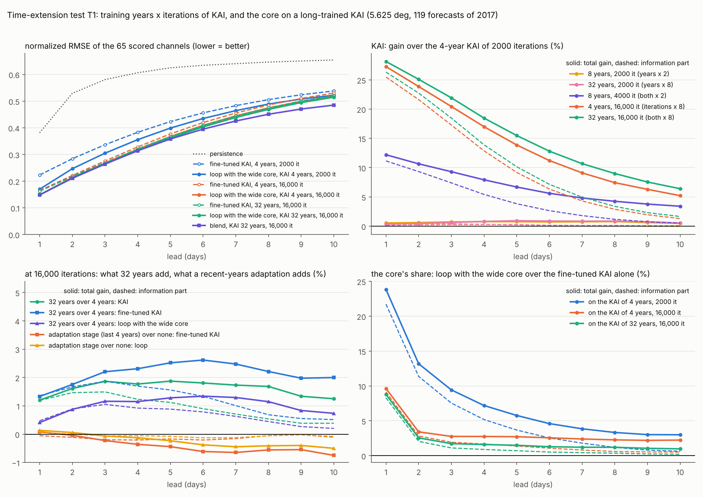
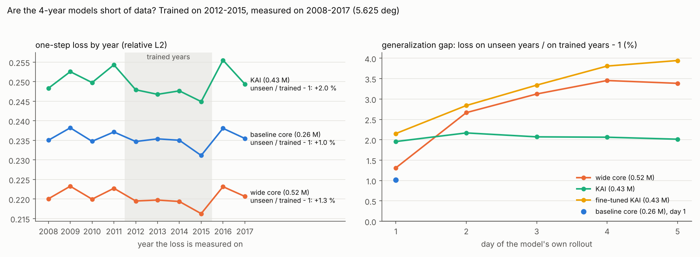
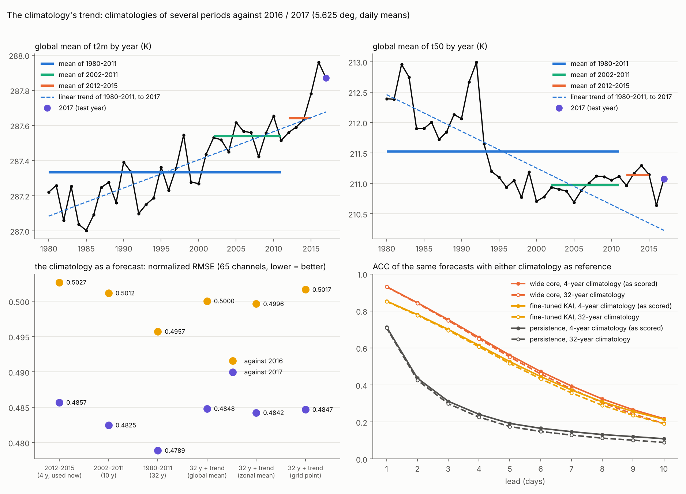

# 시간 확장 시험: 학습 기간을 늘리면 무엇이 좋아지고, 모델의 어느 부분이 함께 커져야 하나? 5.625° 작은 시험 (2026-11-14)

요청(2026-11-14 10:40, 13:11 KST): "++모델은 해상도에 따른 확장이었는데 시간적으로 확장 즉 데이터 기간을 늘리면 이에 따른 확장도 필요할까요?", "한번 시간확장 버젼도 시험".

이렇게 읽었습니다: 학습 기간을 4년에서 32년으로 늘릴 때 (1) 지금 크기의 모델이 그 자료를 쓸 수 있는지, (2) 크기와 반복 수 가운데 무엇을 함께 늘려야 하는지, (3) 정규화와 기후값은 그대로 두어도 되는지를 5.625° CPU 시험으로 잽니다. 이 문서의 KAI는 5.625° 시험용으로 줄인 작은 KAI(0.43 M, 우리가 4년으로 다시 학습한 것)이고 원본 checkpoint(7.57 M, 32년)가 아닙니다.

**상태(2026-11-14 18:10 KST): 진단 두 가지(2, 3절)와 KAI 쪽 1차 채점 T1(5절)이 끝났습니다. 1980 ~ 2011년 KAI(T1b), core 쪽 채점(T2, T3)은 진행 중이고 6절부터 채웁니다.**

## 요약 (지금까지)

1. **연도만 늘리면 거의 그대로입니다.** KAI를 같은 반복 수(2000회)로 8년, 32년에 학습하면 총 이득이 +0.3 ~ +0.9 %입니다. 진단(2절)이 미리 말한 대로입니다: 그 모델은 자료가 아니라 반복 수와 용량이 모자랐습니다.
2. **긴 기간의 효과를 여는 것은 반복 수입니다.** 4년 그대로 반복 수만 8배로 하면 1 / 3 / 5 / 7 / 10일 +27.3 / +20.4 / +13.9 / +9.1 / +5.2 %(정보 항 +25.5 / +17.3 / +9.2 / +4.3 / +1.3)입니다. 지금까지 5.625° 시험의 KAI는 11 epoch만 학습된 덜 익은 모델이었습니다.
3. **반복 8배에서는 32년이 4년보다 좋습니다.** KAI +1.2 / +1.9 / +1.9 / +1.7 / +1.2 %, 미세조정 KAI +1.3 / +2.2 / +2.5 / +2.5 / +2.0 %. 4년 모델은 이 반복 수에서 과적합으로 넘어가고(처음 보는 해의 오차가 +6.8 %) 32년이 그것을 +1.7 %로 되돌립니다. 32년에서는 다시 용량이 모자랍니다(5.3절).
4. **취약점: 길게 학습한 KAI 위에서는 core의 몫이 크게 줄어듭니다.** 넓은 core를 되먹임으로 붙인 이득이 4년 KAI 위 +23.8 / +9.4 / +5.8 / +3.9 / +3.0 %에서 32년 KAI 위 +8.8 / +1.7 / +1.5 / +1.2 / +1.0 %(정보 항 +8.3 / +1.1 / +0.7 / +0.4 / +0.2)가 됩니다. 남는 것은 주로 지표 변수(t2m +39 / +19 / +14 / +12 / +12 %)입니다. 이 core는 아직 4년, 반복 1배 그대로입니다(5.4절).
5. **새 최고 모델**: 32년 KAI + 넓은 core. 되먹임이 이전 최고보다 +12.7 / +13.1 / +9.2 / +5.5 / +1.4 %, 혼합이 +12.7 / +13.6 / +9.2 / +5.7 / +2.9 %입니다(5.5절).
6. **최근 연도 적응 단계는 전체로는 손해이고, 이득은 느린 평균 상태에만 있습니다.** 32년 학습 뒤 최근 4년으로 미세조정하면 총 +0.1 / −0.2 / −0.4 / −0.6 / −0.7 %입니다. 띠 평균(k0)은 +1.1 / +0.7 / +0.7 / +1.1 / +1.8 %, t2m은 10일에 +1.9 % 좋아지고 파동(행성 규모, 종관 규모)은 −0.3 ~ −1.0 % 나빠집니다. 가중치 전체를 최근 연도에 맞추는 구조는 필요하지 않고, 필요가 있다면 평균 상태만 맞추는 작은 구조입니다(5.6절).
7. 진단에서 나온 것(2, 3절): 4년 모델의 과적합 폭은 +1.0 ~ +2.2 %뿐입니다. 기후값 추세 보정은 필요하지 않습니다(32년 기후값이 4년 것보다 2017년에 1.4 % 가깝고, 예외는 t2m 하나). 지금까지의 ACC는 4년 기후값의 잡음 때문에 조금 높게 나와 있습니다(10일 0.214가 32년 기준 0.191). 정규화는 기간을 바꿔도 0.03 표준편차 이내로 같습니다.





## 1. 시험의 구성

| 물음 | 방법 | 절 |
|---|---|---|
| 지금 모델이 자료 부족인가, 용량 부족인가 | 학습한 해와 처음 보는 해의 오차 비교 (학습 없음) | 2 |
| 긴 기간의 기후값과 정규화를 그대로 써도 되나 | 여러 기간의 기후값을 2016, 2017년과 비교 (학습 없음) | 3 |
| 연도, 반복 수, 크기 가운데 무엇이 이득을 주나 | KAI와 core를 4 / 8 / 32년, 반복 수 1 / 2 / 8배로 학습하고 2017년 채점 | 4 ~ |

모든 학습은 `runs/kaitend/stats.npz`(2012 ~ 2015년의 정규화와 기후값)를 그대로 씁니다. 그래서 모델 사이에 달라지는 것은 학습 자료, 크기, 반복 수뿐입니다. 연도 묶음은 모두 2015년에 끝납니다(물리항 G(x)의 눈금을 마지막 학습 연도에서 잡기 때문): 4년 = 2012 ~ 2015, 8년 = 2008 ~ 2015, 32년 = 1984 ~ 2015. 검증 2016년, 시험 2017년(IC 119개, 10일)은 그대로입니다. 1980 ~ 2011년 일평균은 WeatherBench2의 공개 5.625° 자료에서 `scripts/wb2_to_kai.py --daily-mean`으로 만들었고, 같은 방법으로 만든 2015년이 기존 자료와 비트 단위로 같습니다.

## 2. 진단 1: 자료 부족인가, 용량 부족인가

`scripts/kai_gap_diag.py`: 학습이 끝난 checkpoint의 하루 예보 loss(학습 기록의 `val`과 같은 상대 L2 오차)를 2008 ~ 2017년 각각에서 잽니다. 자료가 부족한(과적합한) 모델은 학습한 해에서 뚜렷하게 더 좋고, 용량이나 반복 수가 부족한 모델은 두 쪽이 거의 같습니다. 2016년의 값은 학습 기록과 같습니다(baseline core 0.2379, KAI 0.2552).

하루 예보 loss (core는 해마다 120일, KAI는 60일):

| 모델 (학습 2012 ~ 2015) | 2008 | 2009 | 2010 | 2011 | **2012** | **2013** | **2014** | **2015** | 2016 | 2017 | 처음 보는 해 / 학습한 해 − 1 |
|---|---|---|---|---|---|---|---|---|---|---|---|
| baseline core (0.26 M) | 0.2350 | 0.2382 | 0.2348 | 0.2371 | 0.2347 | 0.2354 | 0.2350 | 0.2311 | 0.2381 | 0.2355 | +1.0 % |
| 넓은 core (0.52 M) | 0.2201 | 0.2233 | 0.2200 | 0.2228 | 0.2195 | 0.2197 | 0.2194 | 0.2163 | 0.2232 | 0.2207 | +1.3 % |
| KAI (0.43 M) | 0.2483 | 0.2526 | 0.2498 | 0.2543 | 0.2479 | 0.2468 | 0.2477 | 0.2449 | 0.2555 | 0.2494 | +2.0 % |

자기 적분의 선행일별 과적합 폭(처음 보는 해 / 학습한 해 − 1, 해마다 60일):

| 모델 | 1일 | 2일 | 3일 | 4일 | 5일 |
|---|---|---|---|---|---|
| 넓은 core | +1.3 % | +2.7 % | +3.1 % | +3.5 % | +3.4 % |
| KAI | +2.0 % | +2.2 % | +2.1 % | +2.1 % | +2.0 % |
| 미세조정 KAI (kai_ro) | +2.2 % | +2.8 % | +3.3 % | +3.8 % | +3.9 % |

읽는 법과 한계:

- 한 해의 loss의 표준오차는 약 0.0013 ~ 0.0018(0.6 ~ 0.7 %)이고, 해마다의 차이(2015년이 가장 쉽고 2016년이 가장 어려움)가 과적합 폭과 비슷한 크기입니다. 폭 자체가 작다는 것이 결론입니다.
- 자료를 한없이 늘리면 학습한 해와 처음 보는 해의 오차가 같아지고, 그 값은 지금의 두 값 사이에 놓입니다. 그래서 "같은 크기, 같은 반복 수에서 연도만 늘린 이득"의 상한이 대략 이 폭입니다. 반복 수나 크기를 함께 늘렸을 때의 이득은 이 진단으로는 알 수 없고 4절의 학습으로 잽니다.
- 넓은 core는 baseline core보다 하루 loss가 6 % 낮은데 과적합 폭은 +1.0 %에서 +1.3 %로만 늘었습니다. 용량이 주는 이득은 4년 자료로도 얻고 있고, 더 큰 core도 4년에서 과적합 없이 쓸 수 있는 구간이 남아 있다는 뜻입니다.
- 1.5°에서는 격자점이 14배 많고 core도 더 크므로(w128 / u96) 같은 진단을 그쪽 checkpoint로 다시 해야 합니다. 명령은 9절에 있습니다.

## 3. 진단 2: 기후값의 추세

`scripts/kai_clim_trend.py`: 기간별 기후값(날짜별 평균, 31일 평활, 점수 계산과 같은 방법)을 2016, 2017년의 매일과 비교합니다. 2012 ~ 2015년으로 다시 만든 기후값은 `stats.npz`의 것과 소수점 넷째 자리까지 같습니다.

### 3.1 추세의 크기

- 1980 ~ 2017년 전 지구 평균의 추세: t2m +0.18 K / 10년, t850 +0.14 K / 10년, z500 +33 m²/s² / 10년, tcwv +0.15 kg/m² / 10년. t50은 −0.46 K / 10년인데 직선이 아닙니다(1990년대 중반까지 내려가고 그 뒤로는 평평, 1982년과 1991 ~ 1992년에 화산 분출 뒤의 승온).
- 2017년의 전 지구 평균 − 기후값: 1980 ~ 2011년 기후값은 t2m +0.54 K, t850 +0.47 K, z500 +111 m²/s². 지금 쓰는 2012 ~ 2015년 기후값도 +0.23 K, +0.26 K, +58 m²/s²입니다(2016, 2017년이 더 따뜻한 해). 오전에 어림한 0.4 K보다 조금 큽니다.

### 3.2 기후값을 예보로 썼을 때의 오차

65채널 nRMSE(낮을수록 좋음)와 MSE의 세 항(전 지구 연평균의 차이 / 격자점별 연평균의 차이 / 나머지 = 날씨와 기후값의 잡음):

| 기후값의 기간 | 2017년 nRMSE | 세 항 | 2016년 nRMSE | 세 항 |
|---|---|---|---|---|
| 2012 ~ 2015 (4년, 지금 쓰는 것) | 0.4857 | 0.0015 / 0.0066 / 0.2982 | 0.5027 | 0.0012 / 0.0080 / 0.3164 |
| 2002 ~ 2011 (10년) | 0.4825 | 0.0044 / 0.0059 / 0.2914 | 0.5012 | 0.0040 / 0.0080 / 0.3103 |
| 1980 ~ 2011 (32년) | **0.4789** | 0.0019 / 0.0067 / 0.2888 | **0.4957** | 0.0025 / 0.0073 / 0.3062 |
| 1984 ~ 2015 (32년) | 0.4787 | 0.0021 / 0.0064 / 0.2889 | 0.4958 | 0.0024 / 0.0073 / 0.3065 |
| 32년 + 추세 (전 지구 평균) | 0.4848 | 0.0093 / 0.0067 / 0.2888 | 0.5000 | 0.0075 / 0.0073 / 0.3062 |
| 32년 + 추세 (위도 평균) | 0.4842 | 0.0093 / 0.0059 / 0.2888 | 0.4996 | 0.0075 / 0.0070 / 0.3062 |
| 32년 + 추세 (격자점) | 0.4847 | 0.0093 / 0.0064 / 0.2888 | 0.5017 | 0.0075 / 0.0094 / 0.3062 |

"+ 추세"는 1980 ~ 2011년 기후값을 그 기간 연평균의 직선 추세만큼 목표 연도로 옮긴 것입니다.

- **32년 기후값이 가장 좋습니다.** 4년 기후값보다 2017년에 1.4 %, 2016년에 1.4 % 가깝습니다. 차이는 셋째 항에서 납니다(0.2982 대 0.2888): 4년 × 31일 평균에는 날씨 잡음이 편차 분산의 3 ~ 4 % 남아 있고, 32년 평균에서는 그것이 8분의 1로 줄어듭니다. 추세가 만드는 첫째 항은 0.002로 전체 MSE의 1 %가 안 됩니다.
- **직선 추세로 옮기면 65채널 평균은 나빠집니다.** 첫째 항이 0.0019에서 0.0093으로 커지는데, 추세가 직선이 아닌 성층권 채널 때문입니다. 옮긴 뒤의 차이가 q50 +0.57, q100 +0.48, t50 +0.08 표준편차입니다(옮기기 전 +0.07, +0.16, −0.04). 50 / 100 hPa를 빼고 보면 추세를 옮긴 쪽이 0.4849 ~ 0.4853으로 32년 기후값(0.4866)보다 0.3 % 좋습니다.

변수별 (기후값을 예보로 쓴 RMSE, 물리 단위, 2017년 / 2016년):

| 기후값의 기간 | t2m (K) | t850 (K) | z500 (m²/s²) | u850 (m/s) | msl (hPa) |
|---|---|---|---|---|---|
| 2012 ~ 2015 (4년) | 2.244 / 2.327 | 3.089 / 3.143 | 777.1 / 803.6 | 4.843 / 4.878 | 6.731 / 6.927 |
| 2002 ~ 2011 (10년) | 2.232 / 2.314 | 3.070 / 3.118 | 768.6 / 800.0 | 4.766 / 4.857 | 6.650 / 6.907 |
| 1980 ~ 2011 (32년) | 2.285 / 2.380 | 3.078 / 3.125 | 768.1 / 798.7 | 4.739 / 4.808 | 6.607 / 6.852 |
| 32년 + 추세 (위도 평균) | 2.212 / 2.279 | 3.043 / 3.084 | 760.5 / 790.0 | 4.734 / 4.818 | 6.603 / 6.862 |

- **t2m은 예외입니다.** 추세가 변동에 비해 큰 변수여서 32년 기후값이 4년 기후값보다 1.8 % 나쁘고(2.285 대 2.244 K), 추세를 옮기면 1.4 % 좋아집니다(2.212 K). t850, z500, u850, msl은 32년 기후값이 4년 기후값과 같거나 좋습니다.

### 3.3 기후값을 바꾸면 ACC, 활동도, 오차 항이 어떻게 달라지나

이미 만들어 둔 2017년 예보(IC 119개)를 그대로 두고 기준 기후값만 바꿨습니다. 예보와 그 RMSE는 같습니다. 1 / 3 / 5 / 7 / 10일:

| 예보 | 기준 기후값 | ACC (채점 방식) | 활동도 |
|---|---|---|---|
| 미세조정 KAI | 4년 (지금) | 0.853 / 0.700 / 0.526 / 0.372 / 0.214 | 0.917 / 0.856 / 0.822 / 0.811 / 0.831 |
| 미세조정 KAI | 32년 | 0.851 / 0.695 / 0.516 / 0.357 / 0.191 | 0.915 / 0.852 / 0.818 / 0.807 / 0.825 |
| 넓은 core | 4년 (지금) | 0.931 / 0.753 / 0.561 / 0.394 / 0.218 | 0.951 / 0.866 / 0.812 / 0.781 / 0.773 |
| 넓은 core | 32년 | 0.930 / 0.748 / 0.551 / 0.378 / 0.191 | 0.950 / 0.862 / 0.807 / 0.773 / 0.762 |
| persistence | 4년 (지금) | 0.713 / 0.312 / 0.192 / 0.147 / 0.109 | 1.002 / 1.006 / 1.011 / 1.017 / 1.028 |
| persistence | 32년 | 0.708 / 0.299 / 0.175 / 0.129 / 0.089 | 1.002 / 1.004 / 1.009 / 1.014 / 1.024 |

- **지금의 ACC가 조금 부풀려져 있습니다.** 오전에는 "오래된 기후값이 ACC를 부풀린다"고 말씀드렸는데 실제는 반대였습니다. 4년 기후값의 잡음이 예보의 편차와 참값의 편차에 똑같이 들어가서 둘의 상관을 올립니다. 편차 분산의 약 3 ~ 4 %가 공통 성분이면 ACC 0.19가 0.22가 되는데, 잰 값(0.191 → 0.214)과 맞습니다. 선행이 길수록(ACC가 낮을수록) 차이가 큽니다.
- **모델 사이의 비교는 달라지지 않습니다.** 넓은 core − 미세조정 KAI의 정보 항 차이는 4년 기준 −0.0138 / +0.0035 / +0.0132 / +0.0159 / +0.0179, 32년 기준 −0.0136 / +0.0039 / +0.0134 / +0.0160 / +0.0176입니다. 지금까지의 "정보 / 진폭" 결론은 그대로입니다.
- 활동도는 0.002 ~ 0.011 낮아집니다(같은 이유).

### 3.4 정규화

기간별 평균과 표준편차를 `stats.npz`(2012 ~ 2015)와 비교하면, 1980 ~ 2011년은 평균이 t2m −0.018, t850 −0.016, z500 −0.012, t50 +0.026 표준편차만큼 다르고 표준편차의 비는 0.985 ~ 1.003입니다. 정규화는 어느 기간으로 만들어도 사실상 같습니다.

### 3.5 32년 실행에 대한 뜻

- 32년 실행의 `stats.npz`는 그 32년으로 만들어지고, 그 기후값은 점수의 기준으로 지금 것보다 낫습니다. 손댈 것이 없습니다.
- 다만 32년 실행의 ACC를 4년 실행의 ACC와 나란히 놓으면 안 됩니다. 4년 쪽이 기후값 잡음만큼(10일에서 약 0.02) 높게 나옵니다. RMSE와 오차 항은 그대로 비교할 수 있습니다.
- t2m만은 긴 기후값이 불리합니다. 혼합에서 기후값 쪽으로 당기는 무게가 t2m에서 조금 달라질 수 있습니다.



## 4. 학습 시험의 설계

대기열 `runs/kaitend/queue30.sh` (2026-11-14 16:15 KST에 queue29를 대신함, 다시 시작 가능). 반복 수 1배는 지금까지의 모델의 값입니다(KAI 2000회 = 4년 자료 11 epoch, core 3000회 = 16 epoch). KAI는 batch 8이라 16,000회가 4년에서는 88 epoch, 32년에서는 11 epoch입니다.

| 이름 | 모델 | 학습 기간 | 반복 수 | 보는 것 | 채점 |
|---|---|---|---|---|---|
| `kai_y8`, `kai_y32` | KAI | 8년, 32년 | 1배 | 연도만 | T1 |
| `kai_y8x2` | KAI | 8년 | 2배 | 같은 epoch | T1 |
| `kai_x8` | KAI | 4년 | 8배 | 반복 수만 (대조) | T1 |
| `kai_y32x8` | KAI | 32년 | 8배 | 32년 실행의 방식 (같은 epoch) | T1 |
| `kai_x8ro`, `kai_y32x8ro` | 미세조정 KAI | 4년, 32년 | 위의 것에서 1000회 | 적분 미세조정까지 | T1 |
| `kai_y32x8ro4` | 미세조정 KAI | 32년 학습 뒤 미세조정만 2012 ~ 2015년 | 1000회 | 최근 연도 적응 단계 | T1 |
| `kai_o32x8`, `kai_o32x8ro`, `kai_o32x8ro4` | KAI, 미세조정 KAI | 1980 ~ 2011년 (원본 KAI의 기간) | 8배 | 시험 연도보다 6년 일찍 끝나는 기간, 그 위의 적응 단계 | T1b |
| `core_gngmz8_y32` | baseline core | 32년 | 1배 | 연도만 | T2 |
| 그다음 (queue31) | core, 더 큰 KAI | | | core의 반복 수와 폭, KAI의 용량 × 기간, 시대 입력 | T2, T3 |

모든 채점은 총합 / 정보 / 진폭으로 나눠 봅니다. 32년 = 1984 ~ 2015, 8년 = 2008 ~ 2015, 4년 = 2012 ~ 2015.

CPU에서 할 수 없어서 빠진 것: core의 반복 수 8배(baseline 18시간, 넓은 core 41시간), 원래 크기의 KAI(7.57 M).

## 5. 1차 채점 T1: KAI의 연도 × 반복 수, 그리고 길게 학습한 KAI 위의 core

2017년 IC 119개, 10일, 65채널. 이득은 + = 좋아짐, 선행 1 / 3 / 5 / 7 / 10일. 넓은 core는 지금까지의 것(`core_gngmz8w`, 4년, 3000회) 그대로입니다. ACC는 지금의 4년 기후값 기준입니다(3.3절의 주의).

### 5.1 nRMSE

| 모델 | 1일 | 3일 | 5일 | 7일 | 10일 | ACC 5일 | ACC 10일 |
|---|---|---|---|---|---|---|---|
| persistence (`persistence`) | 0.381 | 0.581 | 0.625 | 0.640 | 0.654 | 0.192 | 0.109 |
| 넓은 core (4년, 혼자) (`core_gngmz8w`) | 0.177 | 0.324 | 0.421 | 0.483 | 0.540 | 0.561 | 0.218 |
| KAI 4년 (`kai`) | 0.225 | 0.357 | 0.459 | 0.530 | 0.595 | 0.484 | 0.174 |
| KAI 8년 (`kai_y8`) | 0.223 | 0.354 | 0.456 | 0.526 | 0.592 | 0.489 | 0.172 |
| KAI 32년 (`kai_y32`) | 0.224 | 0.355 | 0.455 | 0.525 | 0.591 | 0.491 | 0.180 |
| KAI 8년, 반복 2배 (`kai_y8x2`) | 0.197 | 0.324 | 0.429 | 0.504 | 0.574 | 0.552 | 0.213 |
| KAI 4년, 반복 8배 (`kai_x8`) | 0.163 | 0.284 | 0.396 | 0.481 | 0.564 | 0.632 | 0.264 |
| KAI 32년, 반복 8배 (`kai_y32x8`) | 0.161 | 0.279 | 0.388 | 0.473 | 0.557 | 0.642 | 0.281 |
| 미세조정 KAI 4년 (`kai_ro`) | 0.223 | 0.337 | 0.423 | 0.483 | 0.538 | 0.526 | 0.214 |
| 미세조정 KAI 4년, 반복 8배 (`kai_x8ro`) | 0.165 | 0.276 | 0.377 | 0.455 | 0.530 | 0.649 | 0.286 |
| 미세조정 KAI 32년, 반복 8배 (`kai_y32x8ro`) | 0.163 | 0.270 | 0.368 | 0.444 | 0.520 | 0.662 | 0.303 |
| 32년 KAI를 최근 4년으로 미세조정 (`kai_y32x8ro4`) | 0.163 | 0.270 | 0.369 | 0.447 | 0.524 | 0.661 | 0.301 |
| 되먹임: 4년 KAI + 넓은 core (이전 최고) (`loop_core_gngmz8w@kai_ro`) | 0.170 | 0.305 | 0.399 | 0.464 | 0.522 | 0.598 | 0.257 |
| 되먹임: 반복 8배 4년 KAI + 넓은 core (`loop_core_gngmz8w@kai_x8ro`) | 0.149 | 0.268 | 0.367 | 0.445 | 0.518 | 0.671 | 0.306 |
| 되먹임: 32년 KAI + 넓은 core (`loop_core_gngmz8w@kai_y32x8ro`) | 0.148 | 0.265 | 0.362 | 0.439 | 0.515 | 0.678 | 0.314 |
| 되먹임: 최근 4년 적응 KAI + 넓은 core (`loop_core_gngmz8w@kai_y32x8ro4`) | 0.148 | 0.265 | 0.363 | 0.441 | 0.517 | 0.678 | 0.313 |
| 혼합: 4년 KAI + 넓은 core (`blend_core_gngmz8w@kai_ro`) | 0.170 | 0.305 | 0.394 | 0.451 | 0.500 | 0.596 | 0.259 |
| 혼합: 반복 8배 4년 KAI + 넓은 core (`blend_core_gngmz8w@kai_x8ro`) | 0.149 | 0.268 | 0.363 | 0.430 | 0.488 | 0.670 | 0.308 |
| 혼합: 32년 KAI + 넓은 core (`blend_core_gngmz8w@kai_y32x8ro`) | 0.148 | 0.264 | 0.358 | 0.425 | 0.485 | 0.678 | 0.319 |

검증 loss(2016년, 64일): `kai` 0.2552, `kai_y8` 0.2542, `kai_y32` 0.2545, `kai_y8x2` 0.2248, `kai_x8` 0.1873, `kai_y32x8` 0.1832, `kai_x8ro` 0.1891, `kai_y32x8ro` 0.1848, `kai_y32x8ro4` 0.1849.

### 5.2 연도와 반복 수 (KAI 혼자, 기준 = 4년 2000회 KAI. 마지막 두 줄은 줄에 적힌 기준)

| 비교 | 총 이득 % | 정보 항 | 진폭 항 | 유의하게 좋아진 / 나빠진 칸 (650) |
|---|---|---|---|---|
| 8년, 반복 1배 | +0.5 / +0.7 / +0.8 / +0.8 / +0.5 | +0.4 / +0.4 / +0.2 / +0.1 / −0.0 | +0.0 / +0.2 / +0.5 / +0.6 / +0.5 | 323 / 33 |
| 32년, 반복 1배 | +0.3 / +0.6 / +0.9 / +0.8 / +0.5 | +0.1 / +0.3 / +0.3 / +0.1 / +0.1 | +0.0 / +0.2 / +0.5 / +0.6 / +0.5 | 308 / 33 |
| 8년, 반복 2배 (같은 epoch) | +12.2 / +9.3 / +6.7 / +4.8 / +3.4 | +11.2 / +7.4 / +3.8 / +1.8 / +0.5 | +0.7 / +1.7 / +2.7 / +2.8 / +2.7 | 634 / 0 |
| 4년, 반복 8배 | +27.3 / +20.4 / +13.9 / +9.1 / +5.2 | +25.5 / +17.3 / +9.2 / +4.3 / +1.3 | +1.3 / +2.9 / +4.4 / +4.5 / +3.6 | 638 / 0 |
| 32년, 반복 8배 (같은 epoch) | +28.1 / +21.9 / +15.5 / +10.7 / +6.4 | +26.3 / +18.5 / +10.2 / +5.0 / +1.7 | +1.4 / +3.2 / +5.1 / +5.5 / +4.5 | 643 / 0 |
| 32년에서 반복 8배 대 1배 | +27.9 / +21.4 / +14.7 / +9.9 / +5.9 | +26.3 / +18.3 / +10.0 / +4.9 / +1.6 | +1.3 / +3.0 / +4.6 / +4.9 / +4.1 | 641 / 0 |
| 반복 8배에서 32년 대 4년 | +1.2 / +1.9 / +1.9 / +1.7 / +1.2 | +1.2 / +1.5 / +1.1 / +0.7 / +0.4 | +0.0 / +0.4 / +0.8 / +1.1 / +0.9 | 488 / 5 |

적분 미세조정까지 한 KAI (기준 = 4년 미세조정 KAI `kai_ro`. 마지막 줄은 `kai_x8ro` 기준):

| 비교 | 총 이득 % | 정보 항 | 진폭 항 | 유의하게 좋아진 / 나빠진 칸 (650) |
|---|---|---|---|---|
| 4년, 반복 8배 | +26.1 / +18.1 / +10.9 / +5.7 / +1.4 | +24.4 / +16.5 / +9.1 / +4.4 / +1.3 | +1.2 / +1.3 / +1.6 / +1.1 / −0.1 | 589 / 11 |
| 32년, 반복 8배 | +27.1 / +19.9 / +13.2 / +8.0 / +3.4 | +25.4 / +18.0 / +10.5 / +5.3 / +1.8 | +1.2 / +1.6 / +2.4 / +2.5 / +1.4 | 628 / 0 |
| 반복 8배에서 32년 대 4년 | +1.3 / +2.2 / +2.5 / +2.5 / +2.0 | +1.4 / +1.9 / +1.6 / +1.0 / +0.5 | −0.0 / +0.3 / +1.0 / +1.5 / +1.5 | 570 / 7 |

- 연도만 늘린 두 모델은 정보 항이 +0.1 ~ +0.4 %뿐입니다. 2절의 과적합 폭(+2.0 %)이 말한 상한 안쪽입니다.
- 반복 수의 이득은 거의 전부 정보 항입니다(1일 +25.5 중 진폭 +1.3). 흐려서 얻은 이득이 아닙니다. 활동도는 0.95 / 0.94 / 0.93 / 0.94 / 0.96으로 4년 KAI(0.94 / 0.93 / 0.93 / 0.96 / 1.02)와 비슷합니다.
- 같은 epoch 수로 맞춘 비교에서는 연도와 반복 수가 함께 늘어난 쪽(32년, 8배)이 4년 8배보다 +1.2 ~ +1.9 %입니다. 즉 "32년 자료를 쓰려면 반복 수를 같은 비율로 늘려야 하고, 그러면 4년에 같은 반복 수를 쓴 것보다 조금 더 좋다"가 KAI 쪽의 답입니다.
- 32년의 이득은 고도(z +3.4 / +3.4 / +2.9 / +2.6 / +2.2 %)와 바람(u +1.7 / +2.7 / +3.3 / +3.3 / +3.1 %)에서 크고, 띠 평균과 행성 규모(+2 ~ +4 %)에서 크고, 열대(+0.3 ~ +2.0 %)에서 작습니다.

### 5.3 길게 학습한 KAI의 과적합 폭

`scripts/kai_gap_diag.py --kai kai_x8 kai_y32x8 kai_y32x8ro`, 해마다 60일, 하루 예보 loss(표준오차 0.0012). * = 학습한 해.

| 모델 | 1981 | 1985 | 1990 | 1995 | 2000 | 2005 | 2010 | 2012 | 2013 | 2014 | 2015 | 2016 | 2017 | 처음 보는 해 / 학습한 해 − 1 (1 / 2 / 3일) |
|---|---|---|---|---|---|---|---|---|---|---|---|---|---|---|
| `kai_x8` (4년, 8배) | 0.1872 | 0.1856 | 0.1835 | 0.1840 | 0.1836 | 0.1862 | 0.1845 | 0.1737* | 0.1740* | 0.1730* | 0.1723* | 0.1878 | 0.1824 | +6.8 / +9.4 / +9.9 % |
| `kai_y32x8` (32년, 8배) | 0.1803 | 0.1766* | 0.1766* | 0.1771* | 0.1757* | 0.1787* | 0.1785* | 0.1792* | 0.1801* | 0.1791* | 0.1785* | 0.1840 | 0.1788 | +1.7 / +1.9 / +2.3 % |
| `kai_y32x8ro` (미세조정) | 0.1817 | 0.1783* | 0.1781* | 0.1786* | 0.1771* | 0.1802* | 0.1801* | 0.1808* | 0.1819* | 0.1805* | 0.1801* | 0.1857 | 0.1805 | +1.7 / +2.0 / +2.5 % |

- 반복 8배의 4년 모델은 자료 부족 쪽으로 넘어갔습니다(+6.8 %, 2000회에서는 +2.0 %). 여기서부터는 연도가 이득을 줍니다.
- 32년 모델은 다시 +1.7 %입니다. 32년 자료에 이 크기(0.43 M)와 11 epoch으로는 용량 / 반복 수가 모자란 상태로 돌아왔고, 다음에 늘릴 것은 연도가 아니라 크기나 반복 수입니다.
- 시대에 따른 차이: 32년 모델의 loss는 1985 ~ 2000년 0.176 ~ 0.177, 2005 ~ 2015년 0.179 ~ 0.180으로 최근 쪽이 1 % 남짓 큽니다. 그런데 그 해들을 본 적이 없는 4년 모델도 같은 모양입니다(표준편차 단위 nRMSE로 1985 ~ 2000년 0.161 ~ 0.163, 2005 / 2010 / 2016 / 2017년 0.163 ~ 0.169). 최근 해가 조금 더 어려운 것이지, 32년 모델이 옛 시대에 치우쳐 최근을 못 맞추는 것이 아닙니다.

### 5.4 core의 몫: 넓은 core를 되먹임으로 붙였을 때 (기준 = 같은 KAI 혼자)

| 비교 | 총 이득 % | 정보 항 | 진폭 항 | 유의하게 좋아진 / 나빠진 칸 (650) |
|---|---|---|---|---|
| 4년 KAI (2000회) 위 | +23.8 / +9.4 / +5.8 / +3.9 / +3.0 | +21.7 / +7.5 / +3.7 / +1.8 / +0.6 | +1.4 / +1.6 / +1.8 / +1.8 / +2.1 | 597 / 0 |
| 4년 KAI, 반복 8배 위 | +9.6 / +2.8 / +2.7 / +2.4 / +2.2 | +9.1 / +1.9 / +1.4 / +0.8 / +0.5 | +0.2 / +0.7 / +1.3 / +1.5 / +1.7 | 597 / 4 |
| 32년 KAI, 반복 8배 위 | +8.8 / +1.7 / +1.5 / +1.2 / +1.0 | +8.3 / +1.1 / +0.7 / +0.4 / +0.2 | +0.2 / +0.5 / +0.7 / +0.7 / +0.7 | 399 / 14 |

- KAI가 길게 학습될수록 core가 보태는 정보가 줄어듭니다. 3일 이후 정보 항은 +7.5 ~ +0.6 %에서 +1.1 ~ +0.2 %가 됩니다. 2026-11-13에 드린 짐작("남지만 작아진다, 1 ~ 5일 정보 +1 % 안팎")은 3 ~ 5일에서 맞고, 1일은 짐작보다 큽니다(+8.3 %).
- 32년 KAI 위에서 남는 이득은 변수로는 지표(+33.9 / +20.3 / +17.9 / +16.9 / +17.3 %, 그중 t2m +39 / +19 / +14 / +12 / +12 %)와 습도(+12.5 / +3.1 / +2.8 / +2.7 / +3.1 %), 지역으로는 열대(+12.5 / +3.8 / +3.6 / +3.7 / +4.0 %)입니다. 고도(z)는 +16.9 / +1.8 / +1.0 / +0.4 / +0.1 %, 남반구 중위도는 3일부터 0에 가깝습니다. 즉 core가 길게 학습한 KAI에 더하는 것은 "KAI가 약한 지표와 열대", 그리고 하루째의 정확도입니다.
- 뜻: 지금까지 5.625°에서 보고한 "KAI 대비 이득"의 큰 부분은 KAI가 덜 학습되어 생긴 것입니다. 1.5° GPU 실행은 KAI가 약 110 epoch이라 이 문제에서 훨씬 멀지만(그 실행의 core 몫은 1일 +20 %, 10일 +1.7 %), 32년 실행에서 core의 몫을 말할 때는 같은 반복 수의 KAI를 기준으로 해야 합니다.
- 아직 모르는 것: 이 표의 core는 4년, 3000회 그대로입니다. core도 KAI처럼 반복 수가 모자랐을 수 있고(2절: 과적합 폭 +1.3 %), 그렇다면 core를 늘렸을 때 몫이 다시 커집니다. T2, T3이 잽니다.

### 5.5 시간 확장 모델과 이전 최고

| 비교 | 총 이득 % | 정보 항 | 진폭 항 | 유의하게 좋아진 / 나빠진 칸 (650) |
|---|---|---|---|---|
| 되먹임: 32년 KAI 대 이전 최고 | +12.7 / +13.1 / +9.2 / +5.5 / +1.4 | +12.7 / +12.6 / +7.9 / +4.1 / +1.5 | −0.0 / +0.5 / +1.3 / +1.4 / −0.1 | 601 / 5 |
| 혼합: 32년 KAI 대 4년 KAI | +12.7 / +13.6 / +9.2 / +5.7 / +2.9 | +12.7 / +13.2 / +8.3 / +4.5 / +1.7 | −0.0 / +0.3 / +0.8 / +1.1 / +1.2 | 649 / 0 |
| 되먹임: 32년 KAI 대 반복 8배 4년 KAI | +0.4 / +1.2 / +1.3 / +1.3 / +0.7 | +0.5 / +1.1 / +0.9 / +0.6 / +0.2 | −0.0 / +0.1 / +0.4 / +0.7 / +0.6 | 460 / 24 |

변수별 (물리 단위 RMSE의 이득 %, 전체 표는 `variable_table_T1.md`):

| 비교 | t2m | t850 | z500 | u850 | msl |
|---|---|---|---|---|---|
| KAI: 반복 8배 (4년) | +33.9 / +27.9 / +24.3 / +21.2 / +21.4 | +27.0 / +21.8 / +15.8 / +9.9 / +6.8 | +39.2 / +27.1 / +16.7 / +9.7 / +4.5 | +26.6 / +20.0 / +10.9 / +6.1 / +1.7 | +35.6 / +26.6 / +14.9 / +8.0 / +3.1 |
| 미세조정 KAI: 32년 대 4년 (반복 8배) | +1.1 / +1.1 / +0.8 / +0.5 / −0.8 | +0.5 / +2.2 / +2.8 / +2.4 / +1.3 | +2.7 / +3.3 / +2.5 / +2.2 / +2.0 | +1.9 / +2.5 / +3.2 / +2.9 / +2.8 | +4.0 / +3.8 / +3.5 / +3.3 / +2.1 |
| 미세조정 KAI: 최근 4년 적응 대 없음 | +0.2 / +0.1 / +0.6 / +1.0 / +1.9 | −0.1 / −0.2 / −0.4 / −0.3 / +0.1 | +1.4 / +0.1 / −0.1 / −0.5 / −0.7 | −0.1 / −0.3 / −0.6 / −0.7 / −1.1 | +0.2 / −0.3 / −0.5 / −0.6 / −0.9 |
| core의 몫: 4년 KAI 위 | +57.9 / +34.6 / +26.9 / +23.4 / +22.6 | +35.3 / +10.7 / +5.9 / +3.6 / +2.9 | +37.0 / +10.2 / +5.3 / +2.5 / +2.1 | +18.3 / +6.1 / +3.2 / +1.8 / +1.6 | +27.1 / +8.1 / +4.5 / +2.4 / +3.1 |
| core의 몫: 반복 8배 4년 KAI 위 | +39.9 / +19.3 / +14.9 / +13.1 / +12.4 | +19.5 / +3.0 / +3.5 / +3.3 / +2.7 | +14.8 / +1.9 / +2.1 / +1.4 / +1.0 | +5.8 / +1.3 / +2.1 / +1.8 / +1.8 | +9.6 / +1.1 / +2.2 / +2.1 / +1.9 |
| core의 몫: 32년 KAI 위 | +39.3 / +18.8 / +14.4 / +12.4 / +11.8 | +19.0 / +1.8 / +1.8 / +1.7 / +1.5 | +13.4 / +0.4 / +0.7 / +0.3 / −0.5 | +5.0 / +0.3 / +0.7 / +0.5 / +0.3 | +8.0 / +0.1 / +1.0 / +0.6 / +0.8 |
| 되먹임: 32년 KAI 대 이전 최고 | +3.6 / +8.4 / +7.7 / +4.5 / +0.8 | +8.0 / +13.9 / +11.4 / +6.7 / +2.6 | +16.5 / +17.9 / +11.0 / +5.5 / +0.4 | +15.2 / +14.9 / +9.1 / +5.3 / +1.2 | +19.4 / +19.6 / +11.6 / +6.1 / +0.6 |
| 혼합: 32년 KAI 대 4년 KAI | +3.6 / +8.0 / +7.8 / +6.0 / +4.3 | +8.0 / +14.3 / +11.1 / +6.6 / +3.6 | +16.5 / +18.5 / +10.8 / +5.4 / +2.5 | +15.2 / +15.3 / +8.7 / +5.1 / +2.6 | +19.4 / +20.0 / +11.0 / +5.9 / +2.9 |

활동도(예보 편차의 크기 / 실제 편차의 크기):

| 모델 | 활동도 1 / 3 / 5 / 7 / 10일 |
|---|---|
| `kai_y8` | 0.94 / 0.92 / 0.92 / 0.94 / 1.00 |
| `kai` | 0.94 / 0.93 / 0.93 / 0.96 / 1.02 |
| `kai_y32` | 0.94 / 0.92 / 0.93 / 0.95 / 1.01 |
| `kai_y8x2` | 0.94 / 0.92 / 0.91 / 0.93 / 0.96 |
| `kai_x8` | 0.95 / 0.94 / 0.93 / 0.94 / 0.96 |
| `kai_y32x8` | 0.95 / 0.93 / 0.92 / 0.93 / 0.96 |
| `kai_x8ro` | 0.94 / 0.90 / 0.87 / 0.86 / 0.86 |
| `kai_ro` | 0.92 / 0.86 / 0.82 / 0.81 / 0.83 |
| `kai_y32x8ro` | 0.94 / 0.89 / 0.85 / 0.84 / 0.85 |
| `kai_y32x8ro4` | 0.94 / 0.89 / 0.86 / 0.85 / 0.86 |
| `loop_core_gngmz8w@kai_ro` | 0.93 / 0.84 / 0.79 / 0.77 / 0.75 |
| `loop_core_gngmz8w@kai_x8ro` | 0.93 / 0.86 / 0.83 / 0.81 / 0.81 |
| `loop_core_gngmz8w@kai_y32x8ro` | 0.93 / 0.86 / 0.82 / 0.81 / 0.81 |
| `loop_core_gngmz8w@kai_y32x8ro4` | 0.93 / 0.86 / 0.83 / 0.81 / 0.81 |
| `blend_core_gngmz8w@kai_y32x8ro` | 0.93 / 0.85 / 0.78 / 0.72 / 0.66 |
| `blend_core_gngmz8w@kai_ro` | 0.93 / 0.81 / 0.74 / 0.68 / 0.64 |

- 이전 최고(4년 KAI + 넓은 core 되먹임)보다 되먹임 +12.7 / +13.1 / +9.2 / +5.5 / +1.4 %, 거의 전부 정보 항입니다. 활동도는 0.75에서 0.81로(10일) 오히려 덜 흐립니다.
- 그 이득의 대부분은 반복 수이고(4년 8배 KAI 위의 되먹임이 이미 0.149 / 0.268 / 0.367 / 0.445 / 0.518), 32년이 더하는 것은 되먹임에서 +0.4 / +1.2 / +1.3 / +1.3 / +0.7 %입니다.
- t2m은 여전히 약합니다: 32년 미세조정 KAI 혼자는 1일 1.38 K로 persistence(1.43 K)와 비슷하고, core를 붙여야 0.84 K가 됩니다.

### 5.6 최근 연도 적응 단계

32년으로 학습한 KAI(`kai_y32x8`)에서 적분 미세조정 1000회를 32년 전체로 한 것(`kai_y32x8ro`)과 최근 4년(2012 ~ 2015)으로 한 것(`kai_y32x8ro4`)의 비교입니다. 반복 수와 방법은 같고 미세조정 단계의 연도만 다릅니다.

| 비교 | 총 이득 % | 정보 항 | 진폭 항 | 유의하게 좋아진 / 나빠진 칸 (650) |
|---|---|---|---|---|
| 미세조정 KAI: 최근 4년 적응 대 32년 그대로 | +0.1 / −0.2 / −0.4 / −0.6 / −0.7 | −0.1 / −0.2 / −0.2 / −0.2 / −0.1 | +0.0 / −0.1 / −0.3 / −0.5 / −0.7 | 86 / 316 |
| 되먹임: 최근 4년 적응 대 32년 그대로 | +0.1 / −0.1 / −0.2 / −0.4 / −0.5 | +0.1 / −0.1 / −0.1 / −0.1 / −0.1 | +0.0 / −0.0 / −0.2 / −0.4 / −0.5 | 120 / 229 |

| 나눠 보면 (미세조정 KAI) | 이득 % |
|---|---|
| 띠 평균 (k0) | +1.1 / +0.7 / +0.7 / +1.1 / +1.8 |
| 행성 규모 (k1-3) | −0.0 / −0.3 / −0.4 / −0.8 / −0.9 |
| 종관 규모 (k4-9) | +0.1 / −0.3 / −0.6 / −0.8 / −1.0 |
| 작은 규모 (k10+) | −0.0 / −0.1 / −0.4 / −0.5 / −1.1 |
| t2m | +0.2 / +0.1 / +0.6 / +1.0 / +1.9 |
| z500 | +1.4 / +0.1 / −0.1 / −0.5 / −0.7 |
| u850 | −0.1 / −0.3 / −0.6 / −0.7 / −1.1 |

- 전체로는 손해입니다(유의하게 좋아진 칸 86, 나빠진 칸 316). 최근 4년에 맞추면 파동의 예보가 4년 자료의 과적합만큼 나빠집니다.
- 이득은 띠 평균과 t2m에만 있습니다. 3절에서 본 것과 같은 그림입니다: 긴 기간의 평균 상태는 시험 연도보다 조금 차갑고(t2m 0.54 K), 그 차이가 드러나는 곳은 느린 평균 상태뿐입니다.
- 그래서 지금까지의 답은 이렇습니다. **가중치 전체를 최근 연도에 맞추는 적응 단계는 필요하지 않습니다. 긴 기간의 효과를 올리는 것은 반복 수(기간에 비례)와 용량이고, 시간 적응이 쓸모 있다면 평균 상태만 맞추는 작은 구조입니다**(시대 입력, 또는 bias만 최근 연도에 맞추기). 그 크기는 띠 평균 오차의 +1 ~ +2 %입니다. 1980 ~ 2011년으로 학습한 KAI(T1b)에서 이 효과가 더 큰지 확인합니다.

### 5.7 이 채점의 한계

- 작은 KAI(0.43 M)입니다. 원본 KAI(7.57 M)는 32년에서 용량이 덜 모자랄 것이고, 그러면 연도의 이득이 여기보다 커질 수 있습니다.
- 반복 8배는 KAI에서만 했습니다. core는 CPU에서 2배까지만 가능합니다.
- 시험 연도는 2017년 하나, 학습 seed는 하나입니다. 반복 8배에서 32년 대 4년의 +1 ~ +2 %는 650칸 가운데 488 ~ 570칸이 유의하게 좋아진 것으로 받쳐지지만, 최근 연도 적응의 −0.2 ~ −0.7 %는 seed를 바꾸면 크기가 달라질 수 있습니다.
- 4년 KAI의 반복 8배(88 epoch)는 1.5° 실행(약 110 epoch)과 비슷한 학습량입니다. 그래서 "32년 대 4년"의 숫자는 1.5° 4년 실행과 32년 실행 사이에서 기대할 크기에 대한 가장 가까운 짐작이지만, 격자와 모델 크기가 달라 그대로 옮길 수는 없습니다.

## 9. 재현

```bash
# 자료: 1980 ~ 2011년 일평균 (1년에 1분)
python scripts/wb2_to_kai.py --out <dir> --years 1984 --daily-mean --no-climode   # <dir>/kaiday/1984.npy

# 진단 1: 과적합 폭 (하루, 그리고 5일 적분)
python scripts/kai_gap_diag.py --out runs/kaitend --cores core_gngmz8 core_gngmz8w \
    --years 2008 2009 2010 2011 2012 2013 2014 2015 2016 2017 --days 120 --json runs/kaitend/diag_gap.json
python scripts/kai_gap_diag.py --out runs/kaitend --kai kai kai_ro --cores core_gngmz8w \
    --years 2008 2009 2010 2011 2012 2013 2014 2015 2016 2017 --days 60 --gap-leads 5 --json runs/kaitend/diag_gap5.json

# 진단 2: 기후값의 추세
python scripts/kai_clim_trend.py --cache data/era5_5p625/kaiday --stats runs/kaitend/stats.npz \
    --dump runs/kaitend/dump_router --tags kai_ro core_gngmz8w \
    --periods 1980-2011 1984-2015 2002-2011 2012-2015 --trend 1980-2011 --years 2016 2017 \
    --json runs/kaitend/diag_clim_trend.json

# 길게 학습한 KAI의 과적합 폭 (5.3절)
python scripts/kai_gap_diag.py --out runs/kaitend --kai kai_x8 kai_y32x8 kai_y32x8ro --days 60 --gap-leads 3 \
    --years 1981 1985 1990 1995 2000 2005 2010 2012 2013 2014 2015 2016 2017 --json runs/kaitend/diag_gap_kai32.json

# 학습과 채점 T1 (5절): KAI는 --lazy로 연도를 디스크에 둔 채 학습
R="python scripts/run_kai_tendency.py --out runs/kaitend --lazy"
$R --arm kai --tag kai_y32x8 --train-years $(seq 1984 2015) --iters 16000 --resume
$R --arm kai --tag kai_y32x8ro --init kai_y32x8 --train-years $(seq 1984 2015) --rollout 2 3 --lr 3e-4 --iters 1000 --resume
$R --arm kai --tag kai_y32x8ro4 --init kai_y32x8 --rollout 2 3 --lr 3e-4 --iters 1000 --resume      # 최근 4년 적응
python scripts/run_kai_tendency.py --out runs/kaitend --score kai kai_ro kai_y8 kai_y8x2 kai_y32 kai_x8 kai_y32x8 kai_x8ro \
    kai_y32x8ro kai_y32x8ro4 --score-cores core_gngmz8w --blend-bases kai_ro kai_x8ro kai_y32x8ro kai_y32x8ro4 \
    --loop-blend core_gngmz8w --pairs kai_x8:kai kai_y32x8:kai_x8 ...      # 전체 줄은 runs/kaitend/queue30.sh
python scripts/eval_kai_breakdown.py ...                                   # 항별 분해 (breakdown_T1/), 같은 대기열에 있음
python scripts/kai_variable_table.py ...                                   # 변수별 표 (variable_table_T1.md)

# 그림
python scripts/plot_kai_time_extension.py runs/kaitend docs/kai_time_extension
```

1.5° 실행에서 같은 진단을 하려면 `--out`을 그 실행 폴더로, `--cores`와 `--kai`를 그 checkpoint 이름으로 바꾸고 학습에 쓰지 않은 해를 `--years`에 넣으면 됩니다(`--days 30` 정도면 충분합니다).
