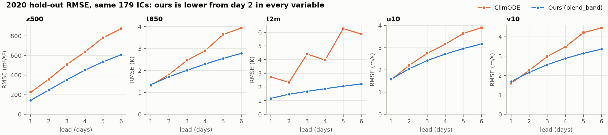
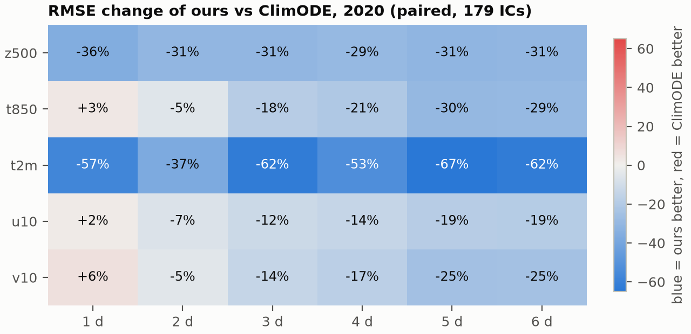
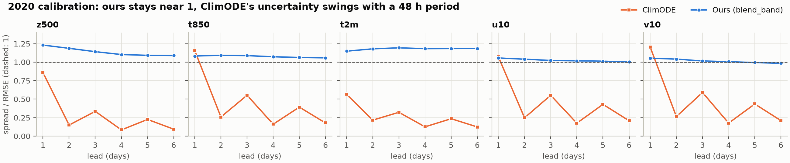
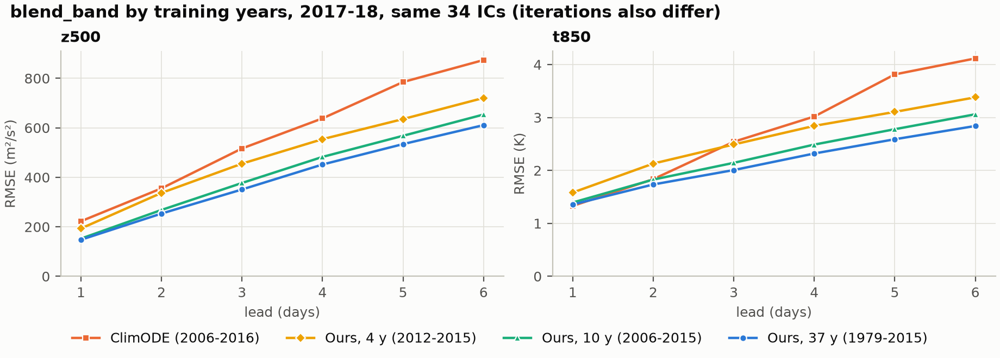

# 결과 정리 (2026-11-04)

지금까지 끝난 GPU 실행의 점수를 한곳에 모은 문서입니다. 수치와 그림은 `scripts/make_results_summary.py`가 `runs/`의 점수 JSON에서 다시 만듭니다.

**결론: best 모델(FM `blend_band`, 1979~2015 학습)은 2020 hold-out에서 ClimODE 공개 체크포인트보다 2일 이후 5개 변수 모두 RMSE가 낮습니다. 1일에서는 z500과 t2m만 낮고, t850·u10·v10은 ClimODE가 근소하게 낫습니다.**

NeuralGCM은 이 문서에 넣지 않았습니다. 비교를 끝내지 못했고, Blackwell GPU의 JAX 결과는 잘못된 값이라 쓸 수 없습니다.

## 1. 2020 hold-out: 저희 모델 대 ClimODE

- 같은 IC 179개(12 UTC, 2일 간격), 같은 정답, 5.625° 격자. 2020은 학습, 보정, 모델 선택 어디에도 쓰지 않은 해입니다.
- ClimODE는 2006~2016 학습 공개 체크포인트를 저자 코드 설정으로 CPU에서 추론만 했습니다.

| RMSE | 모델 | 1일 | 2일 | 3일 | 4일 | 5일 | 6일 |
|---|---|---:|---:|---:|---:|---:|---:|
| z500 (m²/s²) | 저희 | **144** | **247** | **353** | **451** | **536** | **608** |
| | ClimODE | 225 | 358 | 509 | 637 | 782 | 874 |
| t850 (K) | 저희 | 1.35 | **1.71** | **2.01** | **2.29** | **2.55** | **2.78** |
| | ClimODE | **1.32** | 1.81 | 2.46 | 2.90 | 3.64 | 3.94 |
| t2m (K) | 저희 | **1.17** | **1.47** | **1.68** | **1.88** | **2.06** | **2.22** |
| | ClimODE | 2.73 | 2.34 | 4.41 | 3.96 | 6.27 | 5.87 |
| u10 (m/s) | 저희 | 1.58 | **2.05** | **2.42** | **2.71** | **2.96** | **3.17** |
| | ClimODE | **1.55** | 2.20 | 2.74 | 3.15 | 3.64 | 3.90 |
| v10 (m/s) | 저희 | 1.69 | **2.16** | **2.56** | **2.88** | **3.15** | **3.36** |
| | ClimODE | **1.60** | 2.26 | 2.98 | 3.48 | 4.21 | 4.46 |





불확실성 보정은 차이가 더 큽니다. spread/RMSE가 저희는 0.99~1.23, ClimODE는 0.08~1.20이고 48시간 주기로 출렁입니다.



ACC, CRPS, 쌍별 차이의 95 % 구간은 [`climode_2020_full_table.md`](climode_2020_full_table.md)에 있습니다.

## 2. 학습 규모별 결과 (2017~18)

| 실행 | 학습 연도 | 설정 | 5변수 CRPS | z500 RMSE 24 / 72 / 144 h | t850 RMSE 24 / 72 / 144 h |
|---|---|---|---:|---:|---:|
| `blend_4y` | 2012~2015 | small | 0.02444 | 189 / 451 / 719 | 1.56 / 2.45 / 3.29 |
| `blend_climode` | 2006~2015 | climode (broad 설정) | 0.02217 | 150 / 379 / 661 | 1.37 / 2.13 / 3.02 |
| `blend_ngcm` | 1979~2015 | ngcm | 0.02071 | 144 / 355 / 618 | 1.33 / 2.00 / 2.80 |

IC 360개, `blend_band` 기준입니다. 반복 수 상한도 실행마다 다르므로(FM·회귀 3,000 / 40,000 / 120,000회) 차이를 학습 연도만의 효과로 읽으면 안 됩니다.

ClimODE와 거의 같은 학습 연도를 쓴 `blend_climode`도 같은 34개 IC에서 z500 RMSE가 152 / 377 / 654로 ClimODE의 223 / 517 / 874보다 낮습니다.



## 3. 시험 해에 맞춰지지 않았는지 확인

`blend_band`는 2017~18 점수를 보고 고른 모델이라 2020으로 다시 확인했습니다. 37년 모델의 결과는 거의 같습니다.

| 시험 해 | IC | 5변수 CRPS | z500 RMSE 24 / 72 / 144 h | t850 RMSE 24 / 72 / 144 h |
|---|---:|---:|---:|---:|
| 2017~18 | 360 | 0.02071 | 143.8 / 355.3 / 617.7 | 1.33 / 2.00 / 2.80 |
| 2020 | 180 | 0.02075 | 144.0 / 353.1 / 607.5 | 1.35 / 2.01 / 2.78 |

## 4. 해석할 때 주의할 점

1. **제외한 IC:** 2020-08-30 12 UTC(index 970)에서 ClimODE 출력이 전부 NaN이라 양쪽에서 뺐습니다. 2020이 배치에 있으면 파트너가 2018이든 2017이든 NaN이고, 2018+2017 배치에서는 나오지 않습니다. 실패 사례에 벌점을 주지 않았으므로 ClimODE에 약간 유리합니다. 2017/18의 34개 IC에서도 같은 이유로 한 쌍을 다른 날로 바꿨습니다(`docs/step22_climode_paired.md`).
2. **ClimODE의 48시간 지그재그:** 2017/18의 저자 로더 결과에도 같은 패턴이 있어 2020 로더 때문은 아닙니다. 원인은 확인하지 못했습니다.
3. **논문 수치와의 차이:** 이 체크포인트의 z500 RMSE는 24 / 72 / 144 h에 225 / 509 / 874로, 논문 표의 193 / 479 / 784보다 큽니다. 시험 해와 IC가 다르고 재현 차이의 원인도 규명하지 않았습니다. 저희 모델(144 / 353 / 608)은 논문 수치보다도 낮지만 같은 IC에서 비교한 값은 아닙니다.
4. **학습 기간:** 1절의 저희 모델은 37년, ClimODE는 약 11년으로 학습했습니다. 비슷한 기간의 비교는 2절의 `blend_climode`를 보십시오. 이 모델은 2020 멤버가 없어 2017~18에서만 비교했습니다.
5. **신뢰구간:** IC 단위 bootstrap입니다. 2일 간격 IC는 서로 상관이 있어 실제보다 좁을 수 있습니다.
6. **CRPS 추정식:** ClimODE는 가우시안, 저희는 8-멤버 앙상블입니다. 같은 가우시안 식으로 계산한 값도 전체 표에 함께 있습니다.

## 5. 파일

| 경로 | 내용 |
|---|---|
| `data/run_summary.csv` | 실행 × 팔별 요약 |
| `data/scores_long.csv` | 전체 IC 앙상블 점수 (run, arm, lead, var, metric) |
| `data/paired_vs_climode.csv` | ClimODE 짝 비교 평균과 95 % 구간 |
| `data/raw/*.json` | 원본 점수 파일 |
| `figures/` | 위 그림 4개 |

예측장, 체크포인트, ERA5 파생 자료는 용량 때문에 올리지 않았습니다(`runs/`, `data/`는 git 제외).

## 6. 재현

```bash
# ClimODE 2020 예측 (CPU, 24스레드에서 약 1시간). kernel.npy는 없으면 새로 계산
python scripts/run_climode_2020.py runs/blend_ngcm/ngcm2020/climode2020 --lead-steps 24 --threads 4
# 짝 비교
N=runs/blend_ngcm/ngcm2020
python scripts/compare_step13_climode.py --era5 data/era5_5p625/era5_data \
  --climode $N/climode2020/climode_pred_2020_valid.npz --arms $N/seqfm_dct_pinn_blend_band \
  --ref-name "ClimODE (public checkpoint)" --out $N/climode2020_paired.json
python scripts/make_climode_table.py $N/climode2020_paired.json docs/results_2026_11/climode_2020_full_table.md
# CSV와 그림
python scripts/make_results_summary.py
```
