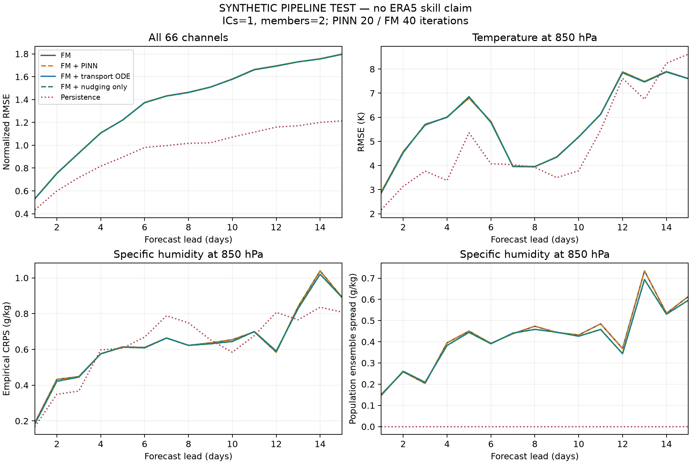

# Step13 ODE experiment scorecard

SYNTHETIC PIPELINE TEST — no ERA5 skill claim

Final lead: 360 h. Initial conditions: 1; members: 2.

| Arm | All-channel normalized RMSE | T850 RMSE (K) | Q850 RMSE (g/kg) | Q850 CRPS (g/kg) |
| --- | ---: | ---: | ---: | ---: |
| FM | 1.798226 | 7.607275 | 1.327330 | 0.891486 |
| FM + PINN | 1.798182 | 7.607326 | 1.327260 | 0.891425 |
| FM + transport ODE | 1.796036 | 7.598993 | 1.318895 | 0.890325 |
| FM + nudging only | 1.796472 | 7.600780 | 1.317816 | 0.890167 |
| Persistence | 1.213174 | 8.620642 | 1.101779 | 0.808546 |

ODE changes q/T at the 12 pressure levels only. Other channels, including TISR, pass through.
Nudging-only is a required control: reduction against FM alone is not evidence of a transport benefit.

[All scores](scores.csv) · [Full metadata](summary.json)
