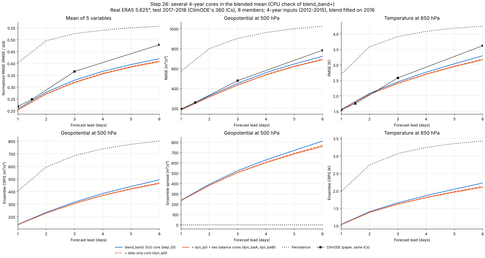

# 26단계: blend_band+ (3일까지 NeuralGCM을 따라잡기 위한 확장판)

소유자 요청(2026-11-04 05:35): "우리 현재 모델을 3일 정도까지 갈 수 있도록 확장 버전인 +버전을 작성해 주세요."

## 1. 목표

같은 초기 정보(5.625°·12층 초기장)에서 출발한 NeuralGCM-2.8°를 3일까지 따라잡는 것이 목표입니다.
NeuralGCM 수치는 23단계에서 공식 결정론 체크포인트를 CPU로 돌린 2020년 IC 9개 값입니다(`docs/step26/neuralgcm/`).

| z500 RMSE (m²/s²) | 1일 | 2일 | 3일 | 4일 | 5일 | 6일 |
| --- | ---: | ---: | ---: | ---: | ---: | ---: |
| NeuralGCM-2.8°, 5.625° 초기장 (IC 9개) | 172 | **232** | **307** | 402 | 490 | 587 |
| 지금 GPU 모델 blend_band (ngcm 37년, 2020 IC 180개) | **144** | 247 | 353 | 451 | 536 | 608 |
| 필요한 개선 | 이미 앞섬 | −6 % | −13 % | −11 % | −9 % | −3 % |

NeuralGCM 자체 초기장(0.25°·37층)에서 출발하면 3일 143이라 scaling만으로는 닿지 않습니다(23단계: 격차의 50~81 %가 초기장 정보).
그래서 +버전의 판정 기준은 "2020년 같은 IC 9개에서 2일 z500 ≤ 232, 3일 ≤ 307"입니다. 2020은 어떤 선택에도 쓰지 않은 해이므로,
기준을 먼저 정해 두고 2020 점수는 한 번만 봅니다.

## 2. 무엇을 키우는가: 근거

1. **3일 skill은 G(x) 코어가 만듭니다.** ngcm 실행(2017~18, ClimODE 짝 IC 34개)에서 72 h z500은 코어 단독 373, 회귀 425, blend 351입니다.
   20단계 혼합 계수도 72 h까지 코어 비중이 회귀보다 큽니다(4년 모델: 24 h 0.74 대 0.29, 72 h 0.59 대 0.40).
2. **코어는 데이터를 늘려도 거의 좋아지지 않습니다.** 코어 단독 72 h z500 (IC 34개):

   | 실행 | 학습 해 | 코어 반복 × batch | rollout | 코어 72 h | 코어 24 h |
   | --- | --- | --- | --- | ---: | ---: |
   | blend_4y | 4년 | 4000 × 4 | 2일 (K = 8) | 492 | 201 |
   | blend_climode | 10년 | 20000 × 16 | 2일 (K = 8) | 391 | 160 |
   | blend_ngcm | 37년 | 60000 × 16 | 5일 (K = 20) | 373 | 168 |

   10년에서 37년(데이터 3.7배, 반복 3배)으로 72 h가 5 %밖에 줄지 않았습니다. 코어는 파라미터가 0.21 M으로 FM U-Net(12.7 M)이나 회귀 U-Net(11.8 M)의
   60분의 1입니다. 용량이 병목이라는 것이 가장 단순한 설명입니다(검증은 4절의 GPU 실행이 합니다).
3. **5일 rollout 학습은 짧은 lead를 희생합니다.** 24 h 코어가 10년·K = 8에서 160, 37년·K = 20에서 168로 오히려 나빠졌습니다.
   그래서 짧은 rollout(K = 8) 코어를 따로 두고, lead별 혼합이 둘 중 나은 쪽에 무게를 주게 합니다.

## 3. 구성

| 부분 | blend_band (지금) | blend_band+ |
| --- | --- | --- |
| PINN, FM + PINN 멤버, 회귀 U-Net | 37년 학습 | **그대로 재사용** (다시 학습하지 않음) |
| 긴 rollout 코어 `plus_long` | 48채널 × 4블록, 0.21 M, K = 20 | **128채널 × 8블록, 2.39 M**, K = 20 (커리큘럼 1 2 4 8 12 16 20), 60000 × 16 |
| 짧은 rollout 코어 `plus_short` | 없음 | **128채널 × 8블록, 2.39 M**, K = 8 (커리큘럼 1 2 4 8), 40000 × 16 |
| 기존 작은 코어 | 혼합에 사용 | 혼합에 그대로 남김 |
| 평균 | μ* = a + b·코어 + c·회귀 + d·x(t) | μ* = a + b₁·plus_long + b₂·plus_short + b₃·작은 코어 + c·회귀 + d·x(t) |
| 퍼짐 | FM 편차 × band Γ (2016에서 닫힌 식) | 같음 (새 평균의 오차로 다시 맞춤) |
| 파라미터 합 | 26.1 M | 30.9 M (NeuralGCM-2.8° 14.5 M) |

- 계수 a, b, c, d는 지금처럼 lead × 변수마다 2016년 정답에 최소제곱으로 맞춥니다(`BlendMBM`, 새 학습 없음).
- 코어는 G(x) 특징(연산자 경향 48채널)을 입력으로 받는 18단계 구조 그대로이고, 폭과 깊이만 키웠습니다. 넓은 코어가 20스텝 rollout의 역전파를
  GPU 메모리에 담도록 6시간 스텝마다 gradient checkpointing을 씁니다(`--grad-ckpt`, 상태만 저장하고 스텝 안의 활성값은 역전파 때 다시 계산).
- 절제 팔 `plus1`: 기존 blend에서 작은 코어만 `plus_long`으로 바꾼 것. 폭의 효과와 코어 여러 개의 효과를 나눠 봅니다.

코드: `pgcfm/dyncore.py`(`grad_ckpt`), `scripts/run_step16_dynpinn.py --grad-ckpt`, `scripts/run_step16_predict.py --device`,
`scripts/run_step13_guide.py --core-extra`, 실행 스크립트 `scripts/run_blend_plus.sh`, 그림 항목 `plot_step13.py fig_step26`.

## 4. GPU 실행 명령

ngcm 실행(`runs/blend_ngcm`)과 2020 hold-out(`run_ngcm_vs_neuralgcm.sh SKIP_TRAIN=1`이 만든 `runs/blend_ngcm/ngcm2020`)이 끝난 서버에서:

```bash
git pull origin claude/project-thread-43gbu8
source .venv/bin/activate
DRYRUN=1 BASE=runs/blend_ngcm OUT=runs/blend_plus DATA=data/era5_5p625 bash scripts/run_blend_plus.sh   # 명령만 확인
# GPU 첫 점검 (약 40분, 수치는 의미 없음). OUT을 꼭 따로 두세요: 같은 OUT이면 본 실행이 smoke 가중치를 "끝난 것"으로 건너뜁니다.
SMOKE=1 BASE=runs/blend_ngcm OUT=runs/blend_plus_smoke DATA=data/era5_5p625 DEVICE=cuda bash scripts/run_blend_plus.sh
nohup env BASE=runs/blend_ngcm OUT=runs/blend_plus DATA=data/era5_5p625 DEVICE=cuda \
    bash scripts/run_blend_plus.sh > runs/blend_plus.log 2>&1 &
tail -f runs/blend_plus.log
```

- 하는 일: 두 코어 학습(GPU) → 2016~18 예측(GPU) → 혼합 2개(plus1, plus; CPU) → 2017~18 채점, 에너지 점수, ClimODE 짝 비교, 그림 →
  2020 예측, 혼합, 채점, ClimODE 2020 짝 비교(`climode2020/climode_pred_2020_valid.npz`가 있으면), NeuralGCM 짝 비교(IC 9개와 18개).
- NeuralGCM은 서버에서 돌리지 않습니다. 23단계에서 CPU로 만든 2020 예측(`docs/step26/neuralgcm/*.npz`, 공식 체크포인트)을 씁니다.
  Blackwell GPU의 JAX 값이 틀렸던 문제를 피합니다.
- 시간(추정, GPU 1장): CPU에서 잰 반복당 시간으로 두 코어 합이 기존 ngcm 코어 학습 시간(`runs/blend_ngcm/dyn_gfeat.json`의 `train_seconds`)의 약 10배입니다(5.2절). 예측·혼합·채점은 약 2시간.
  로그의 `it ... s` 줄로 실제 속도를 확인하고, job 제한이 있으면 `MAX_HOURS=11`(종료 코드 75, 같은 명령으로 재개)을 붙이세요.
- GPU 메모리가 모자라면 `BATCH=8` 또는 `PLUS_HIDDEN=96 PLUS_BLOCKS="2 2 2"`(1.04 M).
- 결과: `runs/blend_plus/score_plus.json`(2017~18, 기준은 기존 blend_band), `runs/blend_plus/fig/fig_step26.png`,
  `runs/blend_plus/y2020/score_plus_2020.json`, `runs/blend_plus/y2020/ngcm_coarse_paired_plus.json`(판정 기준),
  혼합 계수 `runs/blend_plus/guide_seqfm_dct_pinn_blend_band.json`, 코어 학습 곡선 `runs/blend_plus/plus_*.pt_metrics.csv`.

## 5. CPU 점검 (4년 입력)

37년 GPU 실행 전에 CPU 4코어에서 확인할 수 있는 것만 확인했습니다. 넓은 코어가 37년 자료에서 얼마나 나아지는지는 이 점검으로 알 수 없습니다(6절 1).

### 5.1 실험 A: 혼합에 코어를 여러 개 넣으면 나아지는가

20단계 4년 입력(FM + PINN 멤버, 회귀, 16단계 코어들, 모두 K = 8)을 그대로 쓰고 혼합에 넣는 코어 수만 바꿨습니다.
blend1은 20단계 blend_band와 같은 계산이며 `--core-extra` 코드의 확인용입니다(검증 RMSE, 계수, 시험 fair CRPS 0.16604가 20단계와 같음).
시험 2017~18 IC 360개, 1000회 부트스트랩, 기준 blend1. 큐 `runs/step26/queue26a.sh`, 점수 `docs/step26/score_cpu_cores.json`.

| 팔 | 혼합에 넣은 코어 | z500 RMSE 24 / 72 / 144 h | t850 RMSE | t2m RMSE | 5변수 CRPS | z500 SSR |
| --- | --- | --- | --- | --- | ---: | --- |
| blend1 (= blend_band) | G(x) 코어 | 188 / 451 / 723 | 1.56 / 2.45 / 3.29 | 1.34 / 2.02 / 2.56 | 0.02449 | 1.26 / 1.16 / 1.12 |
| blend2 | + 자료만 쓴 코어 dyn_lp0 | 184 / 436 / 695 | 1.55 / 2.41 / 3.19 | 1.31 / 1.98 / 2.50 | 0.02386 | 1.27 / 1.17 / 1.11 |
| blend4 | + dyn_lp0, 균형 코어 2개 | **183 / 433 / 689** | **1.54 / 2.40 / 3.16** | **1.30 / 1.97 / 2.47** | **0.02366** | 1.27 / 1.17 / 1.10 |

- blend2, blend4 모두 5변수 × 6 lead 30칸 전부에서 RMSE와 CRPS가 blend1보다 유의하게 낫습니다(95 % 구간이 0 아래).
- 72 h z500은 −3.3 %(코어 2개), −4.0 %(4개)입니다. 두 번째 코어가 대부분을 주고 세 번째부터는 작아집니다.
- 혼합 안의 코어 계수 합(z500, 24 → 144 h)이 0.74 → 0.38(코어 1개)에서 0.83 → 0.62(4개)로 커집니다. 코어 여러 개의 평균은 오차가 작아
  혼합이 코어를 더 믿습니다. 계수는 모두 양수라 공선성으로 부호가 뒤집히는 일은 없었습니다.
- 그림 `docs/step26/fig_step26_cpu.png`.



해석: 여러 코어의 이득은 서로 다른 코어의 오차가 일부 상쇄되는 앙상블 평균 효과입니다. +버전의 세 코어(넓은 5일 코어, 넓은 2일 코어, 기존 작은 코어)는
크기와 rollout 길이가 달라 오차가 덜 겹칠 것으로 기대합니다. 이 효과만으로는 72 h에서 4 % 정도이므로, 목표 −13 %의 나머지는 넓은 코어가 채워야 합니다.

### 5.2 실험 B: 넓은 코어의 속도와 메모리

학습 1년, batch 4, K = 8, 6회 반복, CPU 4스레드(`runs/step26/queue26b.sh`, 로그 `docs/step26/timing_cpu.txt`). 반복당 시간은 2~6회의 평균, 최대 RSS는 자료 적재(약 3 GB)를 포함합니다.

| 코어 | 파라미터 | checkpointing | 반복당 시간 | 최대 RSS | 6회 후 손실 |
| --- | ---: | --- | ---: | ---: | ---: |
| 기존 48 × 4블록 | 0.21 M | 없음 | 1.2 s | 4.6 GB | 5.3697 |
| 기존 48 × 4블록 | 0.21 M | 있음 | 2.0 s | 3.4 GB | 5.3697 |
| 넓은 128 × 8블록 | 2.39 M | 없음 | 6.4 s | 10.1 GB | 5.1204 |
| 넓은 128 × 8블록 | 2.39 M | 있음 | 9.2 s | 3.9 GB | 5.1204 |

- checkpointing은 손실이 비트 단위로 같고(같은 기울기), 시간은 넓은 코어에서 약 1.45배, 활성값 메모리는 약 7 GB에서 1 GB 아래로 줄었습니다.
- batch 16, K = 20이면 checkpointing 없이 활성값이 약 70 GB라 GPU 1장에 들어가지 않습니다. 그래서 스크립트는 `--grad-ckpt`를 늘 켭니다.
- 넓은 코어 반복 1회는 기존의 약 5배(checkpointing 포함 약 8배)입니다. 긴 코어는 기존 ngcm 코어와 반복 수가 같고, 짧은 코어는 반복 2/3,
  평균 rollout 길이가 약 0.4배이므로, 두 코어 합은 **기존 ngcm 코어 학습 시간의 약 10배**로 봅니다(`runs/blend_ngcm/dyn_gfeat.json`의
  `train_seconds`로 환산). GPU는 넓은 합성곱을 더 잘 쓰므로 실제 배수는 이보다 작을 수 있습니다.

### 5.3 실행 스크립트 전체 smoke

`SMOKE=1 DEVICE=cpu`(코어 2회 반복, 16채널 × 2블록)로 `run_blend_plus.sh`의 모든 단계를 4년 입력으로 끝까지 돌렸습니다(29분).
기반 폴더는 20·22·23단계 결과를 `runs/blend_ngcm`과 같은 이름으로 이어 붙인 `runs/step26/fakebase`이고, 시험 해는 2017만 썼습니다.

- 두 코어 학습·예측, 혼합 2개, 채점, 에너지 점수, ClimODE 짝 비교(IC 34개), 그림, 2020 예측·혼합·채점, NeuralGCM 짝 비교 2개가 모두 끝났습니다.
- 확인값: 기존 blend_band가 2020 IC 180개에서 189 / 452 / 726(25단계와 같음), NeuralGCM 짝 IC 9개에서 201 / 344 / 472(23단계와 같음),
  NeuralGCM(5.625° 초기장) 172 / 232 / 307. 즉 서버에서도 같은 IC, 같은 정답으로 비교됩니다.
- 2회 학습한 코어는 거의 지속 예보라 혼합 계수가 크게 흔들립니다(검증 RMSE는 기존 혼합과 같음). 실제 학습된 코어에서는 5.1처럼 계수가 모두 양수였습니다.
- 고친 것: 스모크에서 투영 점검 길이(`--proj-K`)가 rollout보다 길어 실패해 `--proj-K 2`를 넣었고, `HOLDOUT=""`가 2020으로 바뀌던 것을 고쳤습니다.

## 6. 약점

1. **넓은 코어의 효과는 아직 검증되지 않았습니다.** 4년 CPU에서는 2.39 M 코어를 수만 번 학습할 수 없어, "용량이 병목"이라는 2절의 설명은 GPU 결과로만 확인됩니다.
   데이터 3.7배에 72 h가 5 %만 준 원인이 용량이 아니라 5.625° 입력의 정보 한계라면 넓은 코어도 거의 늘지 않습니다.
   다만 5.625° 초기장 NeuralGCM이 3일 307을 내므로 같은 입력 정보로 307까지는 가능하다는 것은 알고 있습니다.
2. **목표 307은 IC 9개 값입니다.** 2020 IC 9개는 계절당 2개 남짓이라 구간이 넓습니다(23단계 짝 차이의 95 % 구간 반폭이 2~3일 z500에서 ±20~25 m²/s², NeuralGCM 값의 8~9 %). 그 9개에서 이겨도
   "같은 정보에서 3일까지 대등"까지만 말할 수 있고, 이기지 못해도 IC 9개 표본 탓일 수 있습니다. 더 많은 IC는 NeuralGCM을 CPU로 더 돌려야 합니다(IC당 약 15분).
3. **파라미터가 늘어납니다.** 26.1 M → 30.9 M으로, NeuralGCM-2.8°(14.5 M)의 2배가 넘습니다. "더 작은 모델"이라는 주장은 해상도·층 수·연산량으로만 하세요.
4. **코어 여러 개의 이득은 앙상블 평균 효과입니다.** 5.1의 이득은 물리 구조가 아니라 평균의 분산 감소이므로, 논문에서는 "코어 앙상블"로 쓰고
   G(x) 특징의 기여로 쓰면 안 됩니다(20단계 결론과 같음).
5. **선택 편향:** +버전의 구성(코어 2개 + 기존 코어)은 2017~18 점수가 아니라 4년 CPU 점검과 2절 근거로 정했지만, GPU 결과를 보고 구성을 바꾸면 다시 2017~18로 고르게 됩니다.
   판정은 2020에서 한 번만 하세요.
6. **BatchNorm 통계:** checkpointing은 역전파 때 각 스텝을 다시 계산하므로 학습 중 BatchNorm 이동 평균이 스텝마다 두 번 갱신됩니다(기울기는 같음).
   예측은 eval 모드라 그 이동 평균을 쓰며, 영향은 작을 것으로 보지만 확인하지 않았습니다.
7. **G(x) 특징은 float64입니다.** 일반 소비자용 GPU는 float64가 느려 코어 시간의 상당 부분이 연산자 특징 계산일 수 있습니다. 기존 ngcm 코어도 같은 조건이었습니다.
8. **짧은 코어도 처음부터 학습합니다.** 긴 코어에서 이어 학습하면 더 싸지만 두 코어의 오차가 비슷해져 5.1의 평균 효과가 줄 수 있어 따로 학습했습니다.
9. **cuda 경로는 여기서 돌리지 못했습니다.** 코어 예측의 `--device cuda`와 cuda 위의 gradient checkpointing은 CPU에서만 확인했으니 GPU smoke를 먼저 돌리세요.
